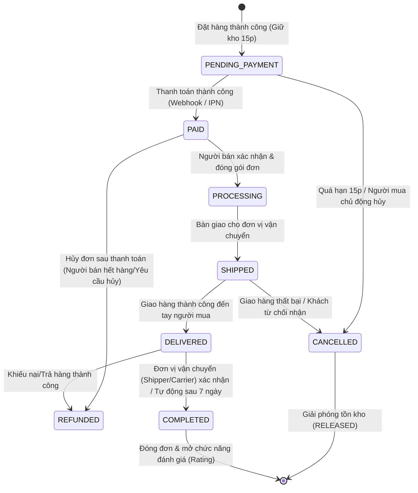

# Nexus E-Commerce - API Specification: Shopping Cart & Order Modules

> **Version**: 1.0.0  
> **Status**: DRAFT FOR TEAM REVIEW (Sprint 1 -> Sprint 2 Alignment)  
> **Target Services**: `commerce-service`, `catalog-service`, `fulfillment-service`  
> **Stakeholders**:  
> - Lead: **Tiến Thương**  
> - Frontend: **Quốc Hảo**  
> - BA: **Linh Đặng**  
> - Inventory / Backend: **Vĩnh Khang**  

---

## 1. Mục tiêu và Phạm vi (Scope & Objectives)
Tài liệu này xác lập thỏa thuận kỹ thuật (Technical Alignment Agreement) cho luồng Giỏ hàng (Shopping Cart) và Đặt hàng (Order Management) theo SRS §3.4 và các quy tắc nghiệp vụ BR-COM-01, BR-COM-02:
1. Chuẩn hóa danh sách Endpoint RESTful v1.
2. Chuẩn hóa cấu trúc Request/Response DTO bọc bởi `ApiResponse<T>`.
3. Chuẩn hóa công thức tính giá (Pricing Calculation Rules).
4. Chuẩn hóa máy trạng thái đơn hàng (Order State Transition Machine).
5. Tích hợp quản lý giữ hàng tồn kho (Inventory Reservation) với nhóm Inventory.

---

## 2. Quy chuẩn chung (API Conventions)
- **Base URL**: `/api/v1`
- **Response Wrapper**: Tuân thủ định dạng chuẩn của Project Nexus:
```json
{
  "success": true,
  "data": { ... },
  "errors": [],
  "timestamp": "2026-10-20T10:00:00Z"
}
```
- **Xác thực (Authentication)**: Bearer JWT qua API Gateway header `Authorization: Bearer <token>`. Gateway forward `X-User-Id` và `X-User-Roles` vào microservice.
- **Idempotency**: Tất cả request tạo đơn hàng (`POST /api/v1/orders`) bắt buộc phải gửi kèm header `Idempotency-Key: <UUID>`.

---

## 3. Đặc tả API Shopping Cart (`/api/v1/cart/**`)

### 3.1. `GET /api/v1/cart` - Lấy thông tin giỏ hàng hiện tại
- **Mô tả**: Lấy giỏ hàng active của user hiện tại, tự động re-validate giá và tồn kho từ `catalog-service`.
- **Phân quyền**: `ROLE_BUYER`
- **Response**: `200 OK`
```json
{
  "success": true,
  "data": {
    "cartId": "e5b8d2a1-7c91-4c12-8e10-6a7f1e9b2c01",
    "userId": "d290f1ee-6c54-4b01-90e6-d701748f0851",
    "status": "ACTIVE",
    "items": [
      {
        "id": "item-1111-2222",
        "skuId": "sku-5555-6666",
        "skuCode": "NK-AF1-WHT-42",
        "productName": "Nike Air Force 1 '07",
        "thumbnailUrl": "https://cdn.nexus.com/images/nike-af1.jpg",
        "unitPrice": 2900000.00,
        "quantity": 2,
        "stockAvailable": 10,
        "isAvailable": true,
        "subtotal": 5800000.00
      }
    ],
    "totalItems": 1,
    "totalQuantity": 2,
    "subtotal": 5800000.00
  },
  "errors": [],
  "timestamp": "2026-10-20T10:00:00Z"
}
```

### 3.2. `POST /api/v1/cart/items` - Thêm SKU vào giỏ hàng
- **Mô tả**: Thêm 1 sản phẩm vào giỏ. Nếu SKU đã tồn tại trong giỏ thì cộng dồn số lượng.
- **Phân quyền**: `ROLE_BUYER`
- **Request Body**:
```json
{
  "skuId": "sku-5555-6666",
  "quantity": 1
}
```
- **Validation**:
  - `skuId`: UUID không rỗng, SKU phải tồn tại và đang ACTIVE trong Catalog.
  - `quantity`: Số nguyên > 0, không vượt quá giới hạn cấu hình mua tối đa hoặc tồn kho hiện có.
- **Response**: `200 OK` (Trả về `CartResponse` cập nhật).

### 3.3. `PUT /api/v1/cart/items/{itemId}` - Cập nhật số lượng SKU
- **Mô tả**: Thay đổi số lượng mua của một dòng giỏ hàng.
- **Request Body**:
```json
{
  "quantity": 3
}
```
- **Response**: `200 OK` (Trả về `CartResponse` cập nhật).

### 3.4. `DELETE /api/v1/cart/items/{itemId}` - Xóa dòng SKU khỏi giỏ
- **Response**: `200 OK`

### 3.5. `DELETE /api/v1/cart/items` - Xóa sạch giỏ hàng (Clear Cart)
- **Response**: `200 OK`

### 3.6. `POST /api/v1/cart/merge` - Gộp giỏ hàng khách vãng lai khi đăng nhập
- **Mô tả**: Khi người dùng thêm hàng lúc chưa đăng nhập (lưu cookie/local storage), sau khi đăng nhập gọi API này để gộp vào giỏ user.
- **Request Body**:
```json
{
  "items": [
    {
      "skuId": "sku-5555-6666",
      "quantity": 1
    }
  ]
}
```

---

## 4. Đặc tả API Orders & Checkout (`/api/v1/orders/**`)

### 4.1. `POST /api/v1/orders/checkout/preview` - Xem trước & Re-validate đơn hàng
- **Mô tả**: Kiểm tra giá mới nhất, tính tạm phí ship, giảm giá voucher, thuế và kiểm tra tồn kho trước khi bấm Đặt Hàng.
- **Request Body**:
```json
{
  "itemIds": ["item-1111-2222"],
  "shippingAddress": "Số 123 Lê Lợi, Bến Nghé, Quận 1, TP. Hồ Chí Minh",
  "voucherCode": "NEXUS2026"
}
```
- **Response**: `200 OK`
```json
{
  "success": true,
  "data": {
    "subtotal": 5800000.00,
    "discountAmount": 200000.00,
    "shippingFee": 35000.00,
    "taxAmount": 0.00,
    "totalAmount": 5635000.00,
    "appliedVoucher": {
      "code": "NEXUS2026",
      "discountValue": 200000.00,
      "description": "Giảm 200k cho đơn từ 2 triệu"
    },
    "items": [
      {
        "skuId": "sku-5555-6666",
        "productName": "Nike Air Force 1 '07",
        "unitPrice": 2900000.00,
        "quantity": 2,
        "itemTotal": 5800000.00
      }
    ],
    "isOrderable": true,
    "warnings": []
  },
  "errors": [],
  "timestamp": "2026-10-20T10:00:00Z"
}
```

### 4.2. `POST /api/v1/orders` - Tạo đơn hàng (Place Order)
- **Headers**:
  - `Idempotency-Key`: UUID bắt buộc (chống duplicate do network retry).
- **Request Body**:
```json
{
  "shippingAddress": "Số 123 Lê Lợi, Bến Nghé, Quận 1, TP. Hồ Chí Minh",
  "recipientName": "Nguyễn Văn A",
  "recipientPhone": "0901234567",
  "voucherCode": "NEXUS2026",
  "paymentMethod": "VNPAY",
  "sourceType": "REGULAR",
  "auctionId": null,
  "selectedItemIds": ["item-1111-2222"]
}
```
- **Luồng xử lý phía Server**:
  1. Kiểm tra cache `Idempotency-Key`. Nếu đã xử lý, trả về order cũ.
  2. Snapshot dữ liệu sản phẩm (Tên, mã SKU, giá tại thời điểm đặt).
  3. Gọi Inventory Service giữ hàng (Create Reservation `PENDING` - 15 phút timeout).
  4. Lưu Order vào DB với status `PENDING_PAYMENT`.
  5. Xóa các SKU tương ứng khỏi Cart của user.
  6. Khởi tạo payment transaction và trả về payment URL (nếu thanh toán online).

### 4.3. `GET /api/v1/orders` - Lịch sử đơn hàng của người mua
- **Query Params**: `page` (default 0), `size` (default 10), `status` (optional).
- **Response**: Trả về danh sách đơn kèm phân trang chuẩn (`PageResponse<OrderSummaryResponse>`).

### 4.4. `GET /api/v1/orders/{orderId}` - Chi tiết đơn hàng
- **Response**: Trả về đầy đủ thông tin order, snapshot sản phẩm, tiến trình trạng thái (`order_status_history`).

### 4.5. `POST /api/v1/orders/{orderId}/cancel` - Hủy đơn hàng
- **Mô tả**: Người mua hủy đơn trong khung thời gian hợp lệ (khi đơn chưa chuyển sang `PROCESSING` hoặc `SHIPPED`).
- **Request Body**:
```json
{
  "reason": "Thay đổi nhu cầu mua hàng"
}
```
- **Hành vi hệ thống**: Chuyển đơn sang `CANCELLED`, gọi Inventory giải phóng giữ hàng (`RELEASED`), ghi log vào `order_status_history`.

---

## 5. Quy chuẩn công thức tính giá (Pricing Standardization)

Tất cả phép toán số tiền sử dụng `BigDecimal` (Java) với scale 2 và làm tròn `HALF_UP`.

1. **Subtotal (Tổng tiền hàng)**:
   $$\text{Subtotal} = \sum_{i=1}^{n} (\text{unit\_price}_i \times \text{quantity}_i)$$
   *Trong đó `unit_price` lấy trực tiếp từ Catalog DB khi checkout.*

2. **Discount (Giảm giá từ Voucher)**:
   - Với `discount_type = 'PERCENTAGE'`:
     $$\text{Discount} = \min\left(\text{Subtotal} \times \frac{\text{discount\_value}}{100},\, \text{max\_discount\_amount}\right)$$
   - Với `discount_type = 'FIXED_AMOUNT'`:
     $$\text{Discount} = \min(\text{discount\_value},\, \text{Subtotal})$$
   - Điều kiện: $\text{Subtotal} \ge \text{min\_order\_value}$, còn hạn sử dụng và chưa vượt quá `usage_limit`.

3. **Tax / VAT**:
   - Nếu niêm yết giá đã bao gồm VAT: $\text{Tax} = 0$.
   - Nếu giá chưa gồm VAT: $\text{Tax} = \max(0, \text{Subtotal} - \text{Discount}) \times \text{VAT Rate}$.

4. **Shipping Fee (Phí vận chuyển)**:
   - Tính toán dựa trên khoảng cách, trọng lượng và cấu hình đơn vị vận chuyển (Fulfillment service).

5. **Total Payable (Tổng tiền thanh toán)**:
   $$\text{Total} = \max(0,\, \text{Subtotal} - \text{Discount}) + \text{Shipping Fee} + \text{Tax}$$
   *Ràng buộc: DB Constraint `total >= 0`.*

---

## 6. Máy trạng thái đơn hàng (Order State Machine)

Trạng thái tuân thủ chính xác ràng buộc `chk_order_status` trong Database (`nexus_schema.sql`):
`PENDING_PAYMENT`, `PAID`, `PROCESSING`, `SHIPPED`, `DELIVERED`, `COMPLETED`, `CANCELLED`, `REFUNDED`.



### Ma trận chuyển đổi quyền hạn (Transition Permissions):
| Từ trạng thái | Sang trạng thái | Tác nhân kích hoạt | Tác động tồn kho / Ghi chú |
| :--- | :--- | :--- | :--- |
| `PENDING_PAYMENT` | `PAID` | Hệ thống (Payment Callback) / COD | Chuyển `Reservation` sang `CONFIRMED`, trừ tồn kho thực |
| `PENDING_PAYMENT` | `CANCELLED` | Buyer / Admin / Hệ thống (Timeout 15p) | Giải phóng `Reservation` (`RELEASED`) |
| `PAID` | `PROCESSING` | Seller / Admin | Chuẩn bị hàng |
| `PAID` | `REFUNDED` | Buyer / Seller / Admin / Hệ thống | Kích hoạt hoàn tiền qua Gateway, hoàn kho |
| `PROCESSING` | `SHIPPED` | Seller / Fulfillment Service | Cập nhật `tracking_no` |
| `SHIPPED` | `DELIVERED` | Carrier Webhook / Admin | Đã giao |
| `DELIVERED` | `COMPLETED` | Shipper (Carrier) / Logistics / Admin / Hệ thống (sau 7 ngày) | Hoàn tất giao dịch (chặn Buyer tự bấm hoàn tất) |

---

## 7. Phối hợp liên nhóm (Action Items for Alignment)

| Thành viên | Trách nhiệm chính cần xác nhận |
| :--- | :--- |
| **Tiến Thương (Lead)** | - Duyệt kiến trúc API, header `Idempotency-Key` và mô hình trạng thái.<br>- Xác nhận phân chia giữa `commerce-service` và `fulfillment-service`. |
| **Quốc Hảo (Frontend)** | - Xác nhận payload request/response DTO giỏ hàng và đặt hàng.<br>- Đồng thuận cơ chế hiển thị cảnh báo giá thay đổi khi checkout preview.<br>- Xác nhận sinh UUID `Idempotency-Key` tại client. |
| **Linh Đặng (BA)** | - Duyệt quy tắc hủy đơn (thời gian tối đa được hủy, chính sách hoàn tiền).<br>- Xác nhận thời gian timeout thanh toán (15 phút) và quy tắc voucher. |
| **Vĩnh Khang (Inventory)** | - Thống nhất API/Event tạo Reservation (`PENDING` 15 phút).<br>- Thống nhất API/Event chuyển sang `CONFIRMED` khi thanh toán xong hoặc `RELEASED` khi hủy đơn. |
