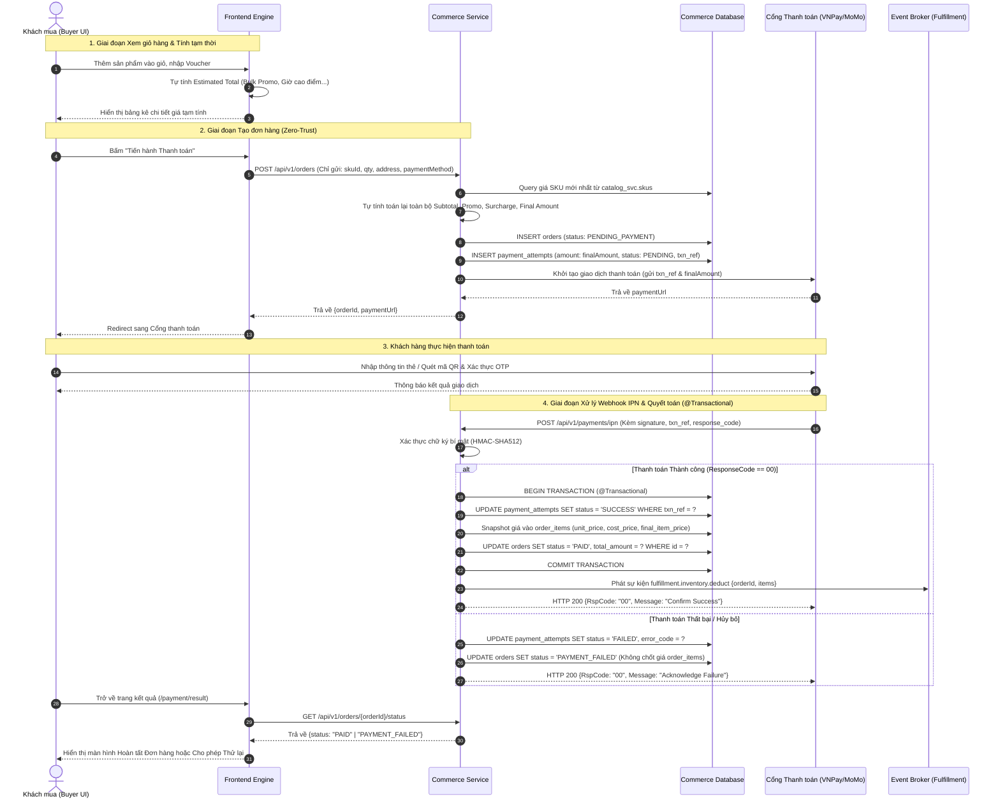

# Đặc tả Kỹ thuật: Vòng đời Giá Động & Quyết toán Thanh toán (Zero-Trust Pricing & Payment Settlement)

Tài liệu này quy định kiến trúc phân định trách nhiệm tính toán giá tiền giữa Frontend và Backend, thiết kế cơ chế **Zero-Trust Pricing**, quản lý các nỗ lực thanh toán (**Payment Attempts**) và giao dịch quyết toán đơn hàng (**Payment Settlement Transaction**).

---

## 1. Nguyên tắc Cốt lõi: Zero-Trust Pricing

| Thành phần | Trách nhiệm | Chi tiết thực thi |
| :--- | :--- | :--- |
| **Frontend (Buyer)** | **Tính giá Tạm tính (Estimated Pricing)** | Tự tính toán số tiền giỏ hàng, chiết khấu theo shop (Bulk Discount), khuyến mại ngành hàng (Category Promo: cua 10%, tôm 15%), phụ phí giờ cao điểm và mã voucher để tối ưu trải nghiệm người dùng tức thì. **Nếu Buyer hủy/thoát trang, không phát sinh bất kỳ rác dữ liệu nào trên Database Backend.** |
| **Backend (Commerce)** | **Tính toán & Xác thực Độc lập** | Tuyệt đối **không tin tưởng** và không nhận số tiền từ FE gửi lên. Khi tạo đơn hàng (`POST /api/v1/orders`), FE chỉ truyền: danh sách `sku_id`, `quantity`, địa chỉ nhận hàng và phương thức thanh toán. Backend tự truy vấn giá mới nhất trong DB và tự tính toán lại toàn bộ chiết khấu/tổng tiền. |
| **Database (Orders)** | **Chỉ Snapshot Giá khi Thanh toán Thành công** | Khi đơn ở trạng thái chờ thanh toán (`PENDING_PAYMENT`), trường `unit_price` trong `order_items` chưa được chốt cứng. Giá bán chính thức chỉ được ghi nhận vào dòng đơn hàng sau khi Cổng thanh toán (VNPay / MoMo) xác nhận giao dịch thành công. |

---

## 2. Quy trình Thanh toán & Bảng Lưu vết `payment_attempts`

Để đảm bảo tính toàn vẹn và khả năng đối soát (reconciliation), **Backend không được bỏ qua việc lưu số tiền gửi sang cổng thanh toán**.

### Quy tắc `payment_attempts`:
1. Trước khi sinh URL chuyển hướng Buyer sang cổng thanh toán (Payment Gateway), BE phải tạo một bản ghi `payment_attempts` với số tiền chính xác mà BE đã tính.
2. **Nguyên tắc Nhất quán 100%**: Số tiền lưu trong `payment_attempts.amount` phải khớp từng đồng với tham số `vnp_Amount` / `amount` gửi sang Payment Gateway.
3. **Cố định Giá giao dịch**: Dù giá sản phẩm trên sàn có biến động trong lúc Buyer đang nhập OTP tại cổng thanh toán, số tiền của phiên thanh toán đó (`payment_attempt`) không bao giờ bị thay đổi hồi tố.

---

## 3. Sequence Diagram: Luồng End-to-End từ Giỏ hàng tới Quyết toán Đơn



---

## 4. Xử lý Giao dịch Quyết toán (`@Transactional Settlement`)

Khi nhận Webhook/IPN xác nhận thành công từ cổng thanh toán, service phải bọc toàn bộ khối cập nhật trong một Database Transaction duy nhất để chống phân mảnh dữ liệu:

```java
@Transactional(isolation = Isolation.READ_COMMITTED, rollbackFor = Exception.class)
public void handlePaymentSuccess(String txnRef, String gatewayTransId) {
    // 1. Kiểm tra Idempotent chống xử lý lặp
    PaymentAttempt attempt = paymentAttemptRepository.findByTxnRef(txnRef)
        .orElseThrow(() -> new NotFoundException("Payment attempt not found: " + txnRef));
    
    if (PaymentAttemptStatus.SUCCESS.equals(attempt.getStatus())) {
        log.info("Giao dịch {} đã được xử lý trước đó (Idempotent). Bỏ qua.", txnRef);
        return;
    }

    // 2. Đánh dấu thanh toán thành công
    attempt.setStatus(PaymentAttemptStatus.SUCCESS);
    attempt.setGatewayTransactionId(gatewayTransId);
    attempt.setCompletedAt(Instant.now());
    paymentAttemptRepository.save(attempt);

    // 3. Snapshot giá chính thức vào từng OrderItem
    Order order = attempt.getOrder();
    for (OrderItem item : order.getItems()) {
        Sku sku = catalogClient.getSkuById(item.getSkuId());
        item.setUnitPrice(sku.getPrice());                  // Giá niêm yết tại thời điểm mua
        item.setCostPrice(sku.getOriginalPrice());          // Giá vốn để tính biên lợi nhuận
        item.setFinalItemPrice(calculateItemNet(item));     // Giá sau khi phân bổ voucher/promo
    }
    orderItemRepository.saveAll(order.getItems());

    // 4. Hoàn tất đơn hàng và phát tín hiệu xuất kho
    order.setStatus(OrderStatus.PAID);
    order.setTotalAmount(attempt.getAmount());
    orderRepository.save(order);

    inventoryEventPublisher.publishDeductStockEvent(order.getId(), order.getItems());
}
```

---

## 5. Lược đồ Cơ sở Dữ liệu & Migrations (DDL)

### 5.1. Bảng Nỗ lực Thanh toán (`commerce_svc.payment_attempts`)
```sql
-- Flyway migration: V3_1__create_payment_attempts.sql
-- Quản lý các lần gọi cổng thanh toán phục vụ đối soát và Idempotency

CREATE TABLE IF NOT EXISTS commerce_svc.payment_attempts (
    id BIGSERIAL PRIMARY KEY,
    order_id BIGINT NOT NULL,
    txn_ref VARCHAR(100) NOT NULL UNIQUE,       -- Mã tham chiếu gửi sang cổng (e.g. VNPAY_20261110_ORDER123_ATT1)
    gateway_name VARCHAR(50) NOT NULL,          -- VNPAY, MOMO, ZALOPAY, SANDBOX
    amount NUMERIC(15, 2) NOT NULL,             -- Số tiền BE tính, gửi sang cổng
    currency VARCHAR(10) NOT NULL DEFAULT 'VND',
    status VARCHAR(30) NOT NULL DEFAULT 'PENDING', -- PENDING, SUCCESS, FAILED, EXPIRED
    gateway_transaction_id VARCHAR(100),        -- Mã giao dịch do cổng thanh toán trả về
    idempotency_key VARCHAR(128) UNIQUE,
    error_code VARCHAR(50),
    error_message TEXT,
    created_at TIMESTAMP WITH TIME ZONE NOT NULL DEFAULT CURRENT_TIMESTAMP,
    completed_at TIMESTAMP WITH TIME ZONE,
    CONSTRAINT fk_payment_attempt_order FOREIGN KEY (order_id) REFERENCES commerce_svc.orders(id) ON DELETE CASCADE
);

CREATE INDEX idx_payment_attempts_order_id ON commerce_svc.payment_attempts(order_id);
CREATE INDEX idx_payment_attempts_txn_ref ON commerce_svc.payment_attempts(txn_ref);
COMMENT ON TABLE commerce_svc.payment_attempts IS 'Lịch sử từng phiên thanh toán gửi sang payment gateway để đối soát';
```

### 5.2. Bổ sung các cột Snapshot Giá vào `commerce_svc.order_items`
```sql
-- Flyway migration: V3_2__add_pricing_snapshots_to_order_items.sql
-- Lưu vết giá vốn và giá thực thu từng sản phẩm sau khi đơn thanh toán thành công

ALTER TABLE commerce_svc.order_items
ADD COLUMN IF NOT EXISTS cost_price NUMERIC(15, 2) DEFAULT 0.00,
ADD COLUMN IF NOT EXISTS final_item_price NUMERIC(15, 2) DEFAULT 0.00;

COMMENT ON COLUMN commerce_svc.order_items.cost_price IS 'Giá vốn của SKU tại thời điểm thanh toán thành công';
COMMENT ON COLUMN commerce_svc.order_items.final_item_price IS 'Giá thực thu sau khi đã áp dụng mọi loại khuyến mãi và chiết khấu';
```

---

## 6. Xử lý Trường hợp Ngoại lệ (Edge Cases)

1. **Khách hàng không thanh toán hoặc bấm Hủy**:
   - Bản ghi `payment_attempts` chuyển sang trạng thái `EXPIRED` hoặc `FAILED`.
   - `order_items` không bị chốt giá, không kích hoạt trừ kho vật lý.
   - Đơn chuyển sang `PAYMENT_FAILED`. Khách có thể ấn "Thanh toán lại" để tạo một `payment_attempt` mới với giá cập nhật theo thời gian thực.
2. **Gateway gửi Webhook nhiều lần (Webhook Retries)**:
   - Cơ chế kiểm tra `attempt.getStatus() == SUCCESS` chặn ngay từ đầu hàm xử lý để đảm bảo an toàn tuyệt đối, không trừ kho 2 lần và không ghi nhận doanh thu 2 lần.
3. **Giá sản phẩm thay đổi trong lúc thanh toán**:
   - Khi thanh toán thành công, số tiền thu của khách tuân thủ theo `payment_attempts.amount` đã được ký với cổng thanh toán. Không phát sinh tranh chấp số tiền đã trừ tài khoản của khách.

