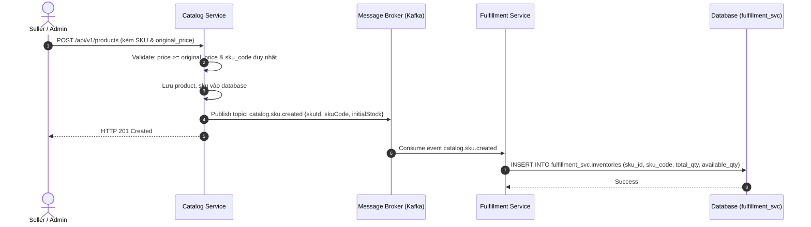

# Đặc tả Kỹ thuật: Quản lý SKU Doanh nghiệp, Tồn kho & Ràng buộc Giá sàn (Min Price)

Tài liệu này quy định kiến trúc kỹ thuật và giao tiếp liên service giữa **Catalog Service**, **Fulfillment Service** và **Commerce Service** nhằm đồng bộ định danh SKU doanh nghiệp, quản lý tồn kho và kiểm soát giá sàn sản phẩm.

---

## 1. Bối cảnh & Vấn đề Kỹ thuật

1. **Thiếu liên kết Tồn kho trong API Sản phẩm**: Hiện tại `catalog_svc.skus` không lưu số lượng tồn kho (thuộc về `fulfillment_svc.inventories`). Khi Frontend gọi `GET /api/v1/products`, trường tồn kho bị trống khiến giao diện từng phải fallback về giá trị giả định.
2. **Định danh SKU Doanh nghiệp**: Mã SKU (`sku_code`) được doanh nghiệp/nhà phân phối cấp (tương tự Thế Giới Di Động, e.g. `TGDD-IP15PM-256G-TITAN`). SKU cần là duy nhất và liên kết trực tiếp với tồn kho vật lý.
3. **Bán phá giá / Vi phạm giá sàn (Min Price Violation)**: Người bán có thể vô tình hoặc cố ý đặt giá bán thấp hơn giá vốn/giá nhập tối thiểu của nhà cung cấp.

---

## 2. Kiến trúc & Nguyên tắc Thiết kế

### 2.1. Phân định dữ liệu giữa các Service
- **Catalog Service**: Quản trị thông tin sản phẩm, phân loại, mô tả, hình ảnh, mã SKU (`sku_code`), giá nhập tối thiểu (`original_price`) và giá bán đề xuất/niêm yết (`price`).
- **Fulfillment Service**: Quản trị kho hàng vật lý, số lượng tồn kho (`total_qty`), số lượng giữ chỗ (`reserved_qty`), số lượng khả dụng (`available_qty`) theo từng `sku_id` và kho hàng (`warehouse_id`).
- **Commerce Service**: Quản trị giỏ hàng, đơn hàng và lịch sử giá bán thực tế tại thời điểm thanh toán.

### 2.2. Luồng tự động khởi tạo tồn kho khi tạo SKU mới (Event-Driven)
Khi Seller tạo mới hoặc Admin phê duyệt một SKU trong Catalog Service:
1. Catalog Service lưu thông tin SKU vào bảng `catalog_svc.skus`.
2. Catalog Service phát sự kiện Domain Event qua Kafka: `catalog.sku.created`.
3. Fulfillment Service lắng nghe sự kiện, tự động tạo một bản ghi tồn kho tương ứng trong `fulfillment_svc.inventories` với số lượng ban đầu (`initial_stock`).



---

## 3. Ràng buộc Nghiệp vụ Cốt lõi (Business Rules)

### BR-SKU-01: Định danh SKU Doanh nghiệp (Unique Enterprise SKU)
- Mã `sku_code` là chuỗi ký tự định danh không dấu, viết hoa, phân cách bằng gạch nối (e.g. `TGDD-IP15PM-256G`).
- Bắt buộc có ràng buộc `UNIQUE` trên bảng `catalog_svc.skus(sku_code)`.
- Nếu Seller nhập mã SKU đã tồn tại trên hệ thống, API từ chối với mã lỗi `409 Conflict`.

### BR-SKU-02: Ràng buộc Giá sàn tối thiểu (Min Price Rule)
- Mỗi SKU có 2 mức giá:
  - `original_price` (Giá vốn / Giá nhập tối thiểu do doanh nghiệp cung cấp).
  - `price` (Giá bán ra trên sàn do người bán thiết lập).
- **Quy tắc**: `price >= original_price`.
- Nếu `price < original_price`:
  - API `POST /api/v1/products` hoặc `PUT /api/v1/products/{id}/skus/{skuId}` phải từ chối.
  - Mã HTTP trả về: `422 Unprocessable Entity`.
  - Response body mẫu:
    ```json
    {
      "status": 422,
      "error": "UNPROCESSABLE_ENTITY",
      "message": "Giá bán (price) không được thấp hơn giá vốn/giá nhập tối thiểu (original_price)",
      "details": [
        {
          "field": "price",
          "rejectedValue": 150000,
          "minAllowedValue": 200000,
          "reason": "Selling price must be greater than or equal to original cost price"
        }
      ]
    }
    ```

---

## 4. API Endpoints cần cung cấp / bổ sung cho Backend

### 4.1. Bổ sung tồn kho vào API Catalog (Enrichment Pattern)
- **Endpoint**: `GET /api/v1/products` và `GET /api/v1/products/{id}`
- **Yêu cầu**: Catalog Service (hoặc API Gateway / BFF) query thông tin tồn kho khả dụng từ Fulfillment Service qua gRPC hoặc In-memory Cache (Redis) để gắn trường `stock` vào từng SKU trong DTO:
  ```json
  {
    "id": 101,
    "name": "Tôm sú Cà Mau tươi sống",
    "skus": [
      {
        "id": 501,
        "skuCode": "HAI-SAN-TOM-SU-LOAI-1",
        "price": 350000,
        "originalPrice": 280000,
        "stock": 45,
        "status": "ACTIVE"
      }
    ]
  }
  ```

### 4.2. API Tra cứu Tồn kho trực tiếp theo mã SKU
- **Endpoint**: `GET /api/v1/inventory/sku/code/{skuCode}`
- **Service xử lý**: Fulfillment Service
- **Response**:
  ```json
  {
    "skuCode": "TGDD-IP15PM-256G",
    "skuId": 501,
    "totalQty": 100,
    "reservedQty": 5,
    "availableQty": 95,
    "warehouseId": "WH-HCM-01"
  }
  ```

---

## 5. Lược đồ Cơ sở Dữ liệu & Migrations (DDL)

### 5.1. Bổ sung trường cho bảng `catalog_svc.skus`
```sql
-- Flyway migration: V2_1__add_original_price_and_unique_sku.sql
-- Phục vụ quản lý giá vốn và định danh SKU doanh nghiệp duy nhất

ALTER TABLE catalog_svc.skus 
ADD COLUMN IF NOT EXISTS original_price NUMERIC(15, 2) NOT NULL DEFAULT 0.00;

COMMENT ON COLUMN catalog_svc.skus.original_price IS 'Giá vốn / Giá nhập tối thiểu từ nhà cung cấp';

-- Ràng buộc giá bán không nhỏ hơn giá vốn
ALTER TABLE catalog_svc.skus
ADD CONSTRAINT chk_sku_price_min_rule CHECK (price >= original_price);

-- Đảm bảo sku_code là duy nhất trên toàn hệ thống
CREATE UNIQUE INDEX IF NOT EXISTS uq_skus_sku_code ON catalog_svc.skus(sku_code);
```

### 5.2. Bảng Lịch sử Giá bán SKU (`catalog_svc.sku_price_history`)
Bảng này phục vụ theo dõi biến động giá theo ngày, chương trình khuyến mãi và thời điểm cao điểm:

```sql
-- Flyway migration: V2_2__create_sku_price_history.sql
-- Lưu vết biến động giá bán SKU theo ngày và theo chiến dịch khuyến mãi

CREATE TABLE IF NOT EXISTS catalog_svc.sku_price_history (
    id BIGSERIAL PRIMARY KEY,
    sku_id BIGINT NOT NULL,
    old_price NUMERIC(15, 2) NOT NULL,
    new_price NUMERIC(15, 2) NOT NULL,
    old_original_price NUMERIC(15, 2),
    new_original_price NUMERIC(15, 2),
    change_reason VARCHAR(255),
    effective_from TIMESTAMP WITH TIME ZONE NOT NULL DEFAULT CURRENT_TIMESTAMP,
    effective_to TIMESTAMP WITH TIME ZONE,
    changed_by BIGINT,
    created_at TIMESTAMP WITH TIME ZONE NOT NULL DEFAULT CURRENT_TIMESTAMP,
    CONSTRAINT fk_price_hist_sku FOREIGN KEY (sku_id) REFERENCES catalog_svc.skus(id) ON DELETE CASCADE
);

CREATE INDEX idx_sku_price_history_sku_date ON catalog_svc.sku_price_history(sku_id, effective_from);
COMMENT ON TABLE catalog_svc.sku_price_history IS 'Lịch sử thay đổi giá bán và giá nhập của từng SKU';
```

### 5.3. Bảng Tồn kho Fulfillment (`fulfillment_svc.inventories`)
Đảm bảo liên kết với `sku_id` từ Catalog:

```sql
-- Bảng tồn kho vật lý tại Fulfillment Service
CREATE TABLE IF NOT EXISTS fulfillment_svc.inventories (
    id BIGSERIAL PRIMARY KEY,
    sku_id BIGINT NOT NULL,
    sku_code VARCHAR(100) NOT NULL,
    warehouse_id VARCHAR(50) NOT NULL DEFAULT 'DEFAULT_WH',
    total_qty INT NOT NULL DEFAULT 0,
    reserved_qty INT NOT NULL DEFAULT 0,
    available_qty INT GENERATED ALWAYS AS (total_qty - reserved_qty) STORED,
    created_at TIMESTAMP WITH TIME ZONE NOT NULL DEFAULT CURRENT_TIMESTAMP,
    updated_at TIMESTAMP WITH TIME ZONE NOT NULL DEFAULT CURRENT_TIMESTAMP,
    CONSTRAINT uq_fulfillment_sku_wh UNIQUE (sku_id, warehouse_id)
);

CREATE INDEX idx_fulfillment_sku_code ON fulfillment_svc.inventories(sku_code);
```
