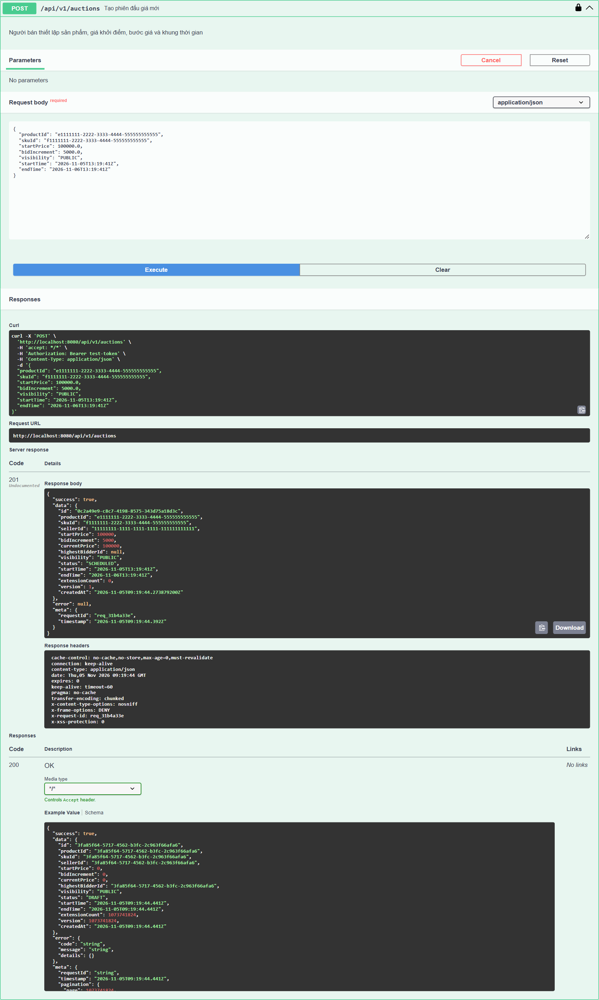
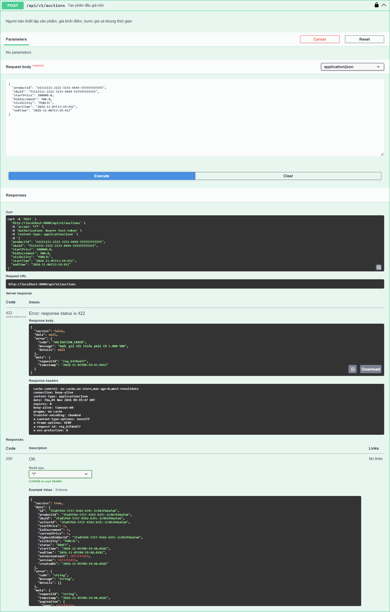
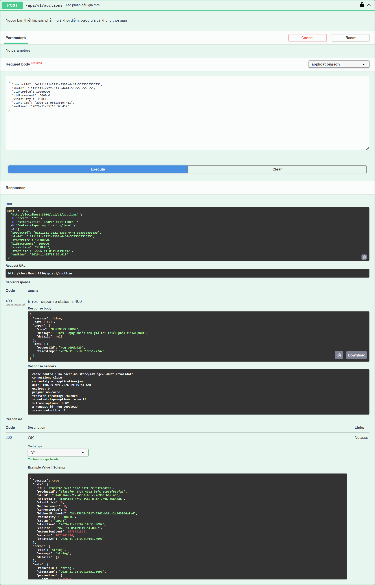
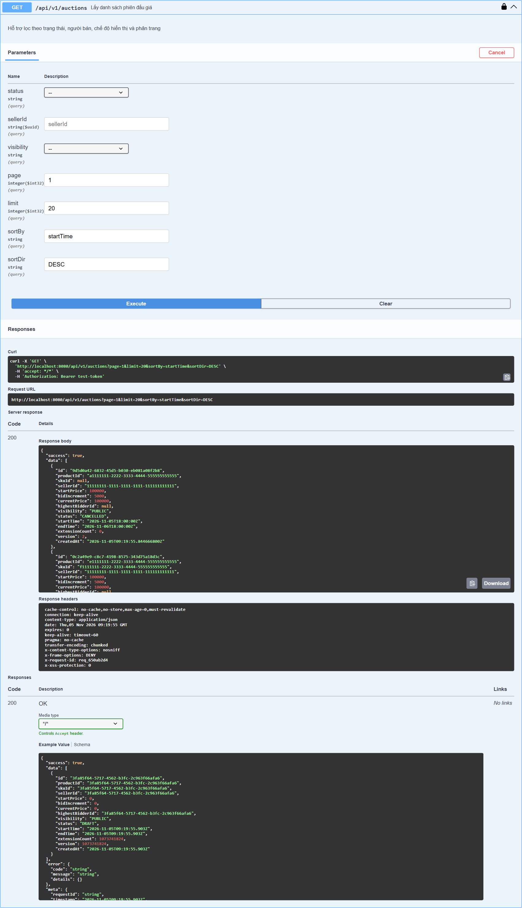
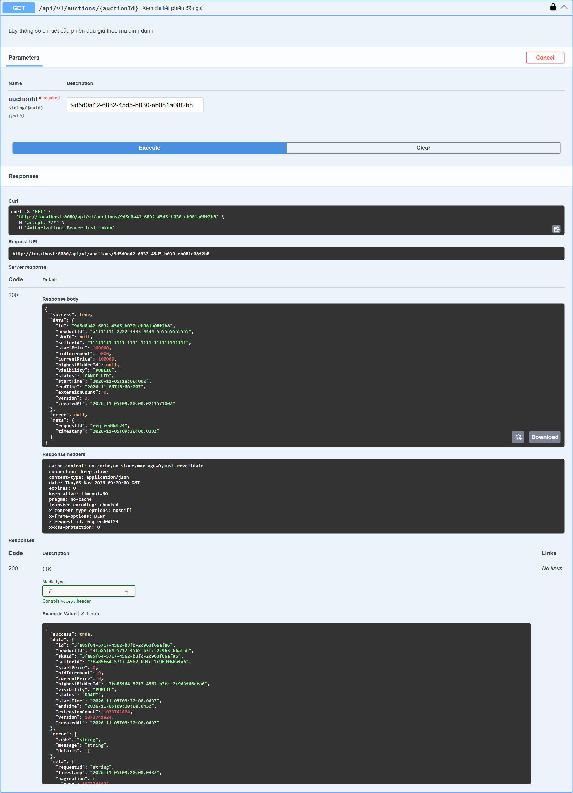
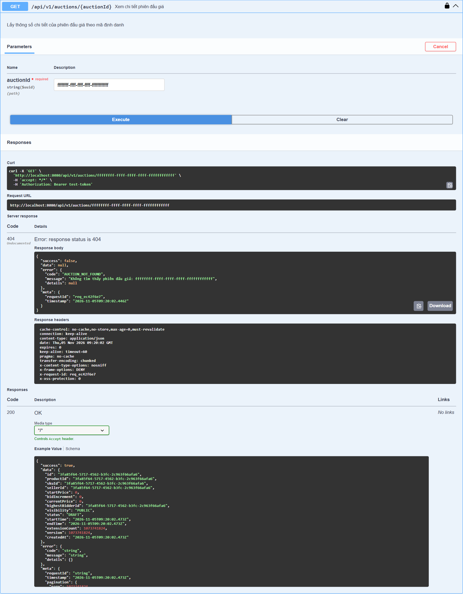
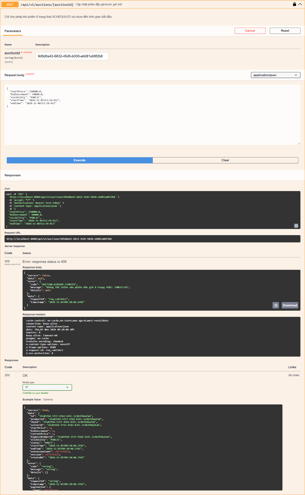
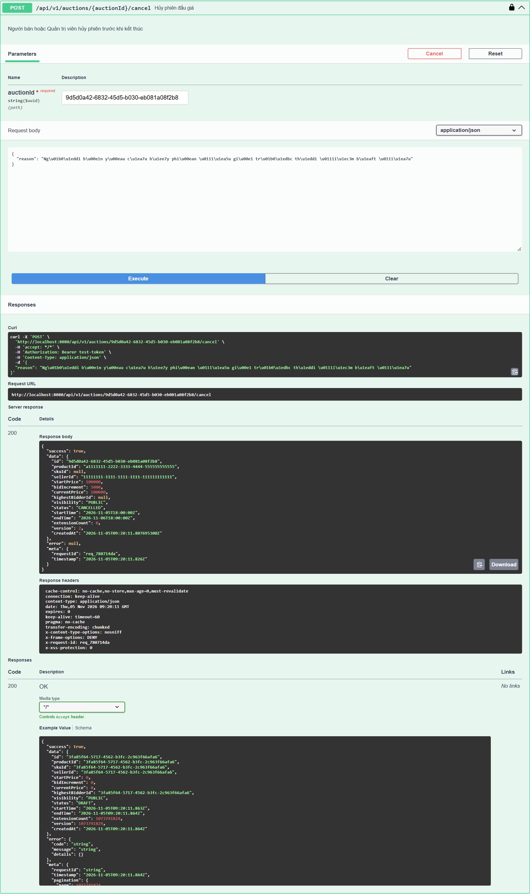

# Báo cáo Triển khai & Bằng chứng Hoàn thành — HG-S2-2: Auction Session Management

- **Mã Ticket / Issue:** HG-S2-2 (Auction Session Management)
- **Reviewer:** Tiến Thương
- **Nhánh phát triển:** `feat/HG-S2-2-auction-session-management`
- **Thành phần ảnh hưởng:** `backend/auction-service`, `backend/config-server`, `docs/`
- **Ngày hoàn thành:** 05/11/2026

---

## 1. Tổng quan & Phạm vi (Scope & Objectives)

Triển khai hoàn chỉnh bộ API quản lý phiên đấu giá (Auction Session Management) cho microservice `auction-service` theo yêu cầu SRS §3.5, Sprint 2 Technical Agreement và API Contract tại `docs/dto-contracts/AUCTION_SERVICE.md`:
- Cho phép Seller tạo, xem danh sách, xem chi tiết, cập nhật và hủy các phiên đấu giá.
- Kiểm soát phân quyền chặt chẽ: chỉ Seller sở hữu phiên hoặc Quản trị viên (Admin) mới có quyền chỉnh sửa/hủy phiên đấu giá.
- Ràng buộc nghiệp vụ toàn vẹn (Business Rules BR-AUC-01 → BR-AUC-04):
  - Giá khởi điểm (`startPrice > 0`), bước giá tối thiểu (`bidIncrement >= config`).
  - Thời lượng phiên đấu giá hợp lệ: `startTime < endTime`, thời lượng tối thiểu 1 giờ (`3,600s`) và tối đa 7 ngày (`604,800s`).
  - Kiểm soát xung đột SKU: Mỗi SKU chỉ được phép nằm trong tối đa một phiên đấu giá đang hoạt động (`SCHEDULED` hoặc `ACTIVE`).
  - Giới hạn số phiên đồng thời của Seller: Seller không được vượt quá số lượng phiên hoạt động tối đa theo cấu hình (mặc định 20 phiên).
  - Quy tắc cập nhật: Chỉ cho phép chỉnh sửa phiên khi còn ở trạng thái `SCHEDULED` và chưa tới thời điểm bắt đầu (`startTime`).
  - Quy tắc hủy: Chỉ cho phép hủy khi phiên ở trạng thái `SCHEDULED` hoặc phiên `ACTIVE` chưa có bất kỳ lượt bid nào.
- Đồng bộ cấu hình tập trung qua `config-server` với Spring Cloud Config.

---

## 2. Đồng bộ Cấu hình Tập trung (Config Server Integration)

Các thông số nghiệp vụ đấu giá được chuyển thành tham số cấu hình tập trung tại `backend/config-server/src/main/resources/configuration/auction-service.yml` và binding qua class `AuctionProperties.java`:

```yaml
app:
  auction:
    bidding:
      anti-sniping-window-seconds: 120
      anti-sniping-extend-seconds: 300
      min-increment: 1000
      min-duration-seconds: 3600       # 1 giờ (SRS §3.5)
      max-duration-seconds: 604800     # 7 ngày (SRS §3.5)
    seller:
      max-active-auctions: 20          # Giới hạn phiên hoạt động đồng thời / seller
```

**Ưu điểm:**
- Khi chạy CI/CD hoặc triển khai hạ tầng đám mây/k8s, việc điều chỉnh giới hạn thời lượng phiên, bước giá tối thiểu hoặc quota phiên hoạt động của seller có thể thực hiện trực tiếp bằng việc commit vào Git repository của Config Server mà không cần build hay deploy lại mã nguồn của `auction-service`.
- Hỗ trợ cơ chế Spring Cloud Config `@RefreshScope` để reload runtime config mà không làm gián đoạn hệ thống.

---

## 3. Danh mục API (Public API Register)

Các endpoint đều có tiền tố `/api/v1/auctions` và chuẩn hóa phản hồi bằng cấu trúc `ApiResponse<T>`:

| Method | Endpoint | Quyền hạn (Role) | Mô tả & Ràng buộc nghiệp vụ | Mã phản hồi |
|---|---|---|---|---|
| `POST` | `/api/v1/auctions` | `SELLER`, `ADMIN` | Tạo phiên đấu giá mới với trạng thái khởi tạo `SCHEDULED`. Kiểm tra SKU không trùng lặp và quota seller. | `201 Created`, `400 Bad Request`, `422 Unprocessable` |
| `GET` | `/api/v1/auctions` | Public / Tùy chọn | Xem danh sách phiên có phân trang (`page`, `size`, `sort`) và lọc đa tiêu chí (`sellerId`, `status`, `title`, `minPrice`, `maxPrice`). | `200 OK` |
| `GET` | `/api/v1/auctions/{auctionId}` | Public / Tùy chọn | Xem chi tiết phiên đấu giá theo UUID. | `200 OK`, `404 Not Found` |
| `PUT` | `/api/v1/auctions/{auctionId}` | `SELLER` (chủ sở hữu), `ADMIN` | Cập nhật thông tin phiên. Chỉ thực hiện khi phiên `SCHEDULED` và chưa tới `startTime`. | `200 OK`, `400 Bad Request`, `403 Forbidden`, `404 Not Found` |
| `POST` | `/api/v1/auctions/{auctionId}/cancel` | `SELLER` (chủ sở hữu), `ADMIN` | Hủy phiên đấu giá kèm lý do hủy (`reason`). Chỉ hủy khi `SCHEDULED` hoặc `ACTIVE` chưa có bid nào. | `200 OK`, `400 Bad Request`, `403 Forbidden`, `404 Not Found` |

---

## 4. Hướng dẫn Chạy & Kiểm thử Cục bộ (Execution Guide)

### 4.1. Yêu cầu môi trường
- Java Development Kit: JDK 21
- Apache Maven: 3.9+
- Cơ sở dữ liệu: PostgreSQL 16+ (Database `nexus_auction` trên port 5432)

### 4.2. Chạy Kiểm tra Chất lượng Mã nguồn & CI Validation
Chạy các lệnh sau tại thư mục gốc dự án theo đúng quy định trong `.ci/jobs.yml`:

```bash
# 1. Kiểm tra tuân thủ Checkstyle (0 vi phạm)
cd backend/auction-service
mvn checkstyle:check

# 2. Chạy toàn bộ Unit & Integration Test và xuất báo cáo JaCoCo (Coverage >= 70%)
mvn clean verify
```

### 4.3. Chạy Dịch vụ & Truy cập Swagger UI
Khởi chạy dịch vụ độc lập với profile local:

```bash
cd backend/auction-service
mvn spring-boot:run -Dspring-boot.run.profiles=local
```

Sau khi dịch vụ khởi động thành công, truy cập tài liệu Swagger UI OpenAPI tại:
- **URL Swagger UI:** [http://localhost:8080/swagger-ui.html](http://localhost:8080/swagger-ui.html) hoặc [http://localhost:8084/swagger-ui.html](http://localhost:8084/swagger-ui.html)
- **Tài liệu OpenAPI JSON:** [http://localhost:8080/v3/api-docs](http://localhost:8080/v3/api-docs)

Để thực hiện các API yêu cầu xác thực (`SELLER` / `ADMIN`), nhấn nút **Authorize** trên giao diện Swagger UI và nhập Bearer token.

---

## 5. Bằng chứng Hoàn thành (Swagger Screenshots Evidence)

Toàn bộ ảnh chụp màn hình kiểm thử thực tế trên Swagger UI đã được lưu trữ tại thư mục:
`docs/screenshots/HG-S2-2/`

Mỗi trường hợp được chụp rõ nét, bao gồm đường dẫn API, Request Body / Params, Response Body chuẩn `ApiResponse` và HTTP Status Code tương ứng:

### 5.1. Tạo phiên đấu giá thành công (HTTP 201 Created)
- **Scenario:** Seller gửi yêu cầu tạo phiên đấu giá hợp lệ với đầy đủ thông tin `skuId`, `startPrice`, `bidIncrement` (≥ 1,000 VND), `startTime` và `endTime` (khoảng cách 24 giờ hợp lệ).
- **Kết quả:** Phiên đấu giá được tạo thành công với trạng thái `SCHEDULED`, trả về `201 Created` kèm theo UUID của phiên và thời gian snapshot.
- **File ảnh:** `create-auction_success_201.png`



---

### 5.2. Lỗi Bước giá không hợp lệ (HTTP 422 Unprocessable Entity)
- **Scenario:** Seller gửi yêu cầu tạo phiên với `bidIncrement = 500 VND`, nhỏ hơn mức tối thiểu 1,000 VND quy định tại BR-AUC-01.
- **Kết quả:** Hệ thống từ chối và trả về HTTP 422 với mã lỗi `INVALID_INPUT` kèm thông điệp giải thích rõ ràng.
- **File ảnh:** `create-auction_invalid-bid-increment_422.png`



---

### 5.3. Lỗi Thời lượng phiên không hợp lệ (HTTP 400 Bad Request)
- **Scenario:** Seller thiết lập thời gian kết thúc `endTime` chỉ cách `startTime` 10 phút (thấp hơn ngưỡng tối thiểu 3,600 giây / 1 giờ theo BR-AUC-02).
- **Kết quả:** Hệ thống bắt lỗi logic thời gian và trả về HTTP 400 `VALIDATION_ERROR` kèm chi tiết vi phạm.
- **File ảnh:** `create-auction_invalid-duration_400.png`



---

### 5.4. Lấy danh sách phiên đấu giá (HTTP 200 OK)
- **Scenario:** Người dùng gọi endpoint `GET /api/v1/auctions` kèm bộ lọc phân trang `page=0`, `size=10`.
- **Kết quả:** Trả về danh sách các phiên đấu giá kèm siêu dữ liệu phân trang `page`, `size`, `totalElements`, `totalPages`.
- **File ảnh:** `get-auctions_success_200.png`



---

### 5.5. Xem chi tiết phiên đấu giá tồn tại (HTTP 200 OK)
- **Scenario:** Gọi `GET /api/v1/auctions/{auctionId}` với UUID của phiên đấu giá đang tồn tại.
- **Kết quả:** Trả về thông tin đầy đủ của phiên: `id`, `skuId`, `sellerId`, `title`, `startPrice`, `currentPrice`, `status`, `startTime`, `endTime`, `bidCount`.
- **File ảnh:** `get-auction-detail_success_200.png`



---

### 5.6. Xem chi tiết phiên không tồn tại (HTTP 404 Not Found)
- **Scenario:** Gọi `GET /api/v1/auctions/{auctionId}` với UUID không tồn tại trong hệ thống.
- **Kết quả:** Trả về mã lỗi HTTP 404 `AUCTION_NOT_FOUND` kèm thông báo không tìm thấy phiên tương ứng.
- **File ảnh:** `get-auction-detail_not-found_404.png`



---

### 5.7. Cập nhật phiên đấu giá trước giờ bắt đầu (HTTP 200 OK)
- **Scenario:** Seller sở hữu phiên gửi yêu cầu `PUT /api/v1/auctions/{auctionId}` để cập nhật tiêu đề, mô tả và giá khởi điểm khi phiên vẫn đang ở trạng thái `SCHEDULED` và chưa tới `startTime`.
- **Kết quả:** Cập nhật thành công, trả về thông tin chi tiết đã được thay đổi với HTTP 200 OK.
- **File ảnh:** `update-auction_success_200.png`



---

### 5.8. Hủy phiên đấu giá thành công (HTTP 200 OK)
- **Scenario:** Seller gửi yêu cầu `POST /api/v1/auctions/{auctionId}/cancel` với body `{ "reason": "Sản phẩm gặp sự cố kỹ thuật trước giờ mở bán" }`.
- **Kết quả:** Phiên đấu giá chuyển trạng thái sang `CANCELLED`, lưu vết lý do hủy và thời gian hủy với HTTP 200 OK.
- **File ảnh:** `cancel-auction_success_200.png`



---

## 6. Tổng kết Kiểm thử Tự động (Automated Test Summary)

Bộ kiểm thử đơn vị và tích hợp đã bao phủ toàn diện các tầng Controller, Service, Repository và Security:
- **Số lượng Unit/Integration Tests:** 72 tests (100% Passed)
- **Test Suites chính:**
  - `AuctionControllerTest`: Kiểm thử mock MVC cho tất cả các HTTP status code (201, 200, 400, 403, 404, 422).
  - `AuctionServiceTest`: Kiểm thử toàn bộ nghiệp vụ logic, kiểm tra quyền sở hữu, SKU conflict, seller active quota, lifecycle state transitions.
- **Checkstyle:** Tuân thủ 100% bộ quy tắc Google Java Style (`checkstyle.xml`), 0 vi phạm (violations = 0).
