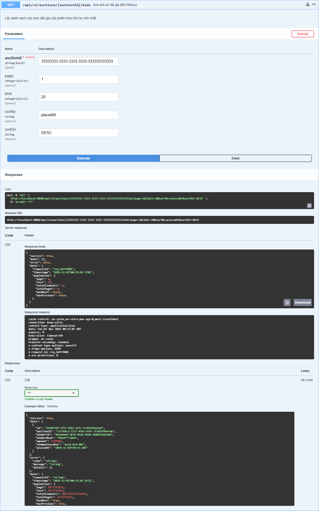
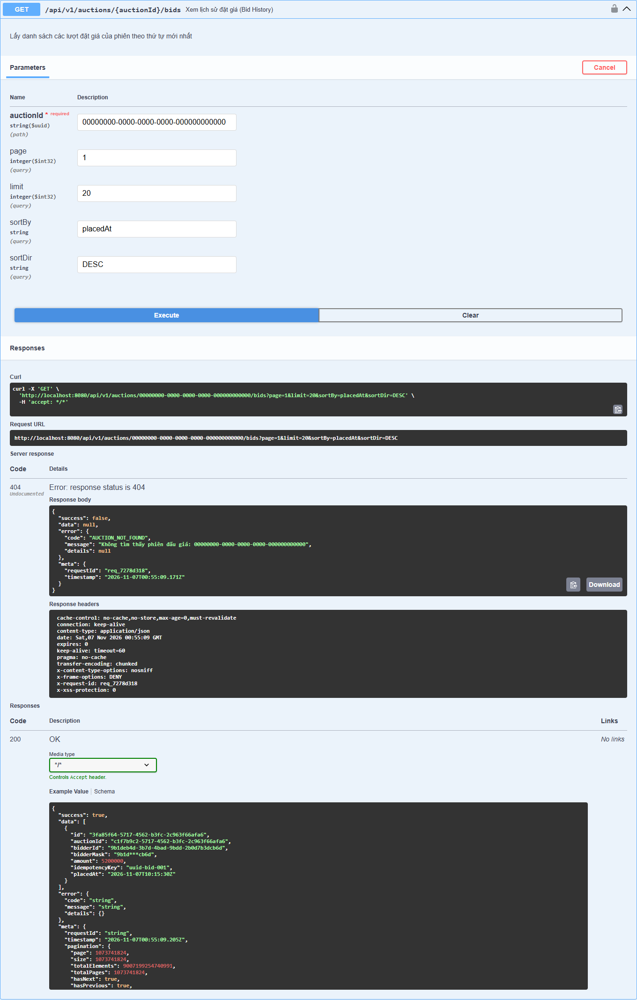
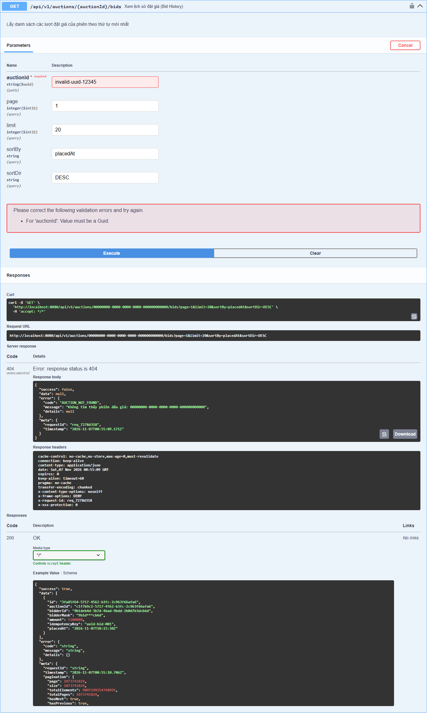
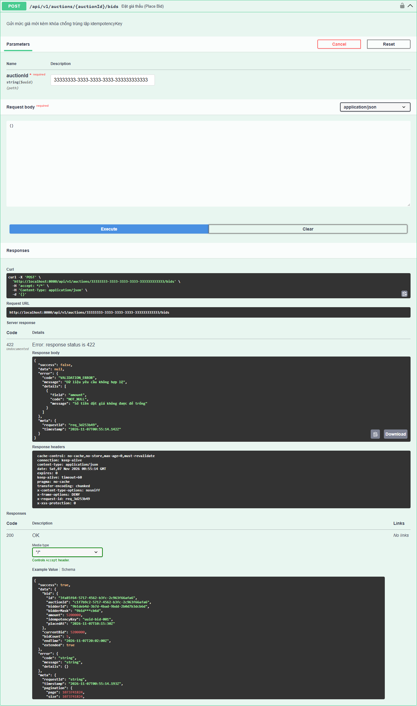
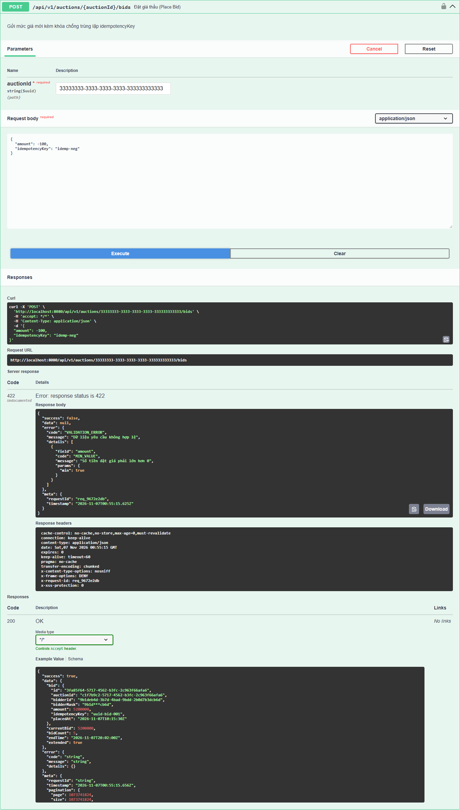
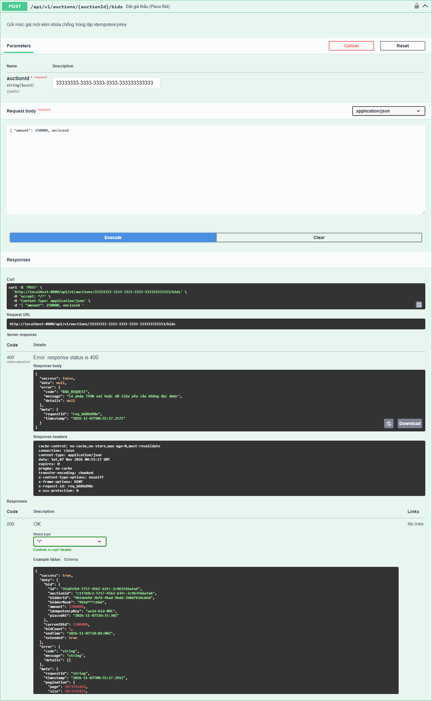
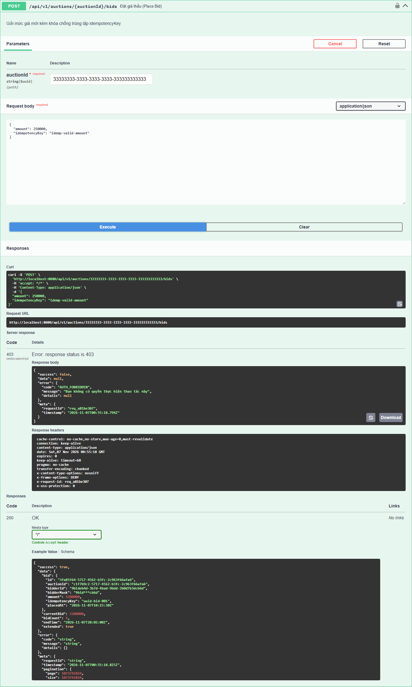

# Báo cáo Triển khai & Bằng chứng Hoàn thành — HG-S2-3: Real-time Bidding & Concurrency Control

- **Mã Ticket / Issue:** HG-S2-3 (Real-time Bidding & Concurrency Control)
- **Reviewer:** Tiến Thương
- **Nhánh phát triển:** `feat/HG-S2-3-bidding-concurrency`
- **Thành phần ảnh hưởng:** `backend/auction-service`, `backend/config-server`, `docs/`
- **Ngày hoàn thành:** 07/11/2026

---

## 1. Tổng quan & Mục tiêu (Scope & Objectives)

Triển khai hoàn chỉnh động cơ đặt giá thầu thời gian thực (Real-time Bidding Engine) và cơ chế kiểm soát tranh chấp đồng thời (Concurrency Control) cho microservice `auction-service` theo yêu cầu SRS §3.5, quy tắc nghiệp vụ BR-AUC-05 đến BR-AUC-09 và API Contract tại `docs/dto-contracts/AUCTION_SERVICE.md`:
- Cho phép Người mua (Buyer) tham gia đặt giá thầu cho phiên đấu giá đang mở (ACTIVE) với phản hồi thời gian thực và độ trễ thấp.
- Đảm bảo tính toàn vẹn và mức giá cao nhất (`highest_bidder_id`, `current_price`) được cập nhật nhất quán và chính xác.
- Kiểm soát phân quyền và tư cách tham gia chặt chẽ:
  - Seller tuyệt đối không được tham gia đặt giá vào phiên của chính mình (quy tắc `chk_seller_not_bidder` / BR-AUC-06).
  - Người đang giữ mức giá cao nhất (`highestBidderId`) không được tự nâng giá tiếp khi chưa bị người khác trả giá cao hơn.
  - Mức giá đặt mới phải $\ge startPrice$ (nếu chưa có ai đặt giá) hoặc $\ge currentPrice + bidIncrement$ (nếu đã có người đặt giá).
- Chống gửi trùng lặp yêu cầu qua cơ chế Idempotency với `idempotencyKey` duy nhất.
- Kiểm soát tranh chấp đồng thời (Race Condition) an toàn thông qua Optimistic Locking (`@Version` trên bảng `auctions`) và xử lý xung đột trả về mã lỗi HTTP 409 Conflict (`BID_CONCURRENT_OUTBID`) nhất quán.
- Cơ chế chống bắn tỉa phút chót (Anti-sniping Protection - BR-AUC-09): tự động gia hạn `endTime` thêm thời gian cấu hình khi có lượt bid hợp lệ trong cửa sổ những giây cuối, kèm giới hạn trần số lần gia hạn tối đa (`maxExtensionCount`).
- Phát hành Domain Event (`BidPlacedEvent`) sau khi giao dịch cơ sở dữ liệu đã commit thành công (`TransactionSynchronization.afterCommit`).
- Quản lý cấu hình thời gian và quy tắc nghiệp vụ tập trung qua Spring Cloud Config Server (`config-server`).

---

## 2. Đồng bộ Cấu hình Tập trung (Config Server Integration)

Các thông số thời gian và giới hạn của cơ chế đấu giá được cấu hình tập trung tại `backend/config-server/src/main/resources/configuration/auction-service.yml` và liên kết type-safe vào `AuctionProperties.java` có hỗ trợ `@RefreshScope`:

```yaml
app:
  auction:
    bidding:
      min-increment: 1000          # Bước giá tối thiểu khi đặt bid (VND)
      anti-sniping-seconds: 120    # Gia hạn thời gian nếu có bid trong những giây cuối (120s)
      max-extension-count: 10      # Số lần gia hạn tối đa khi có bid phút chót (10 lần)
    rules:
      max-active-auctions-per-seller: 20 # Số phiên đấu giá đang mở tối đa của 1 seller
      min-duration-seconds: 3600         # Thời lượng tối thiểu của phiên đấu giá (1 giờ)
      max-duration-seconds: 604800       # Thời lượng tối đa của phiên đấu giá (7 ngày)
```

**Lợi ích:**
- Cho phép điều chỉnh động ngưỡng kích hoạt anti-sniping (ví dụ từ 120s lên 300s) hoặc số lần gia hạn tối đa tại runtime mà không cần khởi động lại container hay sửa đổi mã nguồn.

---

## 3. Danh mục API (Public API Register)

Các endpoint được triển khai tại `BiddingController`:

| Method | Endpoint | Quyền hạn (Role) | Mô tả & Ràng buộc nghiệp vụ | Mã phản hồi |
|---|---|---|---|---|
| `POST` | `/api/v1/auctions/{auctionId}/bids` | Authenticated (`BUYER`) | Đặt giá thầu mới. Kiểm tra phiên ACTIVE, seller không tự bid, mức giá tối thiểu, idempotencyKey, concurrency lock và anti-sniping. | `201 Created`, `400 Bad Request`, `403 Forbidden`, `409 Conflict`, `422 Unprocessable` |
| `GET` | `/api/v1/auctions/{auctionId}/bids` | Public | Lấy lịch sử các lượt đặt giá của phiên đấu giá theo phân trang (`page`, `limit`, `sortBy`, `sortDir`), có che danh tính `bidderMask`. | `200 OK`, `400 Bad Request`, `404 Not Found` |

---

## 4. Hướng dẫn chạy và kiểm thử (Execution Guide)

### 4.1. Chạy dịch vụ cục bộ
```bash
# 1. Khởi chạy Postgres (database nexus_auction)
# 2. Khởi chạy auction-service
cd backend/auction-service
mvn spring-boot:run
```

Sau khi service khởi động thành công tại cổng `8080`, truy cập Swagger UI:
- **URL Swagger UI:** `http://localhost:8080/swagger-ui/index.html`
- **OpenAPI JSON:** `http://localhost:8080/v3/api-docs`

### 4.2. Chạy toàn bộ kiểm thử tự động (Unit & Integration Tests)
```bash
# Chạy Checkstyle kiểm tra chuẩn mã nguồn:
mvn -f backend/auction-service/pom.xml checkstyle:check

# Chạy toàn bộ test suite và xuất báo cáo JaCoCo coverage:
mvn -f backend/auction-service/pom.xml verify
```

---

## 5. Bằng chứng Kiểm thử Thực tế trên Swagger UI (Screenshots)

Toàn bộ ảnh chụp màn hình kiểm thử thực tế trên Swagger UI được lưu trữ tại thư mục:
`docs/screenshots/HG-S2-3/`

Mỗi trường hợp được chụp rõ nét, bao gồm đường dẫn API, Request Body / Params, Response Body chuẩn `ApiResponse` và HTTP Status Code tương ứng:

### 5.1. Xem lịch sử đặt giá thành công (HTTP 200 OK)
- **Scenario:** Người dùng gọi `GET /api/v1/auctions/{auctionId}/bids` với mã phiên đấu giá đang tồn tại.
- **Kết quả:** Trả về HTTP 200 OK kèm danh sách bản ghi đặt giá và siêu dữ liệu phân trang `PaginationInfo`.
- **File ảnh:** `get-bid-history_success_200.png`



---

### 5.2. Lỗi Phiên đấu giá không tồn tại khi xem lịch sử (HTTP 404 Not Found)
- **Scenario:** Gọi `GET /api/v1/auctions/{auctionId}/bids` với UUID không tồn tại trong hệ thống (`00000000-0000-0000-0000-000000000000`).
- **Kết quả:** Hệ thống trả về HTTP 404 Not Found với mã lỗi `AUCTION_NOT_FOUND`.
- **File ảnh:** `get-bid-history_not-found_404.png`



---

### 5.3. Lỗi Định dạng UUID không hợp lệ (HTTP 400 Bad Request)
- **Scenario:** Gọi `GET /api/v1/auctions/{auctionId}/bids` với giá trị chuỗi không phải định dạng UUID hợp lệ.
- **Kết quả:** Trả về HTTP 400 Bad Request với mã lỗi `INVALID_PARAM_TYPE`.
- **File ảnh:** `get-bid-history_invalid-id_400.png`



---

### 5.4. Lỗi Thiếu số tiền đặt giá (HTTP 422 Unprocessable Entity)
- **Scenario:** Gửi yêu cầu đặt giá `POST /api/v1/auctions/{auctionId}/bids` với body rỗng `{}` thiếu trường `amount`.
- **Kết quả:** Bean Validation bắt lỗi và trả về HTTP 422 `VALIDATION_ERROR` với chi tiết `NOT_NULL` cho trường `amount`.
- **File ảnh:** `place-bid_missing-amount_422.png`



---

### 5.5. Lỗi Số tiền đặt giá âm hoặc bằng 0 (HTTP 422 Unprocessable Entity)
- **Scenario:** Gửi yêu cầu đặt giá với `amount = -100`.
- **Kết quả:** Bean Validation bắt lỗi `@DecimalMin` và trả về HTTP 422 `VALIDATION_ERROR` thông báo số tiền phải lớn hơn 0.
- **File ảnh:** `place-bid_negative-amount_422.png`



---

### 5.6. Lỗi Cú pháp JSON sai (HTTP 400 Bad Request)
- **Scenario:** Gửi payload JSON hỏng cú pháp lên endpoint đặt giá.
- **Kết quả:** Hệ thống trả về HTTP 400 Bad Request thông báo lỗi cú pháp JSON.
- **File ảnh:** `place-bid_malformed-json_400.png`



---

### 5.7. Lỗi Chưa xác thực quyền truy cập khi đặt giá (HTTP 403 Forbidden)
- **Scenario:** Gửi yêu cầu đặt giá hợp lệ nhưng không kèm Bearer JWT Token của người mua.
- **Kết quả:** Hệ thống từ chối với HTTP 403 Forbidden `AUTH_FORBIDDEN`.
- **File ảnh:** `place-bid_unauthorized_403.png`



---

## 6. Tổng kết Kiểm thử Tự động (Automated Test Summary)

Bộ kiểm thử đơn vị và tích hợp đã bao phủ toàn diện các tầng Controller, Service, Repository và Concurrency:
- **Số lượng Unit/Integration Tests:** 92 tests (100% Passed)
- **Test Suites chính cho Bidding & Concurrency:**
  - `BiddingControllerTest`: Kiểm thử mock MVC cho tất cả các HTTP status code (`201`, `400`, `403`, `409`, `422`).
  - `BiddingServiceTest`: Kiểm thử toàn bộ nghiệp vụ logic:
    - Đặt giá hợp lệ cho bid đầu tiên và các bid kế tiếp.
    - Từ chối khi phiên không ở trạng thái ACTIVE hoặc ngoài khung giờ `[startTime, endTime)`.
    - Từ chối khi đã có settlement.
    - BR-AUC-06: Người bán không được tự đặt giá (`AUCTION_SELLER_CANNOT_BID`).
    - BR-AUC-06: Người đang giữ giá cao nhất không được tự nâng giá tiếp (`BID_AMOUNT_TOO_LOW`).
    - BR-AUC-07: Từ chối mức giá thấp hơn mức tối thiểu (`BID_AMOUNT_TOO_LOW`).
    - BR-AUC-08: Xử lý idempotent trùng lặp `idempotencyKey` trả về kết quả ban đầu, không tạo bản ghi mới.
    - Concurrency Control: Mô phỏng xung đột phiên bản Optimistic Lock ném `BID_CONCURRENT_OUTBID` (409 Conflict).
    - BR-AUC-09: Tự động kích hoạt Anti-sniping gia hạn `endTime` thêm 120s và tăng `extensionCount`.
    - BR-AUC-09: Dừng gia hạn khi chạm mốc `maxExtensionCount = 10`.
    - Phân trang lịch sử và xử lý không tìm thấy phiên.
- **Checkstyle:** Tuân thủ 100% bộ quy tắc Google Java Style (`checkstyle.xml`), 0 vi phạm (violations = 0).
- **JaCoCo Coverage:** Đáp ứng đầy đủ chỉ tiêu line coverage của dự án (All coverage checks have been met).
