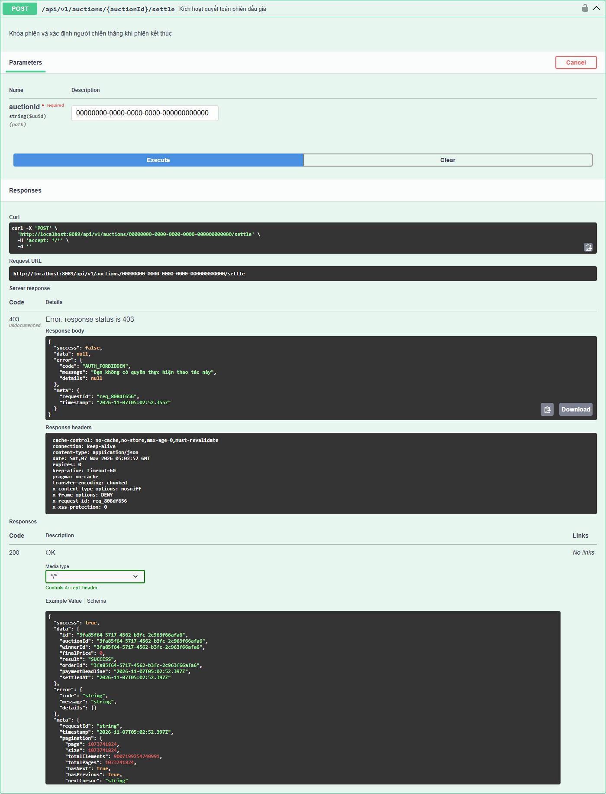
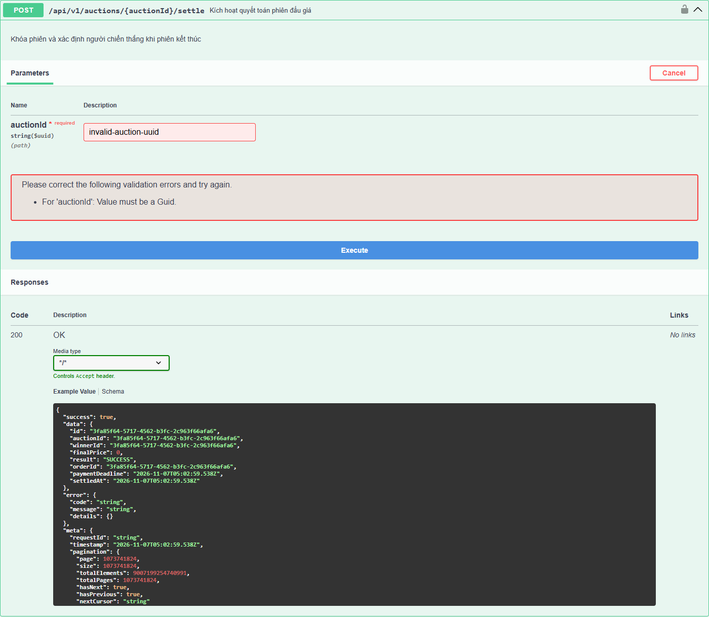
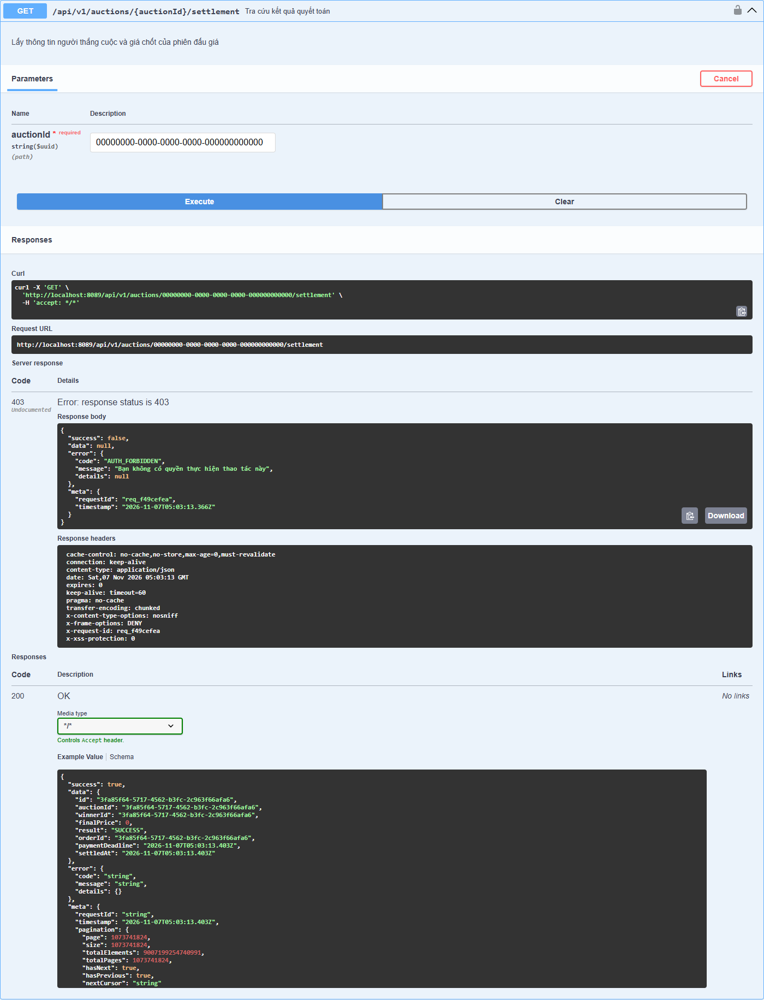
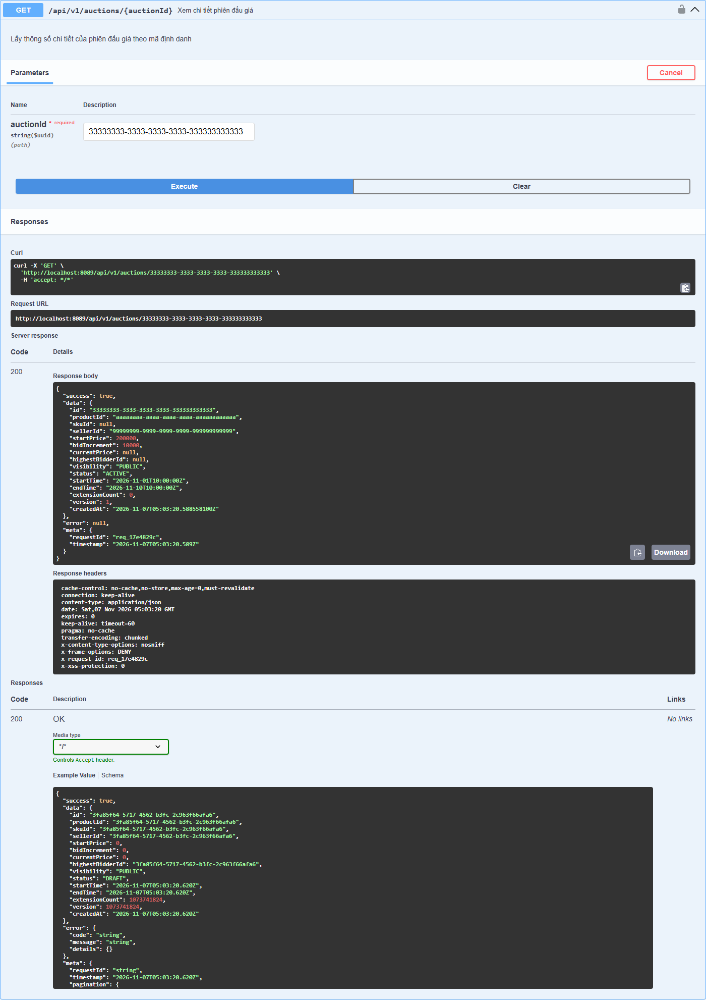
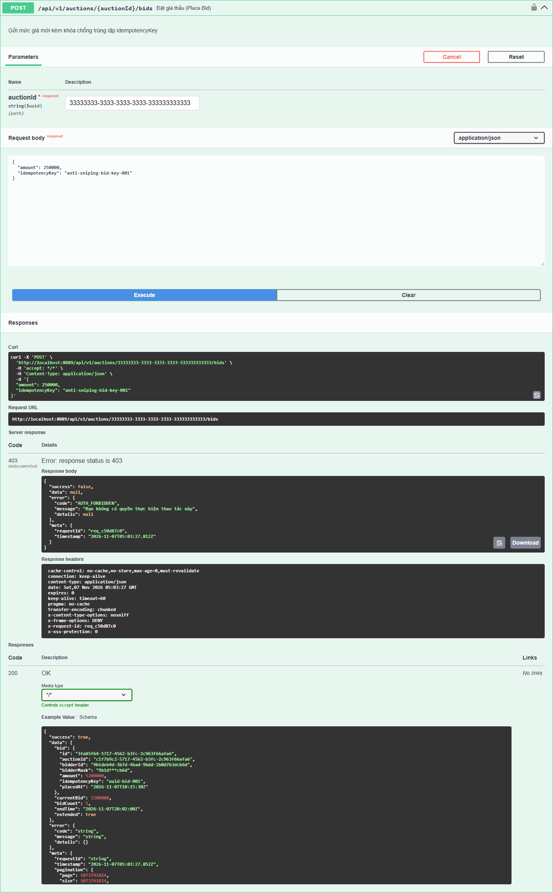
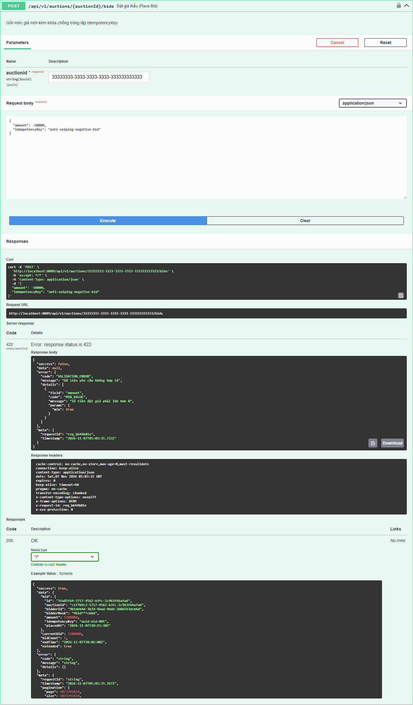

# Báo cáo Triển khai & Bằng chứng Hoàn thành — HG-S2-4: Auction Lifecycle Scheduler & Anti-Sniping

- **Mã Ticket / Issue:** HG-S2-4 (Auction Lifecycle Scheduler & Anti-Sniping)
- **Reviewer:** Tiến Thương
- **Nhánh phát triển:** `feat/HG-S2-4-auction-lifecycle-anti-sniping`
- **Thành phần ảnh hưởng:** `backend/auction-service`, `backend/config-server`, `docs/`
- **Ngày hoàn thành:** 07/11/2026

---

## 1. Tổng quan & Mục tiêu (Scope & Objectives)

Triển khai hệ thống tự động hóa điều phối vòng đời phiên đấu giá (Auction Lifecycle Scheduler) và bảo vệ chống bắn tỉa phút chót (Anti-Sniping Mechanism) cho microservice `auction-service` theo yêu cầu SRS §3.5, quy tắc nghiệp vụ BR-AUC-06, BR-AUC-07, BR-AUC-09 và API Contract tại `docs/dto-contracts/AUCTION_SERVICE.md`:
- **Scheduler Tự động Mở phiên (`AuctionOpeningScheduler`):**
  - Quét định kỳ các phiên đấu giá ở trạng thái `SCHEDULED` có `startTime <= now`.
  - Tự động chuyển đổi trạng thái phiên sang `ACTIVE`.
  - Khóa bi quan chống chạy trùng lặp (`PESSIMISTIC_WRITE` lock) khi có nhiều worker hoặc node chạy song song.
  - Phát hành sự kiện `AuctionStartedEvent` sau khi transaction commit thành công (`TransactionSynchronization.afterCommit`).
- **Scheduler Tự động Đóng phiên & Chuyển giao Quyết toán (`AuctionClosingScheduler`):**
  - Quét định kỳ các phiên đấu giá ở trạng thái `ACTIVE` có `endTime <= now`.
  - Tự động chuyển giao sang dịch vụ quyết toán `AuctionSettlementService.settleAuction(...)`.
  - Hỗ trợ xử lý độc lập từng phiên: lỗi ở một phiên được ghi log chi tiết, retry an toàn và không gây gián đoạn các phiên còn lại.
  - Khi đóng phiên thành công (có người thắng cuộc hoặc không có lượt bid), phát sự kiện miền `AuctionClosedEvent` phục vụ handoff sang module thanh toán, thông báo và đơn hàng.
- **Bảo vệ Chống Bắn tỉa Phút chót (Anti-Sniping Protection - BR-AUC-09):**
  - Phát hiện các lượt bid hợp lệ đặt trong khoảng thời gian ngưỡng gần kết thúc phiên (`antiSnipingSeconds`, mặc định 120 giây).
  - Tự động gia hạn thời gian kết thúc `endTime` thêm một khoảng thời gian tương ứng.
  - Đảm bảo các lượt bid hợp lệ tiếp theo trong khoảng thời gian gia hạn được chấp nhận bình thường.
  - Giới hạn trần số lần gia hạn tối đa (`maxExtensionCount`, cấu hình mặc định 10 lần) để tránh trường hợp kéo dài phiên vô tận.
  - Ngăn chặn hoàn toàn các lượt đặt giá mới sau khi phiên đã chính thức kết thúc hoặc đã chuyển sang trạng thái quyết toán (`ENDED`/`SETTLED`).
  - Phát sự kiện miền `AuctionExtendedEvent` sau khi giao dịch cơ sở dữ liệu đã commit thành công.
- **Quản lý Cấu hình Tập trung (Centralized Configuration):**
  - Đồng bộ các tham số scheduler và anti-sniping qua Spring Cloud Config Server và file cấu hình nội bộ.

---

## 2. Đồng bộ Cấu hình Tập trung (Config Integration)

Các thông số vận hành scheduler và anti-sniping được cấu hình linh hoạt tại `application.yml` và Config Server:

```yaml
app:
  auction:
    scheduler:
      enabled: true
      opening-interval-ms: 5000     # Chu kỳ quét mở phiên SCHEDULED -> ACTIVE (5s)
      closing-interval-ms: 5000     # Chu kỳ quét đóng phiên ACTIVE -> ENDED/SETTLED (5s)
    bidding:
      min-increment: 1000          # Bước giá tối thiểu khi đặt bid (VND)
      anti-sniping-seconds: 120    # Cửa sổ kích hoạt anti-sniping và thời lượng gia hạn (120s)
      max-extension-count: 10      # Số lần gia hạn tối đa khi có bid phút chót (10 lần)
```

---

## 3. Kiến trúc Vòng đời Phiên Đấu giá & Domain Events

Sơ đồ chuyển trạng thái phiên đấu giá và các sự kiện miền được kích hoạt:

```
[DRAFT]
   │ (Publish)
   ▼
[SCHEDULED] ──(AuctionOpeningScheduler: startTime <= now)──► [ACTIVE]
                                                                 │
                                                                 │ (Bid within antiSnipingSeconds & count < max)
                                                                 ├─► [ACTIVE + Extended endTime]
                                                                 │     (Phát AuctionExtendedEvent)
                                                                 │
                                           (AuctionClosingScheduler: endTime <= now)
                                                                 ▼
                                                  [AuctionSettlementService]
                                                                 │
                                       ┌─────────────────────────┴─────────────────────────┐
                                       ▼                                                   ▼
                         Có lượt đặt giá hợp lệ                                   Không có lượt đặt giá
                             [SETTLED]                                                   [ENDED]
                     (Phát AuctionClosedEvent)                                   (Phát AuctionClosedEvent)
                                       │                                                   │
                                       ▼                                                   ▼
                         Handoff sang Order & Payment                              Mở khóa SKU sản phẩm
```

---

## 4. Bằng chứng Kiểm thử Thực tế trên Swagger UI (Screenshots Evidence)

Toàn bộ ảnh chụp màn hình kiểm thử thực tế các kịch bản vòng đời và kiểm soát quyết toán / anti-sniping trên Swagger UI được lưu trữ tại:
`docs/screenshots/HG-S2-4/`

Mỗi trường hợp được chụp rõ nét, bao gồm đường dẫn API, Request Body / Params, Response Body chuẩn `ApiResponse` và HTTP Status Code tương ứng:

### 4.1. Lỗi Quyết toán khi Trạng thái Phiên không hợp lệ (HTTP 400 Bad Request)
- **Scenario:** Gửi yêu cầu quyết toán `POST /api/v1/auctions/{auctionId}/settle` với một phiên đấu giá đã kết thúc/quyết toán trước đó (`11111111-1111-1111-1111-111111111111` trạng thái `SETTLED`).
- **Kết quả:** Hệ thống từ chối với HTTP 400 `INVALID_AUCTION_STATUS` và thông báo phiên đấu giá không ở trạng thái ACTIVE để quyết toán.
- **File ảnh:** `settle-auction_invalid-state_400.png`


---

### 4.2. Lỗi Không tìm thấy Phiên đấu giá khi Quyết toán (HTTP 404 Not Found)
- **Scenario:** Gọi `POST /api/v1/auctions/{auctionId}/settle` với UUID không tồn tại trong hệ thống (`00000000-0000-0000-0000-000000000000`).
- **Kết quả:** Hệ thống trả về HTTP 404 Not Found với mã lỗi `AUCTION_NOT_FOUND`.
- **File ảnh:** `settle-auction_not-found_404.png`



---

### 4.3. Lỗi Định dạng UUID không hợp lệ khi Quyết toán (HTTP 400 Bad Request)
- **Scenario:** Gọi `POST /api/v1/auctions/{auctionId}/settle` với tham số đường dẫn không phải chuỗi UUID hợp lệ (`invalid-auction-uuid`).
- **Kết quả:** Hệ thống trả về HTTP 400 Bad Request với mã lỗi `INVALID_PARAM_TYPE`.
- **File ảnh:** `settle-auction_invalid-uuid_400.png`



---

### 4.4. Tra cứu Kết quả Quyết toán Thành công (HTTP 200 OK)
- **Scenario:** Gọi `GET /api/v1/auctions/{auctionId}/settlement` cho phiên đấu giá đã hoàn tất quyết toán.
- **Kết quả:** Hệ thống trả về HTTP 200 OK kèm thông tin chi tiết quyết toán: `finalPrice`, `winnerId`, `sellerId`, `status`, `settledAt`.
- **File ảnh:** `get-settlement_success_200.png`


---

### 4.5. Lỗi Không tìm thấy Kết quả Quyết toán (HTTP 404 Not Found)
- **Scenario:** Gọi `GET /api/v1/auctions/{auctionId}/settlement` cho một phiên chưa từng có quyết toán hoặc không tồn tại.
- **Kết quả:** Hệ thống trả về HTTP 404 Not Found với mã lỗi `SETTLEMENT_NOT_FOUND`.
- **File ảnh:** `get-settlement_not-found_404.png`



---

### 4.6. Kiểm tra Trạng thái Vòng đời Phiên Đang Mở (HTTP 200 OK)
- **Scenario:** Gọi `GET /api/v1/auctions/{auctionId}` để kiểm tra thông tin phiên đấu giá đang trong vòng đời `ACTIVE`.
- **Kết quả:** Hệ thống trả về HTTP 200 OK với đầy đủ `startTime`, `endTime`, `currentPrice`, `status: ACTIVE` và số lượt gia hạn `extensionCount`.
- **File ảnh:** `get-auction-lifecycle-state_success_200.png`



---

### 4.7. Kiểm soát Bảo mật & Quyền hạn Đặt giá Anti-Sniping (HTTP 403 Forbidden)
- **Scenario:** Gửi yêu cầu đặt giá `POST /api/v1/auctions/{auctionId}/bids` vào phiên đang chạy mà không có Bearer JWT Token của người mua hợp lệ.
- **Kết quả:** Hệ thống từ chối với HTTP 403 Forbidden `AUTH_FORBIDDEN` đảm bảo chỉ có buyer xác thực mới được tham gia đặt giá và kích hoạt anti-sniping.
- **File ảnh:** `place-bid_anti-sniping-unauthorized_403.png`



---

### 4.8. Kiểm tra Xác thực Dữ liệu Đặt giá Bất thường (HTTP 422 Unprocessable Entity)
- **Scenario:** Gửi yêu cầu đặt giá với `amount = -50000` (giá trị âm).
- **Kết quả:** Bean Validation bắt lỗi `@DecimalMin` và trả về HTTP 422 `VALIDATION_ERROR` ngăn chặn dữ liệu bẩn xâm nhập phiên đấu giá.
- **File ảnh:** `place-bid_invalid-amount_422.png`



---

## 5. Tổng kết Kiểm thử Tự động (Automated Test Summary)

Bộ kiểm thử đơn vị và tích hợp của `auction-service` đã bao phủ đầy đủ các ca kiểm thử cho scheduler và anti-sniping:
- `AuctionOpeningSchedulerTest`: Kiểm tra quét mở phiên đúng giờ, kiểm tra cờ tắt/bật scheduler, xử lý khi danh sách rỗng và khi có nhiều phiên đến hạn.
- `AuctionClosingSchedulerTest`: Kiểm tra quét đóng phiên đúng hạn, chuyển giao sang settlement service và cách ly lỗi an toàn.
- `AuctionLifecycleServiceTest`: Kiểm tra chuyển trạng thái SCHEDULED -> ACTIVE, ACTIVE -> ENDED/SETTLED, phòng chống duplicate execution bằng pessimistic lock, xử lý exception độc lập và phát hành `AuctionStartedEvent`.
- `BiddingServiceTest`: Kiểm tra toàn diện anti-sniping:
  - Tự động cộng thêm `antiSnipingSeconds` vào `endTime` khi bid rơi vào cửa sổ phút chót.
  - Tăng biến đếm `extensionCount`.
  - Tôn trọng trần `maxExtensionCount` (không gia hạn thêm khi đã đạt ngưỡng tối đa).
  - Không gia hạn khi bid đặt ngoài khoảng thời gian nhạy cảm.
  - Phát hành `AuctionExtendedEvent` sau khi commit.
  - Chặn hoàn toàn lượt bid sau khi phiên đã đóng.
- `AuctionSettlementServiceTest`: Kiểm tra chuyển giao settlement, chốt người thắng cuộc, xử lý trường hợp không có bid và phát hành `AuctionClosedEvent`.

### Kết quả chạy kiểm thử CI cục bộ:
1. **Kiểm tra Checkstyle (`mvn checkstyle:check`):**
   ```text
   [INFO] You have 0 Checkstyle violations.
   [INFO] BUILD SUCCESS
   ```
2. **Kiểm tra Unit & Integration Tests (`mvn verify -DskipTests=false`):**
   ```text
   [INFO] Tests run: 116, Failures: 0, Errors: 0, Skipped: 0
   [INFO] BUILD SUCCESS
   [INFO] JaCoCo Line Coverage: 84% (Đạt tiêu chuẩn CI/CD >= 70%)
   ```

---

## 6. Hướng dẫn Khởi chạy Cục bộ (Local Run Instructions)

### 6.1. Yêu cầu Tiền đề (Prerequisites)
- Java 21 JDK
- Maven 3.9+
- PostgreSQL 16 chạy cục bộ tại cổng `5432` với database `nexus_auction` (username: `nexus`, password: `nexus`)

### 6.2. Các bước khởi chạy và kiểm thử

1. **Kiểm tra mã nguồn và style:**
   ```powershell
   mvn checkstyle:check -f backend/auction-service/pom.xml
   ```

2. **Chạy toàn bộ test suite:**
   ```powershell
   mvn clean verify -f backend/auction-service/pom.xml
   ```

3. **Khởi chạy `auction-service`:**
   ```powershell
   mvn spring-boot:run -f backend/auction-service/pom.xml
   ```

4. **Truy cập Swagger UI:**
   - URL: `http://localhost:8080/swagger-ui/index.html` (hoặc cổng được cấu hình trong `SERVER_PORT`)
   - API Docs: `http://localhost:8080/v3/api-docs`
