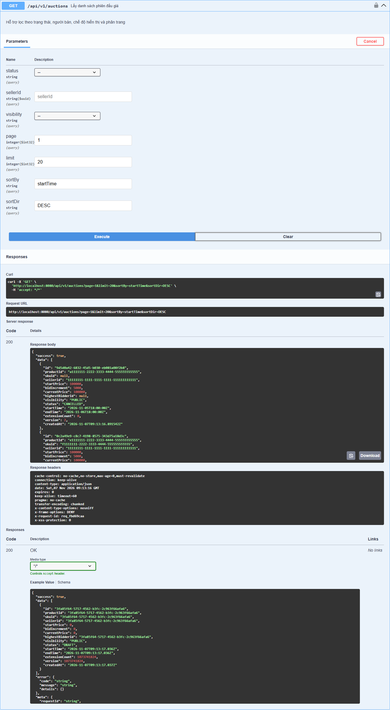
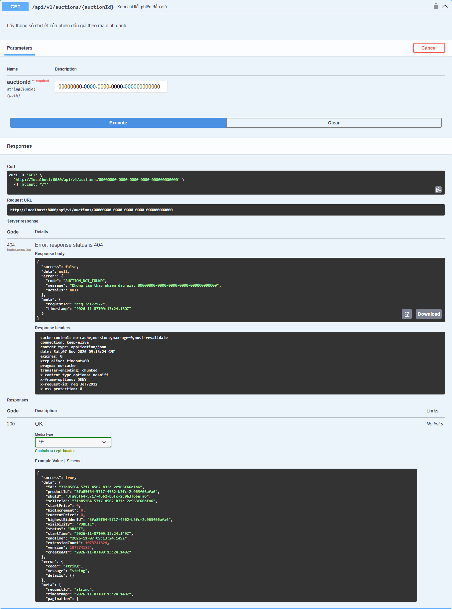
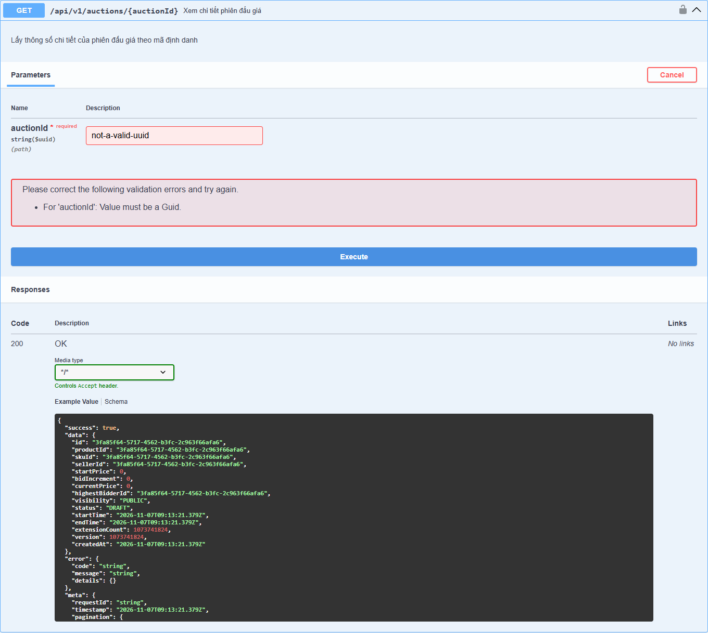
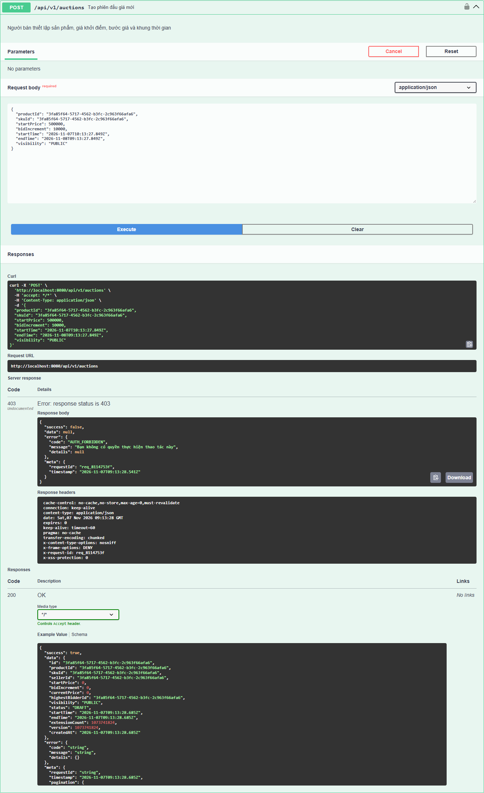
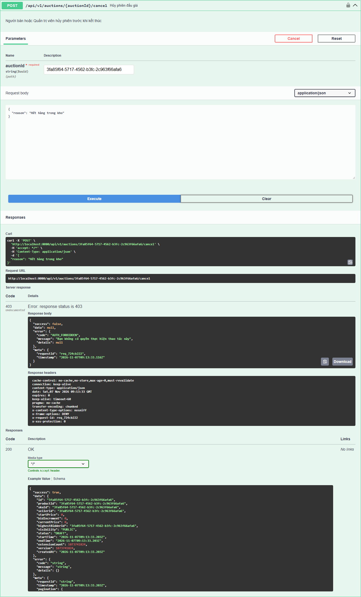
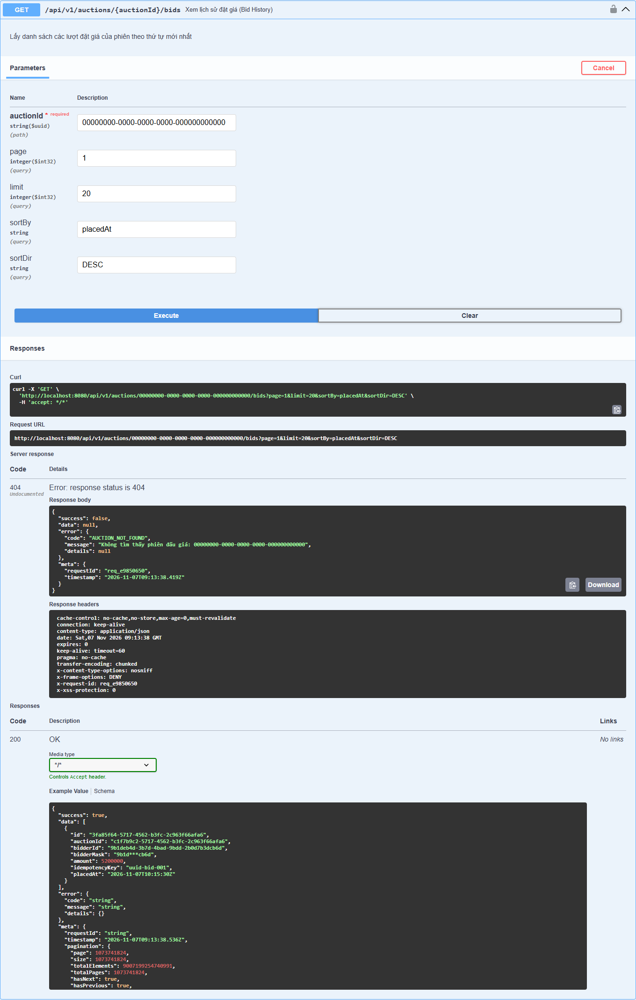

# Báo cáo Triển khai & Bằng chứng Hoàn thành — LD-S2-2: Seller Auction Creation UI & Admin Auction Management Portal

- **Mã Ticket / Issue:** LD-S2-2 (Develop Seller Auction Creation UI & Admin Auction Management Portal)
- **Ticket liên quan:** Closes #55
- **Người thực hiện & phối hợp:** @fsa_ThuongNT_02, @fsa_HungHTQ, @fsa_KhangLV, @dangtnl
- **Nhánh phát triển:** `feature/seller-auction-creation-admin-portal`
- **Thành phần ảnh hưởng:** `frontend-web/`, `backend/auction-service`, `docs/`
- **Ngày hoàn thành:** 07/11/2026

---

## 1. Tổng quan & Mục tiêu Nghiệp vụ (Scope & Objectives)

Hoàn thiện giao diện Seller/Admin cho task **[LD-S2-2]**, kết nối Auction API thực tế, loại bỏ dữ liệu đấu giá mẫu giả lập tự xuất hiện. Bổ sung trang chủ Buyer hiển thị phiên đang diễn ra và sắp diễn ra từ cùng nguồn dữ liệu chuẩn hóa:
1. **Phân hệ Seller (Người bán):**
   - Tạo phiên đấu giá mới với validation đầy đủ (giá khởi điểm, bước giá $\ge 1,000$ VND, thời gian bắt đầu ở tương lai, thời lượng từ 1 giờ đến 7 ngày).
   - Xem chi tiết phiên đấu giá, xem lịch sử các lượt đặt giá thực tế (Bid History) qua API `GET /api/v1/auctions/{auctionId}/bids`.
   - Chỉnh sửa thông số phiên trước giờ mở phiên (`SCHEDULED`).
   - Hủy phiên đấu giá trước giờ mở kèm lý do bắt buộc. Backend và Frontend đều chặn Seller hủy phiên khi phiên đã ở trạng thái `ACTIVE` hoặc đã đến/qua giờ mở.
2. **Phân hệ Admin (Quản trị viên):**
   - Quản lý toàn bộ danh sách phiên đấu giá, tra cứu người gửi qua User API.
   - Phê duyệt (`APPROVED`) hoặc từ chối (`REJECTED`) phiên đấu giá kèm lý do.
   - Tạm dừng (`PAUSED`) hoặc tiếp tục (`RESUME`) phiên đấu giá.
   - Buộc hủy (Force Cancel) phiên đấu giá vi phạm quy chế sàn kể cả khi phiên đang diễn ra (`ACTIVE`).
3. **Phân hệ Buyer (Người mua):**
   - Trang chủ Buyer lấy danh sách phiên đang diễn ra và sắp diễn ra từ Auction API.
   - Có trạng thái rỗng (empty state) rõ ràng khi chưa có dữ liệu và CTA "Đấu giá ngay".
   - Loại bỏ nội dung hero nói về dữ liệu nội bộ và liên kết sản phẩm mẫu cũ.
4. **Hiển thị Thời gian & Dữ liệu:**
   - Thời gian bắt đầu, kết thúc và lượt đặt giá hiển thị đầy đủ cả ngày lẫn giờ.

---

## 2. Bằng chứng Kiểm thử Swagger UI (Evidence Screenshots)

Thư mục lưu trữ bằng chứng: `docs/screenshots/LD-S2-2/`

### 2.1. Danh sách phiên đấu giá (Get Auctions — 200 OK)
- **Endpoint:** `GET /api/v1/auctions`
- **Mô tả:** Lấy danh sách các phiên đấu giá công khai có phân trang.


### 2.2. Chi tiết phiên đấu giá không tìm thấy (404 Not Found)
- **Endpoint:** `GET /api/v1/auctions/{auctionId}`
- **Mô tả:** Trả về mã lỗi `AUCTION_NOT_FOUND` khi ID phiên không tồn tại trong hệ thống.


### 2.3. Chi tiết phiên đấu giá định dạng UUID sai (400 Bad Request)
- **Endpoint:** `GET /api/v1/auctions/{auctionId}`
- **Mô tả:** Trả về lỗi khi `auctionId` không đúng chuẩn UUID.


### 2.4. Tạo phiên đấu giá yêu cầu xác thực người bán (403 Forbidden)
- **Endpoint:** `POST /api/v1/auctions`
- **Mô tả:** Kiểm tra phân quyền bắt buộc token hợp lệ có vai trò `ROLE_SELLER`.


### 2.5. Hủy phiên đấu giá yêu cầu xác thực (403 Forbidden)
- **Endpoint:** `POST /api/v1/auctions/{auctionId}/cancel`
- **Mô tả:** Kiểm tra phân quyền bắt buộc `ROLE_SELLER` hoặc `ROLE_ADMIN`.


### 2.6. Tra cứu lịch sử đặt giá không tìm thấy phiên (404 Not Found)
- **Endpoint:** `GET /api/v1/auctions/{auctionId}/bids`
- **Mô tả:** Trả về `AUCTION_NOT_FOUND` khi tra cứu bid history của phiên không tồn tại.


---

## 3. Hướng dẫn Khởi chạy và Kiểm thử Cục bộ (Run Instructions)

### 3.1. Chạy Frontend Web
```powershell
cd frontend-web
npm.cmd install
npm.cmd test
npm.cmd run build
npm.cmd run dev
```
- Ứng dụng web mở tại: `http://localhost:5173`

### 3.2. Chạy Backend Microservice (Auction Service)
```powershell
# Chạy unit & integration test
mvn test -Dtest=AuctionServiceTest,AuctionControllerTest,AuctionLifecycleServiceTest,AuctionOpeningSchedulerTest,BiddingControllerTest,BiddingServiceTest -f backend/auction-service/pom.xml

# Khởi chạy service
mvn spring-boot:run -f backend/auction-service/pom.xml
```
- Swagger UI: `http://localhost:8080/swagger-ui/index.html`
- OpenAPI JSON Spec: `http://localhost:8080/v3/api-docs`
