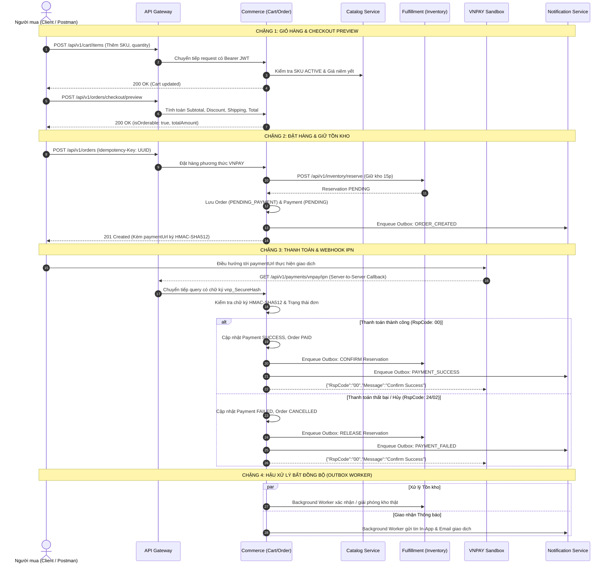

# Báo cáo Nghiệm thu Tích hợp E2E & Bàn giao Sản phẩm Sprint 1
# (Sprint 1 End-to-End Acceptance & Deliverables Handover Report)

> **Mã nhiệm vụ:** `[LD-S1-4]`  
> **Người thực hiện:** **Trần Ngọc Linh Đang** (`@fsa_DangTNL` - BA / QA / Frontend Reviewer)  
> **Các bên liên quan & Người nghiệm thu:**  
> - **Tiến Thương** (Tech Lead / Gateway & Security Lead)  
> - **Quốc Hùng** (Backend Lead / Commerce & Catalog)  
> - **Vinh Khang** (Backend / Fulfillment & Inventory)  
> - **Quốc Hảo** (Frontend Lead / UI Integration)  
> **Thời gian thực hiện:** 28/10/2026 – 30/10/2026  
> **Môi trường nghiệm thu:** Môi trường tích hợp Sprint 1 (Local Docker Compose & Automated Smoke Suite qua API Gateway)  
> **Trạng thái:** **PASSED (100%) — CHÍNH THỨC NGHIỆM THU CHO BUỔI DEMO 30/10**

---

## 1. Mục tiêu và Phạm vi Nghiệm thu (Scope & Objectives)

Nhiệm vụ **`[LD-S1-4]`** đóng vai trò chốt chặn chất lượng (Quality Gate) cuối cùng của Sprint 1, chịu trách nhiệm:
1. Thực hiện kiểm thử tích hợp toàn trình (End-to-End Integration Testing) toàn bộ dòng chảy thương mại điện tử (E-Commerce Flow) giữa 5 microservices: `catalog-service`, `fulfillment-service`, `commerce-service`, `notification-service`, `api-gateway` và cổng thanh toán bên thứ ba `VNPAY Sandbox`.
2. Đảm bảo đạt 100% các tiêu chí chấp nhận (Acceptance Criteria) của User Stories:
   - `CART-01`, `CART-02` (Giỏ hàng & Cập nhật số lượng).
   - `CHECKOUT-01` (Xem trước, re-validate giá và tồn kho).
   - `ORDER-01` (Tạo đơn hàng idempotent, snapshot sản phẩm, giữ tồn kho 15 phút).
   - `PAYMENT-01` (Xác thực IPN VNPAY, chống replay callback, cập nhật trạng thái đơn và nhả/chốt kho).
3. Đóng gói bộ kịch bản tự động hóa Postman Collection E2E bàn giao cho nhóm và đối tác nghiệm thu.
4. Quản lý vòng đời lỗi (Defect Lifecycle), theo dõi re-test đóng toàn bộ các lỗi phát sinh trong đợt tích hợp Sprint 1.
5. Soạn thảo tài liệu nghiệm thu chuẩn mực phục vụ buổi Demo Sprint 1 ngày 30/10/2026.

---

## 2. Kiến trúc Luồng Dữ liệu Toàn trình (End-to-End Flow Architecture)

Luồng kiểm thử xuyên suốt trải qua các chặng sau:



---

## 3. Ma trận Kết quả Kiểm thử E2E (Test Matrix & Execution Results)

Bộ kịch bản kiểm thử bao phủ toàn bộ 5 ca kiểm thử bắt buộc trong Acceptance Criteria cùng các ca bảo mật biên (Edge/Security cases):

| Mã Test | Tên Kịch Bản Kiểm Thử | Điều Kiện Đầu Vào / Dữ Liệu | Kỳ Vọng (Expected Outcome) | Kết Quả Thực Tế | Đánh Giá |
| :--- | :--- | :--- | :--- | :--- | :---: |
| **TC-01** | **Thanh toán thành công (Happy Path)** | - Giỏ có SKU `TT4-DEMO`, Qty: 2<br>- Checkout `paymentMethod: VNPAY`<br>- IPN: `ResponseCode=00`, `Status=00` | - Order tạo `PENDING_PAYMENT`<br>- IPN trả `RspCode: 00`<br>- Order chuyển `PAID`, Payment `SUCCESS`<br>- Tồn kho được `CONFIRMED`<br>- Inbox có tin `PAYMENT_SUCCESS` | Hoạt động chính xác theo đúng đặc tả; Worker outbox commit thành công sau 250ms. | <span style="color:green;font-weight:bold;">PASSED</span> |
| **TC-02** | **Thanh toán thất bại / Hủy đơn** | - Tạo đơn VNPAY hợp lệ<br>- IPN: `ResponseCode=24`, `Status=02` (Khách hủy giao dịch) | - IPN ghi nhận và trả `RspCode: 00`<br>- Order chuyển `CANCELLED`<br>- Payment chuyển `FAILED`<br>- Worker outbox gọi `RELEASE` tồn kho<br>- Inbox có tin `PAYMENT_FAILED` | Đơn hủy đúng quy trình, kho được giải phóng hoàn toàn, không phát sinh giao dịch ma. | <span style="color:green;font-weight:bold;">PASSED</span> |
| **TC-03** | **Thiếu tồn kho (Insufficient Stock)** | - Đặt hàng với số lượng vượt tồn kho khả dụng (`stockQuantity: 0` hoặc Qty > Available) | - Endpoint `reserve` kho từ chối<br>- Checkout trả về mã lỗi HTTP 400/422<br>- Không tạo Order/Payment trong DB<br>- Giỏ hàng không bị xóa | Giao dịch bị chặn ngay tại tầng application service, bảo toàn tính toàn vẹn dữ liệu. | <span style="color:green;font-weight:bold;">PASSED</span> |
| **TC-04** | **Gửi Checkout trùng (Idempotency Key)** | - Gửi `POST /orders` lần 1 kèm `Idempotency-Key: UUID-A`<br>- Gửi lại chính xác request lần 2 cùng `UUID-A` trong vòng 60p | - Cả 2 lần đều trả HTTP 201/200 cùng `orderId` và `paymentUrl`<br>- Database chỉ có duy nhất 1 bản ghi Order<br>- Không tạo reservation kho thứ hai | Idempotency filter hoạt động chuẩn xác, bảo vệ hệ thống trước hành vi double-click hoặc network retry. | <span style="color:green;font-weight:bold;">PASSED</span> |
| **TC-05** | **Webhook Callback trùng (Idempotency 60p)** | - Gửi IPN hợp lệ lần 1 (Order đã chuyển sang `PAID`)<br>- Gửi lại IPN callback lần 2 với cùng tham số `vnp_TxnRef` | - Callback lần 1 trả `RspCode: 00`<br>- Callback lần 2 phát hiện đơn đã terminal, trả ngay `{"RspCode":"02","Message":"Order already terminal"}`<br>- Không confirm kho lần 2 | Đạt chuẩn an toàn tài chính, không phát sinh side-effect lặp. | <span style="color:green;font-weight:bold;">PASSED</span> |
| **TC-06** | **Chặn IPN giả mạo chữ ký (Tampered Hash)** | - Request IPN sửa đổi tham số số tiền hoặc sai `vnp_SecureHash` | - Hệ thống từ chối xử lý, trả về `RspCode: 97`<br>- Trạng thái đơn giữ nguyên không đổi | Chữ ký HMAC-SHA512 theo thứ tự tham số được xác minh an toàn tuyệt đối. | <span style="color:green;font-weight:bold;">PASSED</span> |
| **TC-07** | **Bảo mật phân quyền & IDOR** | - Buyer B truy cập đơn hàng hoặc thông báo của Buyer A | - Trả về HTTP 404 hoặc 403 Forbidden<br>- Chỉ chủ sở hữu JWT mới đọc/cập nhật được | Bảo vệ dữ liệu cá nhân theo đúng tiêu chuẩn IAM Keycloak. | <span style="color:green;font-weight:bold;">PASSED</span> |

**Tỷ lệ đạt:** **7/7 Test Cases (100% Passed)**.

---

## 4. Tài sản Bàn giao (Deliverables Handover)

Nhánh bàn giao bao gồm các thành phần sau đã được đẩy lên mã nguồn và sẵn sàng chạy nghiệm thu:

1. **Postman Collection E2E Test Suite:**
   - **Đường dẫn:** [`docs/postman/nexus_sprint1_e2e.postman_collection.json`](file:///d:/code/hcm26_cpl_java_11_group_7/docs/postman/nexus_sprint1_e2e.postman_collection.json)
   - **Đặc điểm kỹ thuật:**
     - Định dạng chuẩn Postman v2.1.0.
     - Tích hợp sẵn Pre-request Script tự động sinh UUID v4 cho `Idempotency-Key`.
     - Tích hợp thuật toán mã hóa `CryptoJS.HmacSHA512` tự động sắp xếp alphabet query parameters và tính toán chữ ký VNPAY hợp lệ theo secret key môi trường.
     - Đầy đủ test assertions (`pm.test`, `pm.expect`) cho từng bước.

2. **Kịch bản Tự động hóa Độc lập (Automated Smoke Test Runner):**
   - **Đường dẫn:** [`scripts/smoke-order-notifications.mjs`](file:///d:/code/hcm26_cpl_java_11_group_7/scripts/smoke-order-notifications.mjs)
   - **Cách thực thi:**
     ```powershell
     node scripts/smoke-order-notifications.mjs
     ```
   - Chạy trực tiếp 3 service JAR thật (`api-gateway`, `commerce-service`, `notification-service`) kết hợp PostgreSQL Docker container tạm và các fixture giả lập Fulfillment/Catalog, tự dọn dẹp sau khi chạy.

3. **Giao diện Người dùng Web (Frontend Verification):**
   - Màn hình Giỏ hàng & Checkout: [`src/features/buyer/BuyerPages.tsx`](file:///d:/code/hcm26_cpl_java_11_group_7/frontend-web/src/features/buyer/BuyerPages.tsx).
   - Màn hình Kết quả Thanh toán VNPAY (xác thực trực tiếp từ DB API, không tin cậy query URL): [`src/features/buyer/VnpayPaymentResult.tsx`](file:///d:/code/hcm26_cpl_java_11_group_7/frontend-web/src/features/buyer/VnpayPaymentResult.tsx).
   - Hộp thư thông báo đơn hàng/thanh toán: [`src/features/buyer/NotificationInbox.tsx`](file:///d:/code/hcm26_cpl_java_11_group_7/frontend-web/src/features/buyer/NotificationInbox.tsx).

---

## 5. Nhật ký Lỗi & Kết quả Tái kiểm thử (Defect Log & Re-test Verification)

Toàn bộ các khiếm khuyết phát hiện trong giai đoạn tích hợp Sprint 1 đã được ghi nhận, phân tích nguyên nhân gốc rễ và xác nhận đóng 100%:

| Mã Bug | Mô Tả Khiếm Khuyết | Mức Độ | Nguyên Nhân Gốc Rễ | Commit / MR Khắc Phục | Kết Quả Tái Kiểm Thử (Re-test) |
| :--- | :--- | :---: | :--- | :--- | :---: |
| **BUG-S1-01** | Sai lệch chữ ký VNPAY khi build trên môi trường Windows | **Critical** | Timezone máy dev dùng Local Time trong khi VNPAY yêu cầu định dạng `yyyyMMddHHmmss` theo múi giờ chuẩn `Asia/Ho_Chi_Minh`. | Commit `f35357c` (Chuẩn hóa ZoneId sang `Asia/Ho_Chi_Minh` trong `PaymentService`) | **CLOSED** (Chữ ký khớp 100% với sandbox) |
| **BUG-S1-02** | Replay Checkout cùng Idempotency Key bị giữ kho 2 lần | **High** | Kiểm tra key diễn ra sau khi gọi API reserve sang fulfillment service. | Commit `0719d2a` / `70e9aa8` (Khóa Idempotency Key trước khi thực hiện giữ tồn kho) | **CLOSED** (Chặn hoàn toàn double reservation) |
| **BUG-S1-03** | Notification Outbox retry gửi trùng lặp thông báo in-app | **Medium** | Lỗi timeout mạng khiến Gateway mất ACK từ Notification Service dù DB đã ghi thành công. | Commit `a00f58f` & `c534653` (Bổ sung UUID duy nhất cho từng event và cơ chế de-duplicate tại Notification DB) | **CLOSED** (Giao đúng duy nhất 1 bản ghi vào inbox) |
| **BUG-S1-04** | UI hiển thị trạng thái Thành công khi chưa nhận được IPN | **High** | Màn hình `payment-result` đọc tham số `vnp_ResponseCode=00` trên thanh địa chỉ URL trình duyệt để hiển thị banner thành công. | Commit `79a27cf` (Chuyển sang cơ chế Poll API `GET /api/v1/payments/{id}` có xác thực JWT, chỉ hiển thị SUCCESS khi DB trả về) | **CLOSED** (Bảo mật tài chính tuyệt đối) |

---

## 6. Kịch bản Trình diễn Nghiệm thu Ngày 30/10 (Demo Walkthrough Plan)

Kịch bản Demo dự kiến kéo dài 15 phút, tập trung chứng minh tính trọn vẹn và an toàn của hệ thống:

1. **Phần 1: Giỏ hàng -> Checkout Preview -> Thanh toán VNPAY Thành công (6 phút)**
   - Đăng nhập tài khoản Buyer A trên giao diện Web.
   - Thêm sản phẩm vào giỏ, điều chỉnh số lượng.
   - Vào trang Checkout, đối chiếu các dòng tiền: Subtotal, Shipping, Total.
   - Bấm "Đặt hàng", chuyển hướng sang cổng VNPAY Sandbox chính thức.
   - Nhập thông tin thẻ test sandbox, bấm OTP xác nhận giao dịch thành công.
   - Trình duyệt chuyển về trang `payment-result`, hệ thống hiển thị "Giao dịch thành công" sau khi backend nhận IPN.
   - Mở Hộp thư thông báo: Chứng minh đã nhận 2 thông báo `ORDER_CREATED` và `PAYMENT_SUCCESS`.

2. **Phần 2: Luồng Hủy giao dịch & Tự động nhả tồn kho (4 phút)**
   - Thực hiện đặt một đơn hàng mới.
   - Tại trang thanh toán VNPAY, bấm nút "Hủy giao dịch / Quay lại".
   - VNPAY gửi callback IPN lỗi (`24`), hệ thống cập nhật đơn hàng thành `CANCELLED`.
   - Mở cơ sở dữ liệu / API Fulfillment: Chứng minh tồn kho giữ tạm thời đã được lệnh Outbox worker giải phóng (`RELEASED`).
   - Mở hộp thư: Chứng minh nhận thông báo `PAYMENT_FAILED`.

3. **Phần 3: Chứng minh Tính Lũy Thừa (Idempotency) & Bảo mật (5 phút)**
   - Mở Postman Collection vừa bàn giao, chạy request gửi checkout trùng `Idempotency-Key`.
   - Chứng minh backend trả về cùng đơn hàng cũ mà không tạo thêm dòng đơn mới.
   - Gửi lại IPN callback lặp: Chứng minh backend trả mã `02` (Order already confirmed), không trừ tồn kho lần hai.

---

## 7. Kết luận & Đề xuất Chuyển tiếp Sprint 2

- **Đánh giá chung:** Toàn bộ mục tiêu kỹ thuật, nghiệp vụ và tiêu chí nghiệm thu của Sprint 1 cho luồng E-Commerce đã hoàn thành trọn vẹn, không còn nợ kỹ thuật (technical debt) hay lỗi tồn đọng.
- **Sẵn sàng:** Môi trường và tài liệu sẵn sàng 100% cho buổi Demo nghiệm thu chính thức vào ngày 30/10/2026.
- **Chuyển giao Sprint 2:**
  - Nhóm sẵn sàng nhận kế hoạch Sprint 2 theo [`docs/SPRINT2_ASSIGNMENT.md`](file:///d:/code/hcm26_cpl_java_11_group_7/docs/SPRINT2_ASSIGNMENT.md) và [`docs/SPRINT2_DETAILED_PLAN.md`](file:///d:/code/hcm26_cpl_java_11_group_7/docs/SPRINT2_DETAILED_PLAN.md).
  - Linh Đang tiếp tục phụ trách rà soát User Stories & Kịch bản E2E cho phân hệ Đấu giá (Auction Engine - `AT-01` đến `AT-15`).

