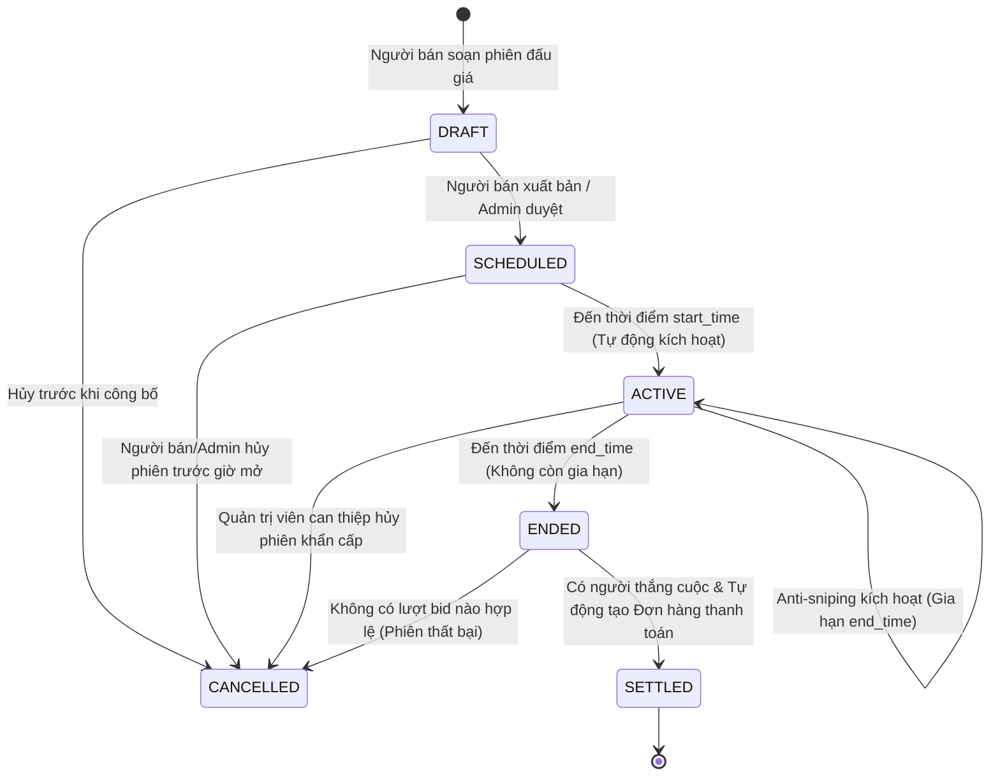

# Phân Tích Nghiệp Vụ User Stories & Acceptance Criteria: Auction Engine (Sprint 2)

> **Mã công việc:** `[LD-S1-3]`  
> **Người thực hiện:** **Trần Ngọc Linh Đang** (`@fsa_DangTNL`)  
> **Người kiểm duyệt (Reviewer):** **Nguyễn Tiến Thương** (`@fsa_ThuongNT_02`)  
> **Mục tiêu:** Xác lập tài liệu Phân tích Nghiệp vụ (Business Analysis), Đặc tả User Stories theo định dạng BDD (Given-When-Then) và Bộ tiêu chí sẵn sàng (Definition of Ready - DoR) cho Module **Online Auction Engine** trong Sprint 2.  
> **Căn cứ nghiệp vụ:** SRS §3.5 (Online Auction Engine), BR-CFG-24, Database Schema `auction_svc` (`nexus_schema.sql`), Thỏa thuận kiến trúc `STANDARDIZED_API_RESPONSE_V2_CHANGELOG.md`.

---

## 1. Tổng quan Module Đấu giá Trực tuyến (Auction Engine Overview)

Module **Auction Engine** là phân hệ cốt lõi phân biệt Project Nexus với các sàn thương mại điện tử truyền thống. Hệ thống cho phép Người bán (Seller) đăng bán sản phẩm/SKU dưới hình thức đấu giá tăng dần kiểu Anh (English Forward Auction), Người mua (Buyer) tham gia trả giá theo thời gian thực (Real-time Live Bidding) qua giao thức WebSocket STOMP, áp dụng cơ chế tự động gia hạn giờ chót (Anti-sniping Protection) và tự động chốt phiên (Settlement) chuyển tiếp sang luồng Đơn hàng (Order Management).

### 1.1. Sơ đồ Máy trạng thái Phiên đấu giá (Auction State Machine)



### 1.2. Thống kê Danh mục Epics Sprint 2

| Mã Epic | Tên Epic Nghiệp vụ | Trách nhiệm chính | Mục tiêu chuyển giao Sprint 2 |
|---|---|---|---|
| **EPIC-AUC-01** | Tạo & Quản lý Phiên đấu giá (Auction Creation & Management) | Seller, Admin, Catalog Service | Đăng ký phiên, cấu hình bước giá, duyệt phiên và quản lý vòng đời |
| **EPIC-AUC-02** | Đấu giá Trực tiếp qua WebSocket (Live Bidding Engine) | Buyer, Auction Service, WebSocket Gateway | Trả giá độ trễ thấp (<200ms), pub/sub realtime, chống tranh chấp concurrency |
| **EPIC-AUC-03** | Cơ chế Bảo vệ Giờ chót (Anti-Sniping Protection) | Auction Service Worker / Scheduler | Tự động gia hạn phiên khi có bid phút chót, ngăn chặn bot bắn tỉa |
| **EPIC-AUC-04** | Chốt phiên & Chuyển đổi Đơn hàng (Settlement & Order Generation) | Auction Service, Commerce Service, Payment | Xác định Winner, tính giá thắng cuộc, sinh Order và áp đặt hạn thanh toán |

---

## 2. Đặc tả Chi Tiết User Stories & Acceptance Criteria (Given-When-Then)

---

### Epic 1: Tạo & Quản lý Phiên đấu giá (Auction Creation & Lifecycle)

#### US-AUC-01: Người bán tạo phiên đấu giá cho sản phẩm
- **User Story:** Là một **Người bán (Seller)**, tôi muốn tạo một phiên đấu giá cho sản phẩm/SKU đã được duyệt trong kho của mình, bao gồm giá khởi điểm, bước giá và khung thời gian, để thu hút người mua trả giá tối ưu nhất.
- **Ràng buộc nghiệp vụ:**
  - `start_price > 0`, `bid_increment >= app.auction.bidding.min-increment` (mặc định 1,000 VND theo BR-CFG-24).
  - `end_time > start_time`, thời lượng phiên tối thiểu 1 giờ, tối đa 7 ngày.
  - Người bán không được vượt quá hạn mức `app.auction.rules.max-active-auctions-per-seller` (mặc định 20 phiên hoạt động cùng lúc).
  - Sản phẩm/SKU được chọn phải ở trạng thái `ACTIVE` và được khóa tồn kho chuyên biệt cho đấu giá (`AUCTION_RESERVED`).

```gherkin
Scenario: Người bán tạo phiên đấu giá hợp lệ thành công
  Given Người bán đã đăng nhập có quyền ROLE_SELLER và có sản phẩm "Đồng hồ Thụy Sĩ Vintage" trạng thái ACTIVE
    And Số phiên đấu giá đang mở của Người bán hiện tại là 3 (dưới hạn mức tối đa 20)
  When Người bán gửi yêu cầu tạo phiên với:
    | startPrice    | 5000000 VND           |
    | bidIncrement  | 100000 VND            |
    | startTime     | Ngày mai 08:00:00     |
    | endTime       | Ngày kia 20:00:00     |
    | visibility    | PUBLIC                |
  Then Hệ thống lưu phiên đấu giá vào bảng auction_svc.auctions với status là "SCHEDULED"
    And Số lượng SKU tương ứng trong catalog-service được đánh dấu khóa tồn kho AUCTION_RESERVED
    And Hệ thống trả về mã HTTP 201 Created bọc trong ApiResponse kèm mã auctionId duy nhất.

Scenario: Từ chối tạo phiên khi bước giá không hợp lệ hoặc nhỏ hơn quy định
  Given Người bán cấu hình bước giá bidIncrement là 500 VND hoặc số âm
  When Người bán gửi yêu cầu tạo phiên đấu giá
  Then Hệ thống từ chối yêu cầu với HTTP 422 Unprocessable Entity
    And Chi tiết lỗi trả về error.details chỉ rõ trường "bidIncrement" vi phạm điều kiện "Bước giá tối thiểu phải từ 1,000 VND".

Scenario: Từ chối tạo phiên khi Người bán vượt quá hạn mức phiên đang hoạt động
  Given Người bán đã có 20 phiên đấu giá ở trạng thái SCHEDULED hoặc ACTIVE
  When Người bán cố gắng tạo thêm phiên thứ 21
  Then Hệ thống từ chối với mã lỗi HTTP 400 Bad Request và code "AUCTION_LIMIT_EXCEEDED"
    And Thông báo rõ: "Bạn đã đạt giới hạn tối đa 20 phiên đấu giá hoạt động cùng thời điểm".
```

#### US-AUC-02: Tự động kích hoạt phiên đấu giá theo lịch trình
- **User Story:** Là **Hệ thống Project Nexus**, tôi muốn tự động chuyển đổi trạng thái phiên đấu giá từ `SCHEDULED` sang `ACTIVE` khi thời gian hiện tại chạm đến `start_time`, để người mua có thể bắt đầu đặt giá mà không cần người bán kích hoạt thủ công.

```gherkin
Scenario: Kích hoạt phiên đấu giá khi đến giờ mở bán
  Given Phiên đấu giá có ID "auc-101" đang ở trạng thái "SCHEDULED" và startTime là "2026-11-01T08:00:00Z"
  When Đồng hồ hệ thống đạt thời điểm "2026-11-01T08:00:00Z"
  Then Auction Engine chuyển trạng thái phiên sang "ACTIVE"
    And Broadcast sự kiện "AUCTION_STARTED" qua kênh WebSocket /topic/auctions/auc-101
    And Màn hình chi tiết sản phẩm của người mua hiển thị form Đặt giá (Place Bid) và đồng hồ đếm ngược kết thúc.
```

---

### Epic 2: Đấu giá Trực tiếp qua WebSocket (Real-time Live Bidding)

#### US-AUC-03: Người mua kết nối kênh Live Bidding và nhận dữ liệu thời gian thực
- **User Story:** Là một **Người mua (Buyer)**, tôi muốn kết nối vào luồng WebSocket của phiên đấu giá đang mở, để theo dõi liên tục mức giá thầu cao nhất hiện tại và danh sách lịch sử trả giá mà không phải bấm F5 / tải lại trang.

```gherkin
Scenario: Kết nối WebSocket STOMP tới phiên đấu giá thành công
  Given Người mua mở màn hình chi tiết phiên đấu giá "auc-101" đang ACTIVE
  When Trình duyệt thiết lập kết nối WebSocket tới endpoint Gateway ws://{host}/ws/auctions
    And Đăng ký subscribe vào topic "/topic/auctions/auc-101"
  Then Kết nối STOMP được thiết lập thành công
    And Client nhận được tin nhắn khởi tạo chứa:
      | currentPrice     | Mức giá cao nhất hiện tại (hoặc startPrice) |
      | highestBidderMask| Tên người trả giá cao nhất dạng m**h (bảo mật danh tính) |
      | bidCount         | Tổng số lượt bid hợp lệ đã thực hiện |
      | serverTimestamp  | Giờ chuẩn của server để đồng bộ đồng hồ đếm ngược |
```

#### US-AUC-04: Người mua đặt giá thầu (Place Bid) hợp lệ
- **User Story:** Là một **Người mua (Buyer)**, tôi muốn gửi mức giá trả mới cao hơn giá hiện tại cộng với bước giá tối thiểu, để vươn lên dẫn đầu phiên đấu giá.
- **Ràng buộc nghiệp vụ:**
  - Phiên đấu giá phải có trạng thái `ACTIVE` và thời gian hiện tại nằm trong khoảng `[start_time, end_time]`.
  - Quy tắc `chk_seller_not_bidder`: Người bán (`seller_id`) tuyệt đối không được tham gia đặt giá vào phiên của chính mình.
  - Người đang nắm giữ giá cao nhất (`highest_bidder_id`) không được đặt tiếp lượt bid kế tiếp nếu chưa có người khác trả giá cao hơn.
  - Mức bid mới tối thiểu: $\text{bid\_amount} \ge \text{current\_price} + \text{bid\_increment}$ (nếu đã có bid), hoặc $\text{bid\_amount} \ge \text{start\_price}$ (nếu chưa có bid nào).
  - Chống trùng lặp qua `idempotency_key` (UUID).
  - Chống race condition: Dùng Optimistic Locking `@Version` trên bản ghi `auctions`.

```gherkin
Scenario: Người mua đặt giá hợp lệ vươn lên dẫn đầu
  Given Phiên đấu giá "auc-101" đang ACTIVE với currentPrice = 5,000,000 VND và bidIncrement = 100,000 VND
    And Người mua B (userId: "u-buyer-2") có điểm uy tín hợp lệ và không phải là Người bán của phiên
  When Người mua B đặt mức giá 5,200,000 VND kèm idempotencyKey "uuid-bid-001"
  Then Hệ thống ghi nhận lượt bid vào bảng auction_svc.bids
    And Cập nhật auction_svc.auctions: current_price = 5,200,000, highest_bidder_id = "u-buyer-2", version = version + 1
    And Broadcast sự kiện "NEW_HIGHEST_BID" tới toàn bộ client đăng ký topic "/topic/auctions/auc-101"
    And Toàn bộ người xem nhìn thấy giá mới 5,200,000 VND trong vòng dưới 200ms.

Scenario: Người bán tự đặt giá phiên của chính mình bị từ chối
  Given Phiên đấu giá "auc-101" do Người bán A (userId: "u-seller-1") sở hữu
  When Người bán A cố tình gửi request đặt giá thầu cho phiên "auc-101"
  Then Hệ thống từ chối với HTTP 403 Forbidden và mã lỗi "SELLER_CANNOT_BID_OWN_AUCTION"
    And Không có bản ghi bid nào được tạo trong Database.

Scenario: Người mua đặt giá thấp hơn mức yêu cầu tối thiểu
  Given Phiên đấu giá có currentPrice = 5,000,000 VND và bidIncrement = 100,000 VND
  When Người mua đặt mức giá 5,050,000 VND (thấp hơn 5,100,000 VND)
  Then Hệ thống từ chối với HTTP 422 Unprocessable Entity
    And Thông báo lỗi: "Mức giá đặt phải tối thiểu là 5,100,000 VND (Giá hiện tại + Bước giá)".

Scenario: Xử lý hai người mua cùng bấm đặt giá một thời điểm (Concurrent Bidding Race Condition)
  Given Phiên đấu giá "auc-101" có currentPrice = 5,000,000 VND (version = 5)
  When Người mua X và Người mua Y cùng gửi yêu cầu đặt giá 5,100,000 VND cùng một miligiây
  Then Giao dịch của Người mua X hoàn tất trước, cập nhật version lên 6
    And Giao dịch của Người mua Y phát hiện OptimisticLockException (hoặc version mismatch)
    And Hệ thống trả về lỗi 409 Conflict cho Người mua Y kèm thông báo: "Đã có người nhanh hơn trả mức giá này, vui lòng nhập giá cao hơn".
```

---

### Epic 3: Cơ chế Chống bắn tỉa Giờ chót (Anti-Sniping Engine)

#### US-AUC-05: Tự động gia hạn phiên đấu giá khi có lượt trả giá ở những phút cuối
- **User Story:** Là một **Người tham gia đấu giá**, tôi muốn hệ thống tự động gia hạn thêm thời gian kết thúc khi có người đặt giá ở những phút/giây cuối cùng, để đảm bảo tính công bằng, tạo cơ hội phản hồi cho những người mua chân chính và ngăn chặn các công cụ bot tự động "bắn tỉa" (sniping) ở giây cuối cùng.
- **Ràng buộc nghiệp vụ:**
  - Tham số cấu hình kích hoạt: `app.auction.bidding.anti-sniping-seconds: 120` (2 phút cuối cùng trước `end_time`).
  - Mỗi khi có lượt bid hợp lệ trong cửa sổ này: `end_time` tự động được cộng thêm 120 giây (hoặc giá trị gia hạn cấu hình).
  - Cập nhật trường `extension_count = extension_count + 1`.
  - Giới hạn số lần gia hạn tối đa `max_extension_count = 10` để tránh một phiên bị kéo dài vô hạn.
  - Broadcast ngay sự kiện `AUCTION_EXTENDED` để UI cập nhật thanh đếm ngược.

```gherkin
Scenario: Kích hoạt Anti-sniping thành công trong 2 phút cuối
  Given Phiên đấu giá "auc-101" có endTime dự kiến là 20:00:00 và extensionCount = 0
  When Vào lúc 19:58:45 (còn 75 giây nữa là kết thúc, nhỏ hơn ngưỡng 120 giây)
    And Người mua C đặt một lượt bid hợp lệ trị giá 6,000,000 VND
  Then Hệ thống chấp nhận lượt bid
    And Tự động kéo dài thời gian kết thúc endTime mới thành 20:02:00 (cộng thêm 120 giây)
    And Tăng extension_count lên 1
    And Gửi WebSocket broadcast sự kiện "AUCTION_EXTENDED" kèm dữ liệu:
      | auctionId      | auc-101               |
      | newEndTime     | 2026-11-01T20:02:00Z  |
      | extensionCount | 1                     |
      | message        | "Phiên đấu giá được gia hạn thêm 2 phút do có lượt trả giá giờ chót!" |
    And Giao diện của tất cả người xem cập nhật lại đồng hồ đếm ngược với mốc giờ mới.

Scenario: Đạt giới hạn số lần gia hạn tối đa (Max Extension Limit)
  Given Phiên đấu giá đã được gia hạn đủ 10 lần (extension_count = 10)
  When Có người tiếp tục đặt giá trong 2 phút cuối của lần gia hạn thứ 10
  Then Hệ thống vẫn ghi nhận lượt bid hợp lệ đó
    And Giữ nguyên endTime hiện tại, không gia hạn thêm nữa (extension_count vẫn là 10)
    And Phiên sẽ dứt khoát kết thúc đúng thời điểm endTime này.
```

---

### Epic 4: Chốt phiên Đấu giá & Khởi tạo Đơn hàng (Settlement & Order Generation)

#### US-AUC-06: Tự động chốt phiên khi hết thời gian đấu giá
- **User Story:** Là **Hệ thống Project Nexus**, tôi muốn tự động đóng phiên khi thời gian đạt `end_time`, xác định người chiến thắng và mức giá thắng cuộc cuối cùng, hoặc tuyên bố phiên thất bại nếu không có ai tham gia.
- **Ràng buộc nghiệp vụ:**
  - Khi `now() >= end_time` và trạng thái đang là `ACTIVE`: Chuyển sang `ENDED`.
  - Nếu `highest_bidder_id IS NULL`: Tạo bản ghi `auction_svc.auction_settlements` với `result = 'FAILED'`, hoàn trả SKU về tồn kho bình thường của Catalog.
  - Nếu `highest_bidder_id IS NOT NULL`: Tạo bản ghi `auction_svc.auction_settlements` với `result = 'SUCCESS'`, `winner_id = highest_bidder_id`, `final_price = current_price`.

```gherkin
Scenario: Chốt phiên đấu giá thành công có người thắng cuộc
  Given Phiên đấu giá "auc-101" đang ACTIVE với currentPrice = 6,000,000 VND và highestBidderId = "u-buyer-2"
  When Thời gian hệ thống vượt qua mốc endTime (không còn gia hạn nào)
  Then Scheduled Settlement Worker chuyển trạng thái phiên thành "ENDED"
    And Tạo bản ghi trong auction_svc.auction_settlements:
      | winner_id        | u-buyer-2             |
      | final_price      | 6000000.00            |
      | result           | SUCCESS               |
      | payment_deadline | now() + 24 giờ        |
    And Broadcast sự kiện "AUCTION_CLOSED" thông báo người thắng cuộc cho toàn sàn.

Scenario: Chốt phiên đấu giá thất bại do không có ai đặt giá
  Given Phiên đấu giá "auc-102" có startPrice = 10,000,000 VND nhưng không nhận được bất kỳ lượt bid nào
  When Thời gian hệ thống vượt qua mốc endTime
  Then Trạng thái phiên chuyển sang "ENDED"
    And Tạo bản ghi auction_settlements với result = "FAILED" và winner_id = NULL
    And Gọi catalog-service giải phóng cờ AUCTION_RESERVED để sản phẩm quay lại bán bình thường.
```

#### US-AUC-07: Tự động sinh Đơn hàng thanh toán cho Người thắng cuộc (Order Generation)
- **User Story:** Là **Người thắng cuộc (Auction Winner)**, tôi muốn hệ thống tự động khởi tạo đơn hàng thanh toán dựa trên mức giá trúng đấu giá, để tôi có thể tiến hành nhập địa chỉ giao hàng và thanh toán qua cổng Payment Sandbox trong thời hạn quy định.
- **Ràng buộc nghiệp vụ:**
  - Tự động gọi API `POST /api/v1/orders` từ `commerce-service` với:
    - `sourceType = 'AUCTION'`
    - `auctionId = auc-101`
    - `unitPrice = final_price`
    - `status = 'PENDING_PAYMENT'`
    - `paymentDeadline = now() + 24 hours`
  - Nếu Người thắng cuộc không hoàn tất thanh toán trước `payment_deadline`: Đơn hàng bị `CANCELLED`, kết quả settlement chuyển thành `DEFAULTED`, trừ 50 điểm uy tín (`reputationScore`) của người mua và có thể cấm tham gia đấu giá 30 ngày.

```gherkin
Scenario: Tự động sinh đơn hàng chờ thanh toán cho Winner
  Given Phiên đấu giá "auc-101" chốt thành công với kết quả SUCCESS cho Winner "u-buyer-2" với giá 6,000,000 VND
  When Hệ thống xử lý settlement sau khi chốt phiên
  Then Một đơn hàng mới được tạo trong bảng commerce_svc.orders:
    | buyer_id         | u-buyer-2             |
    | total            | 6000000.00 VND        |
    | status           | PENDING_PAYMENT       |
    | is_auction_order | true                  |
    | auction_id       | auc-101               |
    | payment_deadline | 24 giờ kể từ lúc chốt |
    And Gửi thông báo Notification (Web push + Email) cho Winner: "Chúc mừng bạn đã thắng phiên đấu giá auc-101! Vui lòng thanh toán trong vòng 24 giờ."
    And Trong màn hình Lịch sử đơn hàng của Người mua, đơn hàng hiển thị huy hiệu "Đơn hàng Đấu giá" kèm đồng hồ đếm ngược hạn thanh toán.
```

---

## 3. Bộ Tiêu Chuẩn Sẵn Sàng (Definition of Ready - DoR) cho Sprint 2

Tất cả User Stories thuộc Module Auction Engine muốn được đưa vào thực hiện trong Sprint 2 phải đáp ứng đầy đủ các tiêu chí DoR dưới đây:

| STT | Tiêu chí DoR | Hiện trạng & Bằng chứng xác nhận | Đánh giá |
|:---:|---|---|:---:|
| **1** | **User Stories rõ ràng & chuẩn BDD** | Toàn bộ 7 User Stories đã được viết chi tiết theo cấu trúc BDD `Given - When - Then`, bao gồm cả kịch bản thành công (happy path) và các ca biên (edge cases: race condition, max limit, invalid bid, sniping). | **ĐẠT** |
| **2** | **Cơ sở dữ liệu (Database Schema)** | Đã định nghĩa và kiểm chứng chuẩn hóa trong `docs/database/nexus_schema.sql` (Schema `auction_svc`: bảng `auctions`, `bids`, `auction_settlements` kèm đầy đủ CHECK constraints và foreign keys). | **ĐẠT** |
| **3** | **Cấu hình động (Config Server)** | Đã khai báo các tham số cấu hình tại `STANDARDIZED_API_RESPONSE_V2_CHANGELOG.md`: `min-increment = 1000`, `anti-sniping-seconds = 120`, `max-active-auctions-per-seller = 20`. | **ĐẠT** |
| **4** | **Phân tuyến API Gateway & WebSocket** | Đã cấu hình định tuyến sẵn tại API Gateway: `/api/v1/auctions/**`, `/api/v1/bids/**`, và `/ws/auctions/**` kết nối tới `auction-service`. | **ĐẠT** |
| **5** | **Tích hợp liên dịch vụ (Cross-Service Integration)** | Luồng chuyển đổi từ Winner sang Order đã được chuẩn hóa DTO theo `API_SPEC_CART_ORDER.md` (`POST /api/v1/orders` với `sourceType: 'AUCTION'`). | **ĐẠT** |
| **6** | **Mô hình DTO & Phản hồi Envelope** | Quy chuẩn đóng gói `ApiResponse<T>` v2 đã được thống nhất xuyên suốt Gateway, Auth và Commerce. | **ĐẠT** |

---

## 4. Kế hoạch Kiểm Thử & Chấp Nhận (Testing & Acceptance Strategy)

1. **Unit Test & Concurrency Test (Backend):**
   - Kiểm thử đa luồng (Concurrent Stress Test) với 100 threads cùng bắn bid vào 1 phiên để xác nhận Optimistic Locking không để lọt giá sai.
   - Kiểm thử hàm tính toán Anti-sniping: Đúng 120 giây cuối thì gia hạn, quá 10 lần thì dừng.
2. **WebSocket STOMP Integration Test:**
   - Client STOMP nhận event trong vòng 200ms sau khi bid được ghi nhận trong DB.
3. **End-to-End Workflow Test:**
   - Kịch bản hoàn chỉnh: Seller tạo phiên -> Scheduler mở phiên -> 2 Buyer đấu giá qua WebSocket -> Kích hoạt Anti-sniping -> Đếm ngược kết thúc -> Tự động sinh Đơn hàng trong trang Đơn hàng của Winner.

