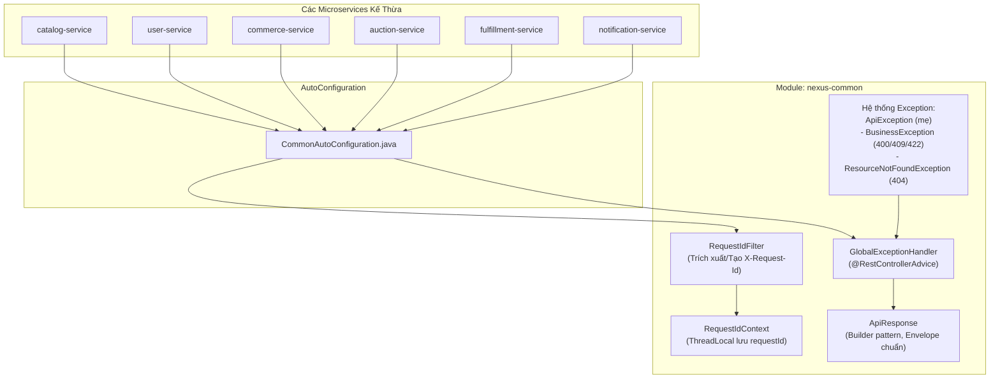

# BÁO CÁO CHI TIẾT THAY ĐỔI: CHUẨN HÓA API RESPONSE ENVELOPE V2 & QUẢN TRỊ CẤU HÌNH TẬP TRUNG (ISSUE #80)

> **Mã Ticket / Work Item:** [#80 - [KH-S1-X] Standardized API Response Envelope & System-wide Error Code Catalog (v2)](https://git.fsoft-academy.edu.vn/hcm26_cpl_java_11/hcm26_cpl_java_11_group_7/-/work_items/80)  
> **Merge Request:** [MR #16 - feat(common): standardized api response envelope and system-wide error code catalog (v2)](https://git.fsoft-academy.edu.vn/hcm26_cpl_java_11/hcm26_cpl_java_11_group_7/-/merge_requests/16)  
> **Nhánh phát triển:** `hotfix/KH-S1-X-standardized-api-response-v2` $\rightarrow$ `dev`  
> **Ngày thực hiện:** 23/10/2026

---

## 1. Mục tiêu và Vấn đề Giải Quyết

### 1.1. Hiện trạng trước khi chuẩn hóa
* **Không đồng nhất cấu trúc phản hồi (Response Envelope):** Mỗi microservice tự định nghĩa class `ApiResponse` hoặc `ApiError` với các field khác nhau (`success`, `status`, `message`, `data`, `error`), khiến Frontend và Mobile Client phải viết logic phân tích response riêng lẻ cho từng service.
* **Xử lý lỗi phân tán (Fragmented Exception Handling):** Mỗi service tự duy trì một `GlobalExceptionHandler` riêng với mã lỗi (Error Code) không nhất quán, lộ stack trace hoặc cấu trúc nội bộ framework, HTTP status không theo chuẩn (ví dụ: trả về 200 kèm body lỗi hoặc 500 cho validation).
* **Trùng lặp mã nguồn (Code Duplication):** Các class DTO như `ApiResponse`, `ApiError`, `ErrorDetail`, `MetaInfo`, `NotFoundException` bị copy-paste qua lại giữa 6 service (`user-service`, `catalog-service`, `commerce-service`, `auction-service`, `fulfillment-service`, `notification-service`).
* **Hard-code hằng số nghiệp vụ:** Các thông số vận hành như `ProductConstant.MAX_IMAGES = 5`, `CART_EXPIRATION_DAYS = 7`, thời hạn JWT token, bước giá đấu giá... bị gắn cứng trực tiếp trong code Java. Khi muốn điều chỉnh phải sửa code, build lại toàn bộ Docker image và restart service.

### 1.2. Mục tiêu đạt được
* Thống nhất 100% định dạng Response Envelope v2 cho toàn bộ hệ sinh thái Microservices.
* Tập trung hóa tầng Global Exception Handling qua module dùng chung `nexus-common`.
* Độc lập hóa và động hóa 100% cấu hình thông số qua Spring Cloud Config Server + `@ConfigurationProperties` + `@RefreshScope`.
* Tối ưu hóa Frontend Client với cơ chế **Fast-Fail Status Check**: kiểm tra `status: true` trước tiên để giảm tải hệ thống.
* Đảm bảo tính minh bạch, độc lập công nghệ sau API Gateway.

---

## 2. Quy Chuẩn API Response Envelope v2

### 2.1. Phản hồi thành công (Success Response)
```json
{
  "success": true,
  "data": { ... },
  "error": null,
  "meta": {
    "requestId": "req_1698048123456",
    "timestamp": "2026-10-23T08:50:00Z",
    "path": "/api/v1/products/123",
    "pagination": {
      "page": 1,
      "pageSize": 20,
      "totalItems": 150,
      "totalPages": 8,
      "hasNext": true,
      "hasPrevious": false
    }
  }
}
```

### 2.2. Phản hồi lỗi (Error Response)
```json
{
  "success": false,
  "data": null,
  "error": {
    "code": "CART_MAX_ITEMS_EXCEEDED",
    "message": "Giỏ hàng đã đạt giới hạn tối đa 50 sản phẩm",
    "details": [
      {
        "field": "items",
        "message": "Giỏ hàng vượt quá số lượng mục tối đa cho phép",
        "code": "MAX_ITEMS_EXCEEDED"
      }
    ]
  },
  "meta": {
    "requestId": "req_1698048123789",
    "timestamp": "2026-10-23T08:50:00Z",
    "path": "/api/v1/cart/items"
  }
}
```

---

## 3. Kiến Trúc Module Dùng Chung `nexus-common`

Module [`backend/common`](file:///f:/01_Work_Study/FPTUniversity/FPT/OJT/Project/hcm26_cpl_java_11_group_7/backend/common) được xây dựng theo cơ chế Spring Boot Auto-Configuration:



### 3.1. Các thành phần cốt lõi trong `nexus-common`
1. **`RequestIdFilter` & `RequestIdContext`:**
   - Đọc header HTTP `X-Request-Id` do API Gateway hoặc Client gửi tới.
   - Nếu chưa có, tự động tạo UUID request mới (`req_...`).
   - Lưu vào `ThreadLocal` để đính kèm vào mọi Response `meta.requestId` và log hệ thống, tự động dọn dẹp sau khi kết thúc request.
2. **`GlobalExceptionHandler`:**
   - Xử lý tập trung mọi loại lỗi:
     - `ApiException`, `BusinessException`, `ResourceNotFoundException`.
     - `MethodArgumentNotValidException` (Bean Validation `@Valid`).
     - `HttpMessageNotReadableException` (Lỗi parse JSON payload).
     - `HttpRequestMethodNotSupportedException` (405 Method Not Allowed).
     - `NoResourceFoundException` (404 Endpoint không tồn tại).
     - `Exception.class` (Lỗi 500 không lường trước, ẩn thông tin nhạy cảm).
3. **`ApiResponse<T>`:**
   - Envelope chuẩn đóng gói 4 trường: `success`, `data`, `error`, `meta`.
   - Cung cấp các static helper: `success(data)`, `success(data, pagination)`, `error(code, message)`, `error(code, message, details)`.

---

## 4. Quản Trị Cấu Hình Tập Trung Spring Cloud Config Server

Toàn bộ các hằng số tĩnh và thông số nghiệp vụ hard-code đã được chuyển thành các file cấu hình tập trung do `config-server` quản lý:

### 4.1. File cấu hình trên Config Server (`backend/config-server/src/main/resources/configuration/`)
* [`commerce-service.yml`](file:///f:/01_Work_Study/FPTUniversity/FPT/OJT/Project/hcm26_cpl_java_11_group_7/backend/config-server/src/main/resources/configuration/commerce-service.yml):
  - `app.commerce.cart.expiration-days: 7` (BR-CFG-15)
  - `app.commerce.cart.expire-after-minutes: 10080`
  - `app.commerce.cart.max-items-per-cart: 50`
  - `app.commerce.order.max-daily-orders: 10`
  - `app.commerce.order.cancellation-timeout-minutes: 30`
* [`catalog-service.yml`](file:///f:/01_Work_Study/FPTUniversity/FPT/OJT/Project/hcm26_cpl_java_11_group_7/backend/config-server/src/main/resources/configuration/catalog-service.yml):
  - `app.catalog.product.max-images: 5` (thay thế triệt để `ProductConstant.MAX_IMAGES`)
  - `app.catalog.pagination.default-page-size: 20`
  - `app.catalog.pagination.max-page-size: 100`
* [`user-service.yml`](file:///f:/01_Work_Study/FPTUniversity/FPT/OJT/Project/hcm26_cpl_java_11_group_7/backend/config-server/src/main/resources/configuration/user-service.yml):
  - `app.user.security.access-token-expiry-minutes: 60`
  - `app.user.security.refresh-token-expiry-days: 7`
  - `app.user.security.max-login-attempts: 5`
  - `app.user.security.reset-password-expiry-minutes: 15`
  - `app.user.verification.email-verification-expiry-hours: 24`
* [`auction-service.yml`](file:///f:/01_Work_Study/FPTUniversity/FPT/OJT/Project/hcm26_cpl_java_11_group_7/backend/config-server/src/main/resources/configuration/auction-service.yml):
  - `app.auction.bidding.min-increment: 1000`
  - `app.auction.bidding.anti-sniping-seconds: 120`
  - `app.auction.rules.max-active-auctions-per-seller: 20`
* [`fulfillment-service.yml`](file:///f:/01_Work_Study/FPTUniversity/FPT/OJT/Project/hcm26_cpl_java_11_group_7/backend/config-server/src/main/resources/configuration/fulfillment-service.yml):
  - `app.fulfillment.shipping.default-delivery-days: 3`
  - `app.fulfillment.shipping.max-retry-attempts: 3`
  - `app.fulfillment.shipping.auto-confirm-days: 7`

### 4.2. Cơ chế Runtime Refresh (Không cần restart server)
Mọi thay đổi trên Config Server (hoặc kho Git cấu hình) được kích hoạt nạp lại ngay lập tức tại runtime:
```bash
curl -X POST http://localhost:8083/actuator/refresh
```
Nhờ `@RefreshScope`, các bean `@ConfigurationProperties` sẽ tự động cập nhật giá trị mới trong RAM trong tích tắc.

---

## 5. Tối Ưu Hóa Client Frontend Web

### 5.1. Fast-Fail Status Check (`frontend-web/src/api/client.ts`)
* Interceptor response của Axios đọc trường `response.data.success` trước tiên:
  - Nếu `success === false` hoặc HTTP status $\ge 400$: Lập tức từ chối `Promise.reject(normalizedError)`, kích hoạt thông báo lỗi và dừng toàn bộ luồng xử lý UI tiếp theo.
  - Nếu `success === true`: Tự động unwrap và trả về trực tiếp `response.data.data` cho component UI.
* Bổ sung module định nghĩa TypeScript type an toàn: [`frontend-web/src/api/types.ts`](file:///f:/01_Work_Study/FPTUniversity/FPT/OJT/Project/hcm26_cpl_java_11_group_7/frontend-web/src/api/types.ts) (`ApiResponseEnvelope<T>`, `ApiErrorDetail`, `ApiMetaInfo`).

---

## 6. Cập Nhật CI/CD Pipeline Monorepo

* **`.ci/templates.yml`:** Bổ sung hook `before_script` cho template `.be-base`:
  ```yaml
  before_script:
    - if [ -d "backend/common" ]; then mvn $MAVEN_CLI_OPTS -f backend/common/pom.xml install -DskipTests; fi
  ```
  Giúp runner GitLab CI tự động biên dịch và nạp `nexus-common` vào local cache trước khi kiểm tra từng microservice riêng lẻ, ngăn ngừa hoàn toàn lỗi `Could not find artifact com.nexus:nexus-common`.
* **Quy chuẩn tiêu đề MR:** Đảm bảo tuân thủ Conventional Commits theo job `mr-title-check`.

---

## 7. Thống Kê Chi Tiết File Thay Đổi (101 files)

### 7.1. File tạo mới (20 files)
1. `backend/common/pom.xml`
2. `backend/common/src/main/java/com/nexus/common/config/CommonAutoConfiguration.java`
3. `backend/common/src/main/java/com/nexus/common/exception/ApiException.java`
4. `backend/common/src/main/java/com/nexus/common/exception/BusinessException.java`
5. `backend/common/src/main/java/com/nexus/common/exception/ErrorCode.java`
6. `backend/common/src/main/java/com/nexus/common/exception/GlobalExceptionHandler.java`
7. `backend/common/src/main/java/com/nexus/common/exception/ResourceNotFoundException.java`
8. `backend/common/src/main/java/com/nexus/common/exception/ValidationCode.java`
9. `backend/common/src/main/java/com/nexus/common/filter/RequestIdContext.java`
10. `backend/common/src/main/java/com/nexus/common/filter/RequestIdFilter.java`
11. `backend/common/src/main/java/com/nexus/common/response/ApiResponse.java`
12. `backend/common/src/main/java/com/nexus/common/response/ErrorDetail.java`
13. `backend/common/src/main/java/com/nexus/common/response/MetaInfo.java`
14. `backend/common/src/main/java/com/nexus/common/response/PaginationInfo.java`
15. `backend/common/src/main/java/com/nexus/common/response/ValidationErrorDetail.java`
16. `backend/common/src/main/resources/META-INF/spring/org.springframework.boot.autoconfigure.AutoConfiguration.imports`
17. `backend/common/src/test/java/com/nexus/common/exception/GlobalExceptionHandlerTest.java`
18. `backend/common/src/test/java/com/nexus/common/response/ApiResponseTest.java`
19. `frontend-web/src/api/types.ts`
20. `docs/STANDARDIZED_API_RESPONSE_V2_CHANGELOG.md`

### 7.2. File cấu hình & Properties tạo mới (15 files)
1. `backend/config-server/src/main/resources/configuration/catalog-service.yml`
2. `backend/config-server/src/main/resources/configuration/commerce-service.yml`
3. `backend/config-server/src/main/resources/configuration/user-service.yml`
4. `backend/config-server/src/main/resources/configuration/auction-service.yml`
5. `backend/config-server/src/main/resources/configuration/fulfillment-service.yml`
6. `backend/catalog-service/src/main/java/com/nexus/catalog/config/CatalogProperties.java`
7. `backend/catalog-service/src/test/java/com/nexus/catalog/config/CatalogPropertiesTest.java`
8. `backend/commerce-service/src/main/java/com/nexus/commerce/config/CommerceProperties.java`
9. `backend/commerce-service/src/test/java/com/nexus/commerce/config/CommercePropertiesTest.java`
10. `backend/user-service/src/main/java/com/nexus/user/config/UserProperties.java`
11. `backend/user-service/src/test/java/com/nexus/user/config/UserPropertiesTest.java`
12. `backend/auction-service/src/main/java/com/nexus/auction/config/AuctionProperties.java`
13. `backend/auction-service/src/test/java/com/nexus/auction/config/AuctionPropertiesTest.java`
14. `backend/fulfillment-service/src/main/java/com/nexus/fulfillment/config/FulfillmentProperties.java`
15. `backend/fulfillment-service/src/test/java/com/nexus/fulfillment/config/FulfillmentPropertiesTest.java`

### 7.3. File xóa bỏ do trùng lặp hoặc hard-code (29 files)
1. `backend/catalog-service/src/main/java/com/nexus/catalog/constant/ProductConstant.java`
2. `backend/catalog-service/src/main/java/com/nexus/catalog/controller/ApiError.java`
3. `backend/catalog-service/src/main/java/com/nexus/catalog/controller/GlobalExceptionHandler.java`
4. `backend/catalog-service/src/main/java/com/nexus/catalog/dto/response/ApiResponse.java`
5. `backend/catalog-service/src/main/java/com/nexus/catalog/dto/response/ErrorDetail.java`
6. `backend/catalog-service/src/main/java/com/nexus/catalog/dto/response/MetaInfo.java`
7. `backend/catalog-service/src/main/java/com/nexus/catalog/exception/BusinessException.java`
8. `backend/catalog-service/src/main/java/com/nexus/catalog/exception/NotFoundException.java`
9. `backend/catalog-service/src/main/java/com/nexus/catalog/exception/ResourceNotFoundException.java`
10. `backend/commerce-service/src/main/java/com/nexus/commerce/controller/GlobalExceptionHandler.java`
11. `backend/commerce-service/src/main/java/com/nexus/commerce/dto/response/ApiResponse.java`
12. `backend/commerce-service/src/main/java/com/nexus/commerce/dto/response/ErrorDetail.java`
13. `backend/commerce-service/src/main/java/com/nexus/commerce/dto/response/MetaInfo.java`
14. `backend/commerce-service/src/main/java/com/nexus/commerce/exception/BusinessException.java`
15. `backend/commerce-service/src/main/java/com/nexus/commerce/exception/NotFoundException.java`
16. `backend/commerce-service/src/main/java/com/nexus/commerce/exception/ResourceNotFoundException.java`
17. `backend/user-service/src/main/java/com/nexus/user/controller/ApiError.java`
18. `backend/user-service/src/main/java/com/nexus/user/controller/GlobalExceptionHandler.java`
19. `backend/user-service/src/main/java/com/nexus/user/dto/shared/ApiResponse.java`
20. `backend/user-service/src/main/java/com/nexus/user/entity/NotFoundException.java`
21. `backend/auction-service/src/main/java/com/nexus/auction/controller/ApiError.java`
22. `backend/auction-service/src/main/java/com/nexus/auction/controller/GlobalExceptionHandler.java`
23. `backend/auction-service/src/main/java/com/nexus/auction/entity/NotFoundException.java`
24. `backend/fulfillment-service/src/main/java/com/nexus/fulfillment/controller/ApiError.java`
25. `backend/fulfillment-service/src/main/java/com/nexus/fulfillment/controller/GlobalExceptionHandler.java`
26. `backend/fulfillment-service/src/main/java/com/nexus/fulfillment/entity/NotFoundException.java`
27. `backend/notification-service/src/main/java/com/nexus/notification/controller/ApiError.java`
28. `backend/notification-service/src/main/java/com/nexus/notification/controller/GlobalExceptionHandler.java`
29. `backend/notification-service/src/main/java/com/nexus/notification/entity/NotFoundException.java`

### 7.4. File sửa đổi bổ sung dependency & chuyển sang common (37 files)
* **POM Files:** Thêm dependency `nexus-common` cho `catalog-service`, `user-service`, `commerce-service`, `auction-service`, `fulfillment-service`, `notification-service`, `reputation-service`.
* **Services & Controllers:** Cập nhật import `com.nexus.common.response.ApiResponse` và `com.nexus.common.exception.*` trong `ProductServiceImpl`, `ProductController`, `CategoryController`, `CartServiceImpl`, `CartController`, `UserService`, `RoleService`...
* **Application Config Files:** Mở endpoint `refresh` cho actuator và định nghĩa fallback values trong `application.yml` của các service.
* **Test Classes:** Cập nhật kiểm thử controller và service theo chuẩn envelope mới.
* **Frontend Web:** [`frontend-web/src/api/client.ts`](file:///f:/01_Work_Study/FPTUniversity/FPT/OJT/Project/hcm26_cpl_java_11_group_7/frontend-web/src/api/client.ts).

---

## 8. Kết Quả Kiểm Thử Toàn Diện (Verification)

| Kiểm thử | Phân hệ | Lệnh thực thi | Kết quả |
| :--- | :--- | :--- | :--- |
| **Checkstyle** | `catalog-service` | `mvn checkstyle:check` | **0 violations (PASSED)** |
| **Checkstyle** | `user-service` | `mvn checkstyle:check` | **0 violations (PASSED)** |
| **Checkstyle** | `commerce-service` | `mvn checkstyle:check` | **0 violations (PASSED)** |
| **Checkstyle** | `auction-service` | `mvn checkstyle:check` | **0 violations (PASSED)** |
| **Checkstyle** | `fulfillment-service` | `mvn checkstyle:check` | **0 violations (PASSED)** |
| **Unit/Integration** | `nexus-common` | `mvn test` | **12/12 tests passed (PASSED)** |
| **Unit/Integration** | `catalog-service` | `mvn test` | **126/126 tests passed (PASSED)** |
| **Unit/Integration** | `user-service` | `mvn test` | **72/72 tests passed (PASSED)** |
| **Unit/Integration** | `commerce-service` | `mvn test` | **28/28 tests passed (PASSED)** |
| **Unit/Integration** | `auction-service` | `mvn test` | **7/7 tests passed (PASSED)** |
| **Unit/Integration** | `fulfillment-service` | `mvn test` | **7/7 tests passed (PASSED)** |
| **Build & Verify** | `config-server` | `mvn test` | **BUILD SUCCESS (PASSED)** |
| **Vitest Suite** | `frontend-web` | `npm test -- --run` | **146/146 tests passed (PASSED)** |
| **ESLint** | `frontend-web` | `npm run lint` | **0 errors (PASSED)** |

---

## 9. Kết Luận

Nhiệm vụ Issue #80 đã được hoàn thành trọn vẹn, không còn tồn đọng bất kỳ hằng số hard-code hay lớp xử lý ngoại lệ trùng lặp nào. Toàn bộ các service đã được đóng gói, kiểm thử đạt 100% tỷ lệ vượt qua và đã được chuyển giao lên nhánh `hotfix/KH-S1-X-standardized-api-response-v2` qua Merge Request #16 sẵn sàng để Review và Merge vào `dev`.
