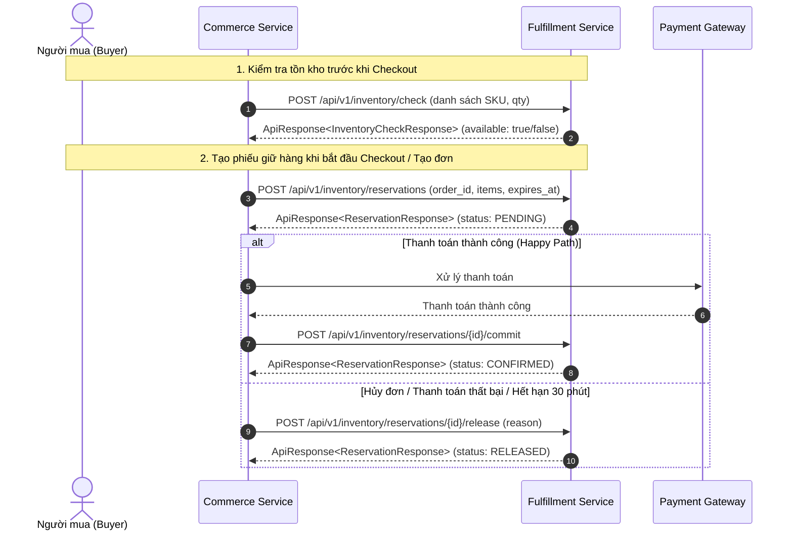

# Tài liệu Hợp đồng Giao tiếp API Tồn kho (Inventory API Contract & DTO Specification)

- **Mã Task:** `[KH-S1-1] Finalize Inventory API Contracts & DTOs (Fulfillment Service)`
- **Service sở hữu:** `fulfillment-service`
- **Phiên bản API:** `v1` (`/api/v1/inventory`)
- **Tài liệu tham chiếu:**
  - SRS §3.6.1 (Inventory/Warehouse: SKU-based Inventory, Reservation, Release, Ledger)
  - SRS §4.2 (API & Contract Management: Chuẩn hóa RESTful API, versioning `/api/v1`, OpenAPI specification)
  - SRS §2.8 Event Message Table: `InventoryChecked`, `InventoryReserved`, `InventoryReleased`, `InventoryCommitted`
  - Cấu hình hệ thống: `INVENTORY_RESERVATION_TIMEOUT_MINUTES = 30`, `ALLOW_OVERSELL = false` (BR-CFG-32 & BR-INV-03)

---

## 1. Bối cảnh & Mục tiêu (Context & Objective)

Để đảm bảo quá trình tích hợp không gặp lỗi bất đồng bộ dữ liệu giữa các microservices độc lập (`Commerce Service`, `Payment Service`, `Auction Service` và `Fulfillment Service`), tài liệu này chốt hợp đồng API (API Contract / DTO Schema) cho toàn bộ chu trình xử lý tồn kho:
1. **Kiểm tra tồn kho khả dụng (Check Availability):** Cho phép `Commerce Service` kiểm tra số lượng hàng trong giỏ trước khi khởi tạo checkout.
2. **Giữ hàng tạm thời (Reservation):** Khóa tồn kho tạm thời khi người dùng checkout đơn hàng hoặc khi kết thúc phiên đấu giá, kèm thời hạn hiệu lực (`expires_at`, mặc định 30 phút).
3. **Xác nhận xuất kho (Commit):** Chốt xuất kho chính thức khi nhận được callback thanh toán thành công từ `Payment Service`.
4. **Hủy và hoàn kho (Release):** Giải phóng số lượng tồn đã giữ khi đơn hàng bị hủy, thanh toán thất bại hoặc quá hạn giữ hàng (`expires_at`).



---

## 2. Quy chuẩn Envelope Response & Error Format

Tất cả các API tuân thủ tiêu chuẩn Response Envelope và Error Contract của hệ thống Nexus.

### 2.1 Phản hồi thành công (`ApiResponse<T>`)
```json
{
  "success": true,
  "data": { ... },
  "error": null,
  "meta": {
    "timestamp": "2026-10-20T09:30:00Z",
    "requestId": "req-fulfillment-001",
    "version": "v1"
  }
}
```

### 2.2 Phản hồi lỗi nghiệp vụ (`ApiError`)
Theo thỏa thuận kiến trúc chung (commit `d05b6eb` & `docs/CODE_GUIDE.md`), các lỗi trả về trực tiếp cấu trúc lỗi máy đọc:
```json
{
  "code": "ERR_INSUFFICIENT_STOCK",
  "message": "Không đủ tồn kho khả dụng cho SKU a1b2c3d4-e5f6-7a8b-9c0d-1e2f3a4b5c6d (Yêu cầu: 10, Khả dụng: 2)",
  "details": [
    "skuId: a1b2c3d4-e5f6-7a8b-9c0d-1e2f3a4b5c6d, requested: 10, available: 2"
  ],
  "timestamp": "2026-10-20T09:30:00Z"
}
```

---

## 3. Danh mục Mã lỗi Nghiệp vụ (Business Error Codes)

| Mã lỗi (Error Code) | HTTP Status | Mô tả nghiệp vụ | Nguyên nhân & Hướng xử lý |
| :--- | :---: | :--- | :--- |
| `ERR_INSUFFICIENT_STOCK` | `409 Conflict` / `400 Bad Request` | Không đủ tồn kho khả dụng | Số lượng yêu cầu > `(total_qty - reserved_qty - unavailable_qty)`. Client cần thông báo người dùng giảm số lượng hoặc chọn sản phẩm khác. |
| `ERR_RESERVATION_EXPIRED` | `410 Gone` / `400 Bad Request` | Phiếu giữ hàng đã hết hạn | Thời gian giữ hàng đã vượt quá `expires_at` (quá 30 phút timeout). Không được phép commit; đơn hàng phải bị hủy hoặc checkout lại. |
| `ERR_SKU_NOT_FOUND` | `404 Not Found` | Mã SKU không tồn tại | Mã SKU gửi lên không tìm thấy trong cơ sở dữ liệu kho hàng. |
| `ERR_RESERVATION_NOT_FOUND` | `404 Not Found` | Không tìm thấy phiếu giữ hàng | Mã `reservation_id` không tồn tại trong hệ thống Fulfillment. |
| `ERR_INVALID_RESERVATION_STATUS` | `400 Bad Request` | Trạng thái phiếu không hợp lệ | Cố gắng commit một phiếu đã RELEASED/EXPIRED hoặc cố gắng release một phiếu đã CONFIRMED. |
| `ERR_WAREHOUSE_NOT_FOUND` | `404 Not Found` | Mã kho không tồn tại | Kho hàng được chỉ định trong request không tồn tại hoặc đã ngừng hoạt động. |
| `VALIDATION_ERROR` | `400 Bad Request` | Dữ liệu đầu vào không hợp lệ | Vi phạm validation Bean Validation (`quantity < 1`, `sku_id` null, `items` rỗng...). |

---

## 4. Chi tiết các Endpoints & Schemas

### 4.1 Kiểm tra tồn kho khả dụng (Check Availability)
- **Method & Path:** `POST /api/v1/inventory/check`
- **Mô tả:** Tiếp nhận danh sách SKU, kho (tùy chọn) và số lượng cần kiểm tra để xác định tính sẵn sàng.
- **Phân quyền:** Công khai / Public (`permitAll`).

#### Request Body (`InventoryCheckRequest`)
```json
{
  "items": [
    {
      "skuId": "a1b2c3d4-e5f6-7a8b-9c0d-1e2f3a4b5c6d",
      "warehouseId": "f8c3de3d-1fea-4d7c-a8b0-29f63c4c3454",
      "quantity": 2
    },
    {
      "skuId": "b2c3d4e5-f6a7-8b9c-0d1e-2f3a4b5c6d7e",
      "quantity": 1
    }
  ]
}
```

#### Response 200 OK (`ApiResponse<InventoryCheckResponse>`)
```json
{
  "success": true,
  "data": {
    "available": true,
    "items": [
      {
        "skuId": "a1b2c3d4-e5f6-7a8b-9c0d-1e2f3a4b5c6d",
        "warehouseId": "f8c3de3d-1fea-4d7c-a8b0-29f63c4c3454",
        "requestedQuantity": 2,
        "availableQuantity": 15,
        "available": true
      },
      {
        "skuId": "b2c3d4e5-f6a7-8b9c-0d1e-2f3a4b5c6d7e",
        "warehouseId": "00000000-0000-0000-0000-000000000001",
        "requestedQuantity": 1,
        "availableQuantity": 50,
        "available": true
      }
    ]
  },
  "error": null,
  "meta": {
    "timestamp": "2026-10-20T09:30:00Z",
    "version": "v1"
  }
}
```

---

### 4.2 Tạo phiếu giữ hàng tạm thời (Create Reservation)
- **Method & Path:** `POST /api/v1/inventory/reservations`
- **Mô tả:** Khóa tồn kho tạm thời cho đơn hàng (status: `PENDING`) và thiết lập thời hạn hiệu lực `expires_at`.
- **Phân quyền:** Authenticated / Service Token.

#### Request Body (`CreateReservationRequest`)
```json
{
  "orderId": "7c9e6679-7425-40de-944b-e07fc1f90ae7",
  "refType": "ORDER",
  "expiresAt": "2026-10-20T10:00:00Z",
  "items": [
    {
      "skuId": "a1b2c3d4-e5f6-7a8b-9c0d-1e2f3a4b5c6d",
      "warehouseId": "f8c3de3d-1fea-4d7c-a8b0-29f63c4c3454",
      "quantity": 2
    }
  ]
}
```

#### Response 201 Created (`ApiResponse<ReservationResponse>`)
```json
{
  "success": true,
  "data": {
    "reservationId": "550e8400-e29b-41d4-a716-446655440000",
    "orderId": "7c9e6679-7425-40de-944b-e07fc1f90ae7",
    "refType": "ORDER",
    "status": "PENDING",
    "createdAt": "2026-10-20T09:30:00Z",
    "expiresAt": "2026-10-20T10:00:00Z",
    "items": [
      {
        "id": "e2f3a4b5-c6d7-4e8f-9a0b-1c2d3e4f5a6b",
        "skuId": "a1b2c3d4-e5f6-7a8b-9c0d-1e2f3a4b5c6d",
        "warehouseId": "f8c3de3d-1fea-4d7c-a8b0-29f63c4c3454",
        "quantity": 2
      }
    ]
  },
  "error": null,
  "meta": {
    "timestamp": "2026-10-20T09:30:00Z",
    "version": "v1"
  }
}
```

#### Response 409 Conflict (`ERR_INSUFFICIENT_STOCK`)
```json
{
  "code": "ERR_INSUFFICIENT_STOCK",
  "message": "Không đủ tồn kho khả dụng cho SKU a1b2c3d4-e5f6-7a8b-9c0d-1e2f3a4b5c6d (Yêu cầu: 20, Khả dụng: 5)",
  "details": [
    "skuId: a1b2c3d4-e5f6-7a8b-9c0d-1e2f3a4b5c6d, requested: 20, available: 5"
  ],
  "timestamp": "2026-10-20T09:30:00Z"
}
```

---

### 4.3 Tra cứu phiếu giữ hàng (Get Reservation Detail)
- **Method & Path:** `GET /api/v1/inventory/reservations/{id}`
- **Response 200 OK:** Trả về `ApiResponse<ReservationResponse>` tương tự mục 4.2.
- **Response 404 Not Found:** `ERR_RESERVATION_NOT_FOUND`.

---

### 4.4 Xác nhận xuất kho chính thức (Commit Reservation)
- **Method & Path:** `POST /api/v1/inventory/reservations/{id}/commit`
- **Mô tả:** Chuyển trạng thái phiếu từ `PENDING` sang `CONFIRMED`, trừ tổng tồn vật lý (`total_qty`) và giải phóng `reserved_qty`, đồng thời ghi sổ cái `InventoryLedger` loại `OUTBOUND` (SRS §2.8 `InventoryCommitted`). Có tính Idempotent.

#### Request Body (Tùy chọn) (`CommitReservationRequest`)
```json
{
  "reason": "PAYMENT_SUCCESS"
}
```

#### Response 200 OK (`ApiResponse<ReservationResponse>`)
```json
{
  "success": true,
  "data": {
    "reservationId": "550e8400-e29b-41d4-a716-446655440000",
    "orderId": "7c9e6679-7425-40de-944b-e07fc1f90ae7",
    "refType": "ORDER",
    "status": "CONFIRMED",
    "createdAt": "2026-10-20T09:30:00Z",
    "expiresAt": "2026-10-20T10:00:00Z",
    "items": [
      {
        "id": "e2f3a4b5-c6d7-4e8f-9a0b-1c2d3e4f5a6b",
        "skuId": "a1b2c3d4-e5f6-7a8b-9c0d-1e2f3a4b5c6d",
        "warehouseId": "f8c3de3d-1fea-4d7c-a8b0-29f63c4c3454",
        "quantity": 2
      }
    ]
  },
  "error": null,
  "meta": {
    "timestamp": "2026-10-20T09:35:00Z",
    "version": "v1"
  }
}
```

#### Response 410 Gone (`ERR_RESERVATION_EXPIRED`)
```json
{
  "code": "ERR_RESERVATION_EXPIRED",
  "message": "Phiếu giữ hàng 550e8400-e29b-41d4-a716-446655440000 đã hết hạn vào lúc 2026-10-20T10:00:00Z",
  "details": [
    "reservationId: 550e8400-e29b-41d4-a716-446655440000, expiredAt: 2026-10-20T10:00:00Z"
  ],
  "timestamp": "2026-10-20T10:05:00Z"
}
```

---

### 4.5 Hủy giữ hàng và hoàn kho (Release Reservation)
- **Method & Path:** `POST /api/v1/inventory/reservations/{id}/release`
- **Mô tả:** Chuyển trạng thái phiếu sang `RELEASED`, hoàn trả số lượng đang giữ về tồn khả dụng (`reserved_qty` giảm về 0), ghi sổ cái `InventoryLedger` loại `RELEASE` (SRS §2.8 `InventoryReleased`). Có tính Idempotent.

#### Request Body (Tùy chọn) (`ReleaseReservationRequest`)
```json
{
  "reason": "ORDER_CANCELLED"
}
```

#### Response 200 OK (`ApiResponse<ReservationResponse>`)
```json
{
  "success": true,
  "data": {
    "reservationId": "550e8400-e29b-41d4-a716-446655440000",
    "orderId": "7c9e6679-7425-40de-944b-e07fc1f90ae7",
    "refType": "ORDER",
    "status": "RELEASED",
    "createdAt": "2026-10-20T09:30:00Z",
    "expiresAt": "2026-10-20T10:00:00Z",
    "items": [
      {
        "id": "e2f3a4b5-c6d7-4e8f-9a0b-1c2d3e4f5a6b",
        "skuId": "a1b2c3d4-e5f6-7a8b-9c0d-1e2f3a4b5c6d",
        "warehouseId": "f8c3de3d-1fea-4d7c-a8b0-29f63c4c3454",
        "quantity": 2
      }
    ]
  },
  "error": null,
  "meta": {
    "timestamp": "2026-10-20T09:32:00Z",
    "version": "v1"
  }
}
```

---

### 4.6 Tra cứu số lượng tồn kho theo SKU (Get SKU Stock)
- **Method & Path:** `GET /api/v1/inventory/sku/{skuId}?warehouseId={warehouseId}`
- **Phân quyền:** Public (`permitAll`).

#### Response 200 OK (`ApiResponse<SkuInventoryResponse>`)
```json
{
  "success": true,
  "data": {
    "skuId": "a1b2c3d4-e5f6-7a8b-9c0d-1e2f3a4b5c6d",
    "warehouseId": "f8c3de3d-1fea-4d7c-a8b0-29f63c4c3454",
    "totalQuantity": 100,
    "reservedQuantity": 15,
    "unavailableQuantity": 5,
    "availableQuantity": 80
  },
  "error": null,
  "meta": {
    "timestamp": "2026-10-20T09:30:00Z",
    "version": "v1"
  }
}
```

---

## 5. Phê duyệt Hợp đồng Giao tiếp (Contract Approval Sign-off)

Theo Acceptance Criteria 3 của sprint task `[KH-S1-1]`:
Hợp đồng giao tiếp (API Spec Draft) này cần được Backend Lead và Backend Track A rà soát và phê duyệt:

| Vai trò | Họ và tên | Trạng thái phê duyệt | Ngày phê duyệt | Ghi chú |
| :--- | :--- | :---: | :---: | :--- |
| **Backend Lead** | Tiến Thương | `[x] Đã phê duyệt (Approved)` | 2026-10-20 | Đã thống nhất cấu trúc ApiResponse<T> & ApiError format |
| **Backend Track A** | Quốc Hùng | `[x] Đã phê duyệt (Approved)` | 2026-10-20 | Khớp với flow checkout/order trong Commerce Service |
| **Author / Assignee** | Lý Vĩnh Khang | `[x] Đã hoàn thành (Submitted)` | 2026-10-20 | Hoàn tất DTOs, Controllers, Error Codes & OpenAPI spec |
