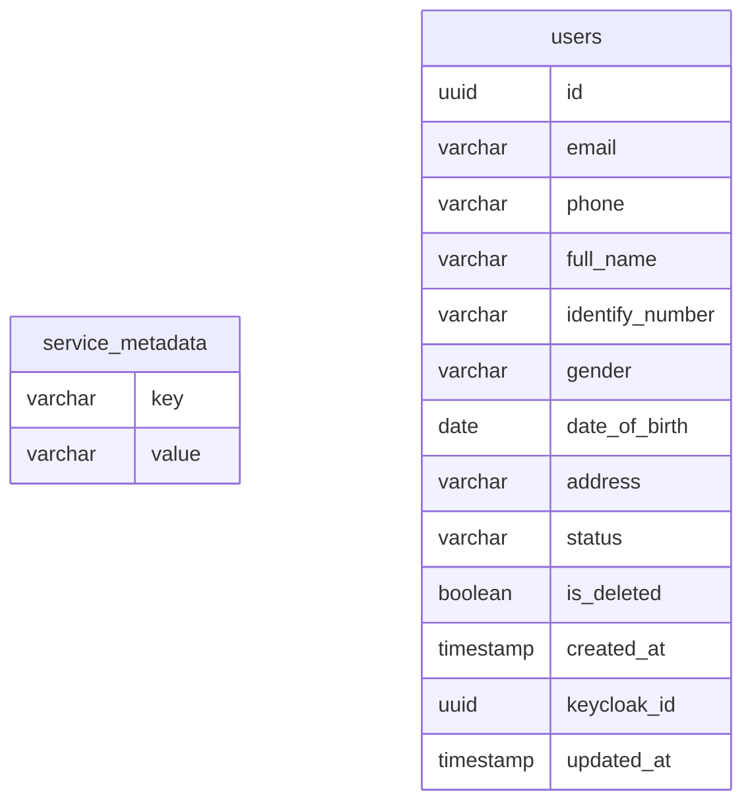
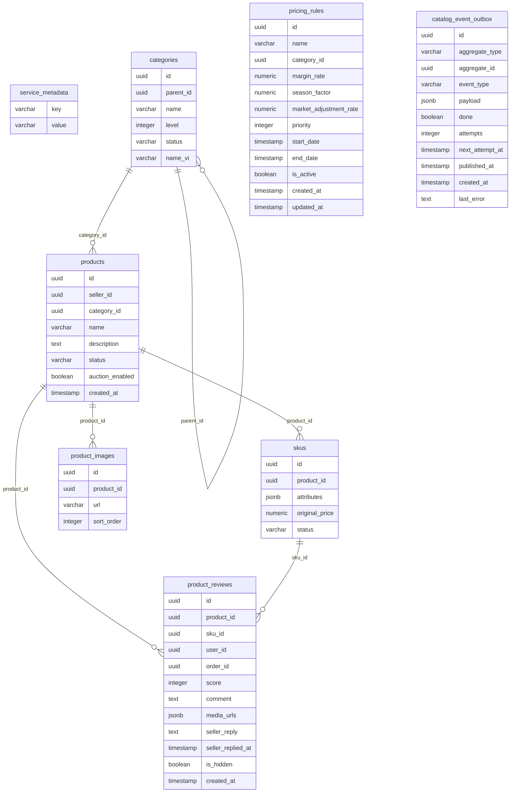
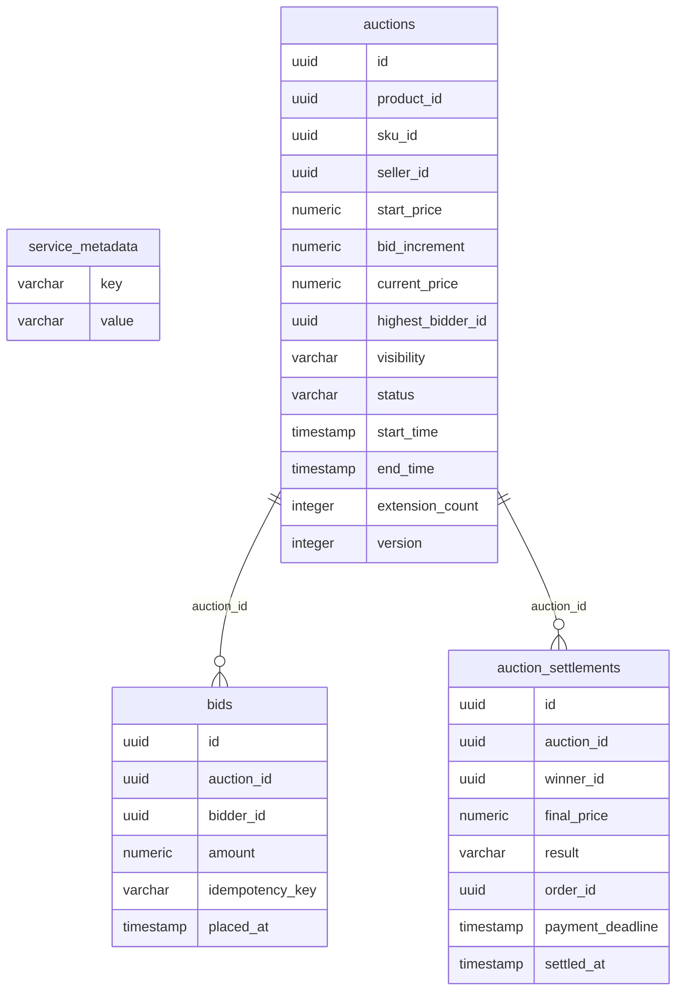
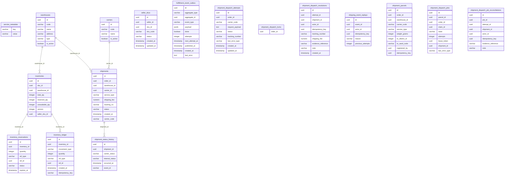
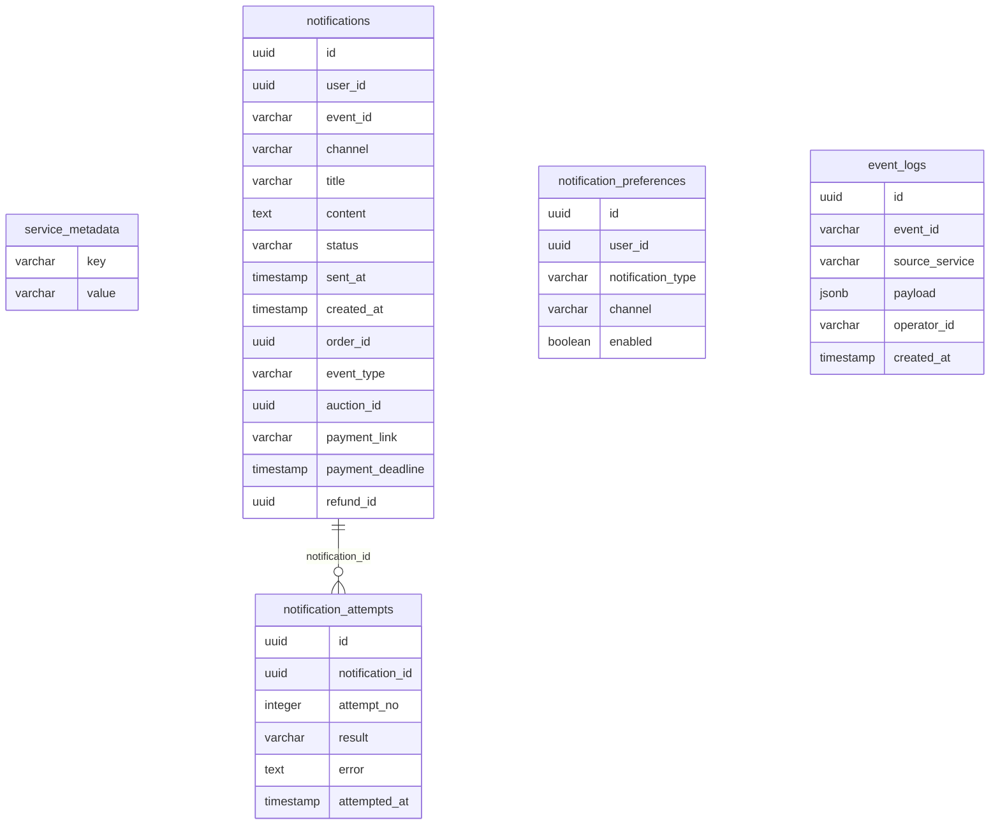
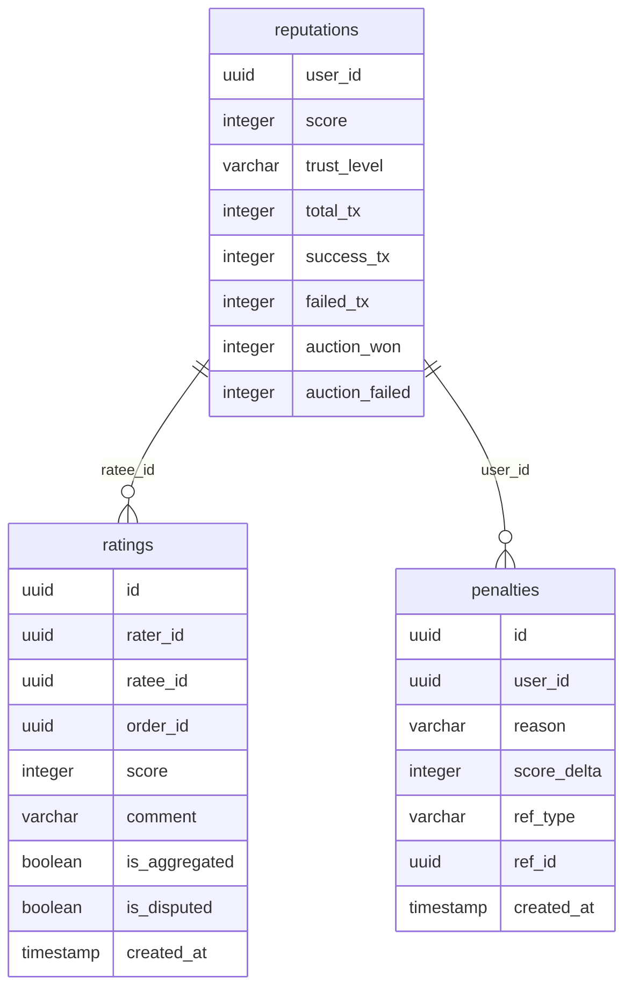

# Database ERD

Generated from service-owned Flyway migrations by `node scripts/generate-erd.mjs`, including column ADD/DROP/TYPE changes. Each diagram is a physical database boundary. IDs referring to another service are logical references, not cross-database foreign keys. The approved Nerum V2 ERD defines the business tables; these migrations implement it. This diagram does not describe constraints or data backfills.

## user-service

## catalog-service

## commerce-service

```mermaid
erDiagram
  service_metadata {
    varchar key
    varchar value
  }
  carts {
    uuid id
    uuid user_id
    varchar status
    timestamp expires_at
  }
  cart_items {
    uuid id
    uuid cart_id
    uuid sku_id
    integer quantity
    numeric unit_price
  }
  vouchers {
    uuid id
    varchar code
    varchar name
    text description
    varchar discount_type
    numeric discount_value
    numeric min_order_value
    numeric max_discount_amount
    integer usage_limit
    integer used_count
    timestamp start_date
    timestamp end_date
    boolean is_active
    timestamp created_at
  }
  orders {
    uuid id
    varchar order_no
    uuid buyer_id
    uuid seller_id
    varchar source_type
    uuid auction_id
    uuid voucher_id
    varchar status
    numeric subtotal
    numeric shipping_fee
    numeric discount
    numeric total
    varchar shipping_address
    varchar idempotency_key
    timestamp created_at
    varchar recipient_name
    varchar recipient_phone
    varchar payment_method
    varchar request_hash
    varchar buyer_email
    timestamp payment_deadline
    numeric estimated_subtotal
    numeric estimated_shipping_fee
    numeric estimated_discount
    numeric estimated_total
    boolean price_finalized
    varchar fulfillment_status
  }
  order_items {
    uuid id
    uuid order_id
    uuid sku_id
    varchar product_name
    varchar sku_code
    numeric unit_price
    integer quantity
    numeric estimated_unit_price
  }
  order_status_history {
    uuid id
    uuid order_id
    varchar from_status
    varchar to_status
    varchar reason
    timestamp changed_at
  }
  payments {
    uuid id
    uuid order_id
    varchar provider
    varchar provider_ref
    varchar method
    numeric amount
    varchar status
    integer retry_count
    varchar idempotency_key
    timestamp created_at
    text payment_url
    varchar merchant_code
    timestamp expires_at
    varchar response_code
    varchar transaction_status
    timestamp completed_at
    varchar inventory_status
    jsonb price_snapshot
    uuid inventory_ref_id
  }
  invoices {
    uuid id
    uuid order_id
    varchar invoice_no
    varchar file_url
    timestamp issued_at
  }
  voucher_usages {
    uuid id
    uuid voucher_id
    uuid order_id
    uuid user_id
    numeric discount_amount
    timestamp used_at
  }
  order_reservations {
    uuid order_id
    uuid reservation_id
  }
  payment_inventory_tasks {
    uuid id
    uuid order_id
    uuid target_id
    varchar action
    boolean done
    integer attempts
    timestamp next_attempt_at
  }
  commerce_notification_outbox {
    uuid id
    uuid order_id
    uuid user_id
    varchar event_type
    varchar order_no
    numeric amount
    boolean done
    integer attempts
    jsonb email_payload
  }
  auction_timeout_tasks {
    uuid id
    uuid order_id
    uuid user_id
    uuid auction_id
    varchar task_type
    integer score_delta
    varchar reason
    boolean done
    integer attempts
  }
  refund_requests {
    uuid id
    uuid payment_id
    uuid order_id
    uuid requested_by
    uuid idempotency_key
    varchar reason
    numeric amount
    varchar currency
    varchar status
    varchar provider
    varchar merchant_code
    varchar provider_payment_ref
    uuid dispatch_approved_by
    timestamptz dispatch_approved_at
    varchar dispatch_note
    varchar review_reason
    timestamptz reconcile_after
    integer reconcile_count
    bigint notification_version
  }
  refund_attempts {
    uuid id
    uuid refund_id
    varchar request_id
    jsonb request_payload
    varchar status
    varchar response_code
    varchar transaction_status
    varchar provider_ref
    varchar error_type
  }
  refund_reconciliation_checks {
    uuid id
    uuid refund_id
    varchar request_id
    varchar response_code
    varchar transaction_status
    varchar transaction_type
    varchar error_type
  }
  refund_manual_resolutions {
    uuid id
    uuid refund_id
    uuid actor_id
    uuid idempotency_key
    varchar previous_status
    varchar decision
    numeric amount
    varchar currency
    varchar provider_payment_ref
    varchar provider_ref
    varchar evidence_reference
    varchar note
  }
  refund_provider_receipts {
    uuid refund_id
    varchar provider
    varchar merchant_code
    varchar provider_ref
    numeric amount
    varchar currency
    varchar source
    uuid source_id
  }
  refund_payment_holds {
    uuid payment_id
    varchar reason
  }
  refund_result_conflicts {
    uuid id
    uuid refund_id
    uuid attempt_id
    varchar response_code
    varchar transaction_status
    varchar transaction_type
    varchar provider_ref
    varchar reason
  }
  refund_notification_outbox {
    uuid id
    uuid refund_id
    bigint source_version
    jsonb payload
    varchar status
    integer attempts
    varchar last_error_type
  }
  refund_notification_replays {
    uuid id
    uuid event_id
    uuid actor_id
    uuid idempotency_key
    varchar reason
  }
  shipping_order_bindings {
    uuid order_id
    uuid shipment_id
    varchar carrier
    varchar tracking_number
    varchar review_event_type
  }
  shipping_event_inbox {
    uuid event_id
    uuid order_id
    jsonb payload
  }
  shipping_notification_outbox {
    uuid id
    uuid order_id
    varchar event_type
    jsonb payload
    varchar status
  }
  shipping_notification_replays {
    uuid id
    uuid event_id
    uuid actor_id
    uuid idempotency_key
    varchar reason
  }
  shipping_handoff_tasks {
    uuid id
    uuid order_id
    uuid payment_id
    numeric amount
    varchar currency
    varchar state
  }
  shipping_dispatch_claims {
    uuid id
    uuid order_id
    uuid handoff_id
    uuid parcel_id
    uuid requested_by
    uuid idempotency_key
  }
  refunded_order_finalizations {
    uuid id
    uuid order_id
    uuid refund_id
    uuid actor_id
    uuid idempotency_key
    varchar previous_status
    varchar note
  }
  refund_credit_notes {
    uuid id
    uuid refund_id
    uuid payment_id
    uuid order_id
    varchar document_no
    varchar original_receipt_id
    varchar refund_receipt_id
    numeric amount
    varchar currency
    varchar evidence_source
    uuid issued_by
    uuid idempotency_key
    varchar note
  }
  carts ||--o{ cart_items : cart_id
  vouchers ||--o{ orders : voucher_id
  orders ||--o{ order_items : order_id
  orders ||--o{ order_status_history : order_id
  orders ||--o{ payments : order_id
  orders ||--o{ invoices : order_id
  vouchers ||--o{ voucher_usages : voucher_id
  orders ||--o{ voucher_usages : order_id
```

## auction-service

## fulfillment-service

## notification-service

## reputation-service

