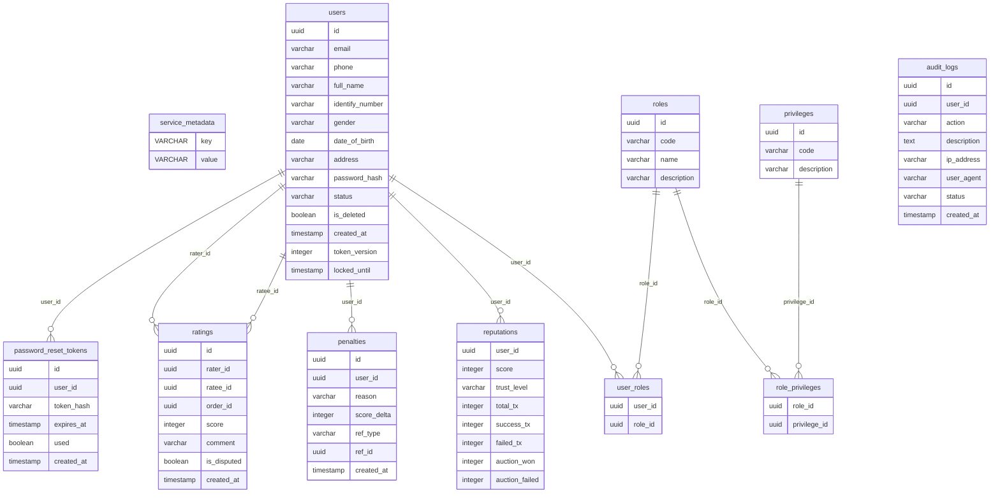
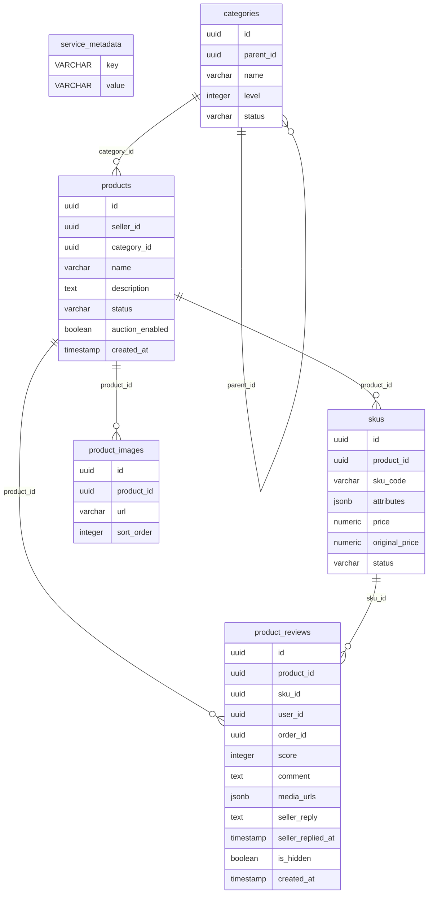
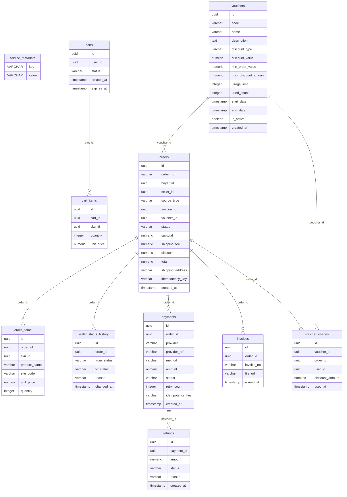
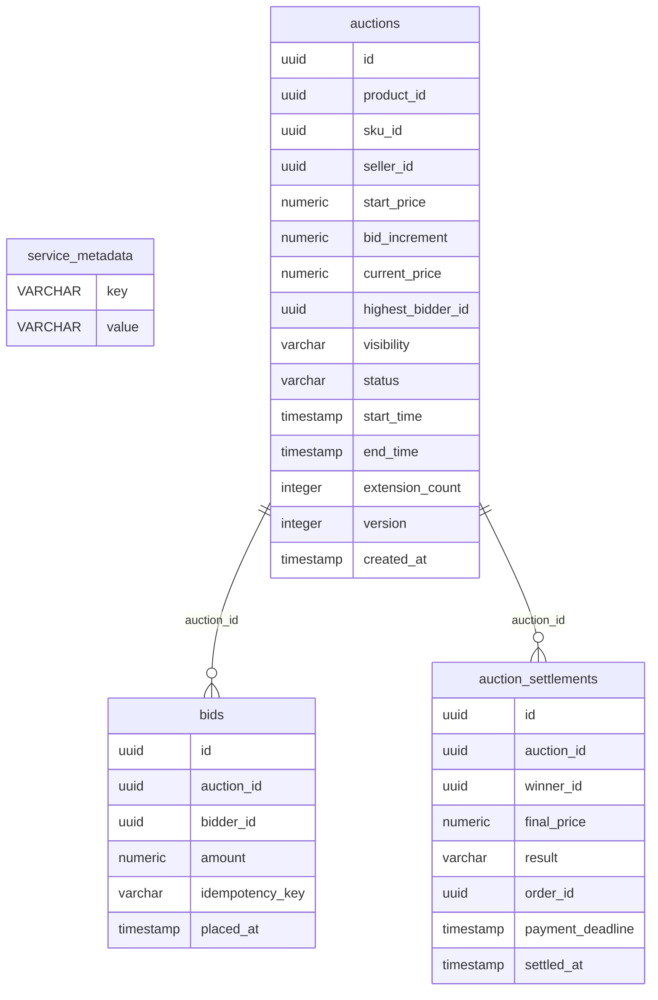
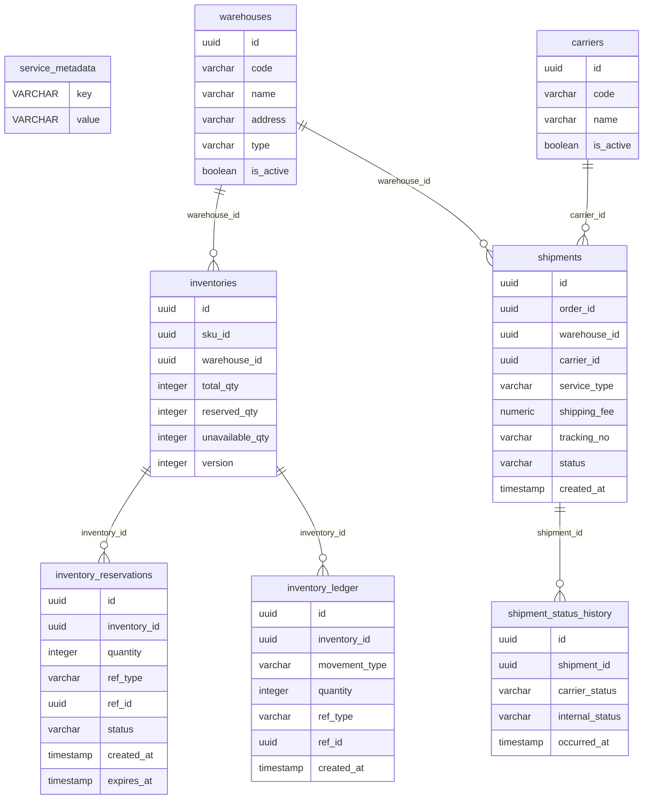
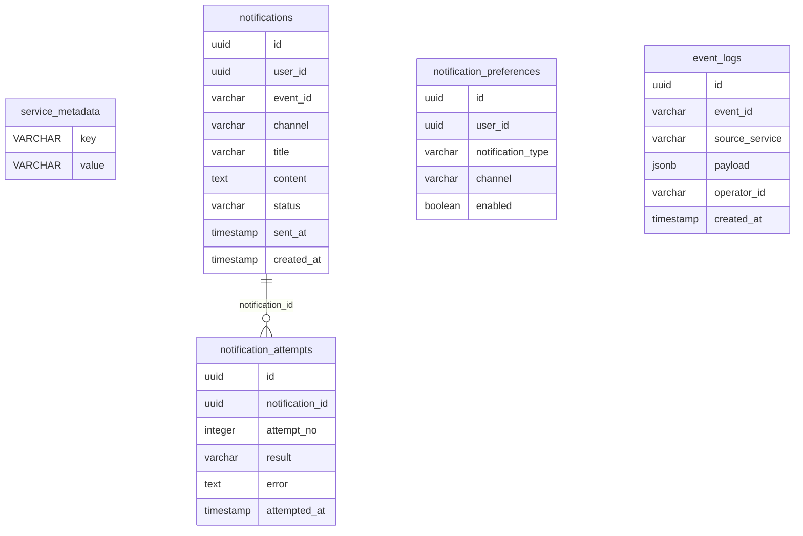

# Database ERD

Generated from service-owned Flyway CREATE TABLE statements by `node scripts/generate-erd.mjs`. Each diagram is a physical database boundary. IDs referring to another service are logical references, not cross-database foreign keys. Later ALTER migrations remain authoritative for added columns.

## user-service

## catalog-service

## commerce-service

## auction-service

## fulfillment-service

## notification-service

