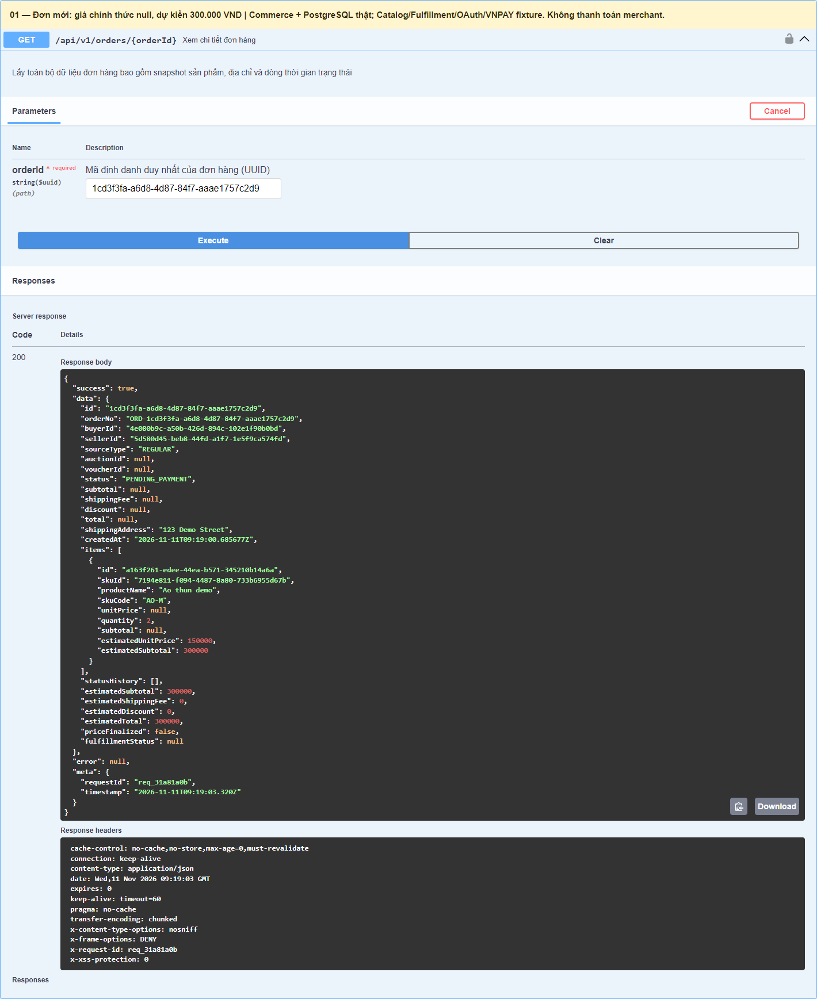
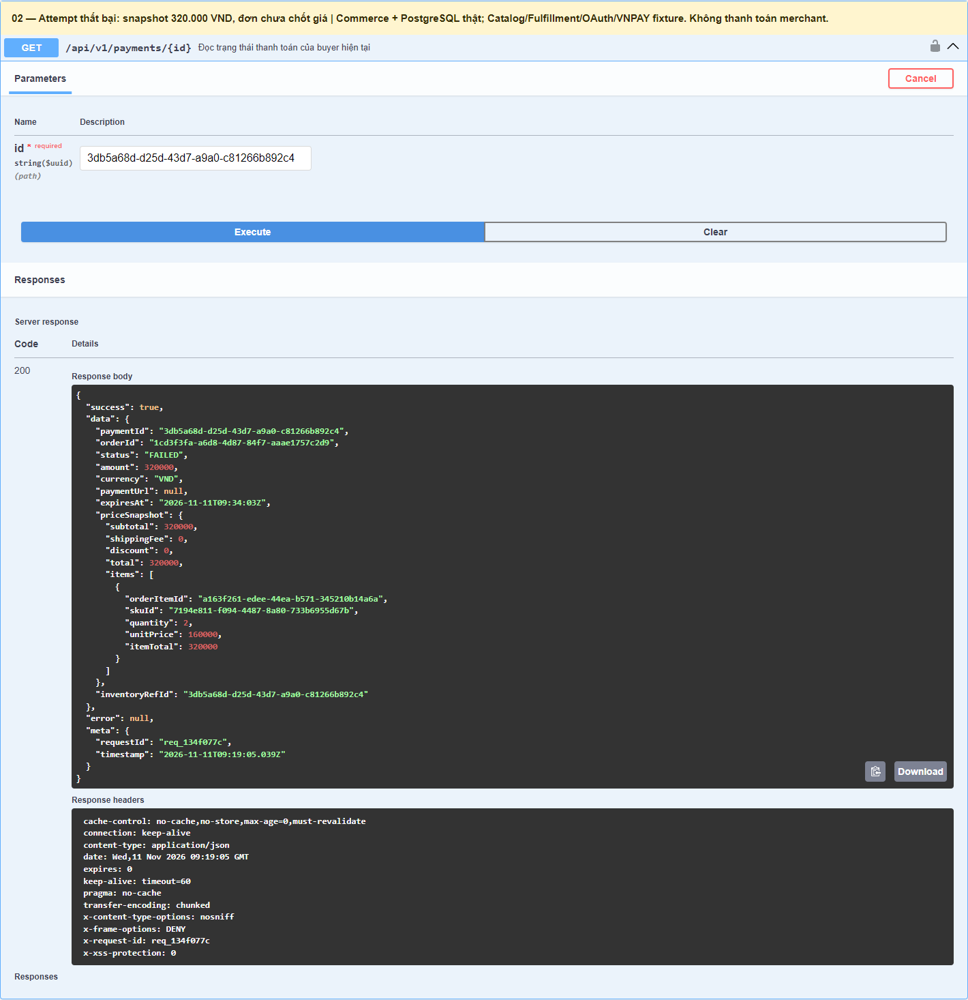
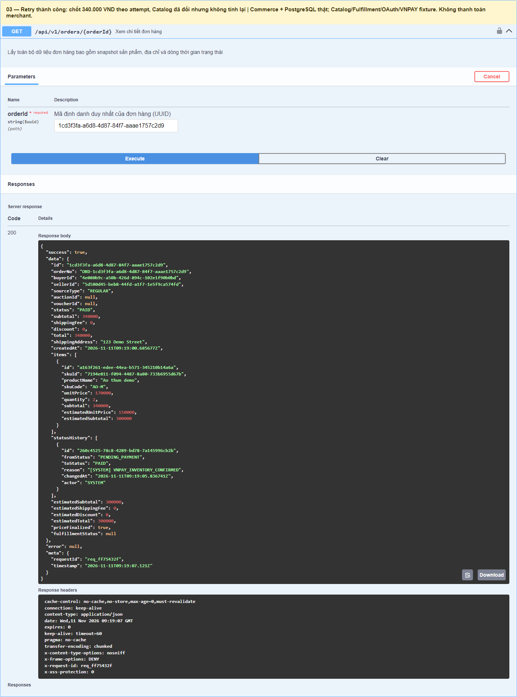
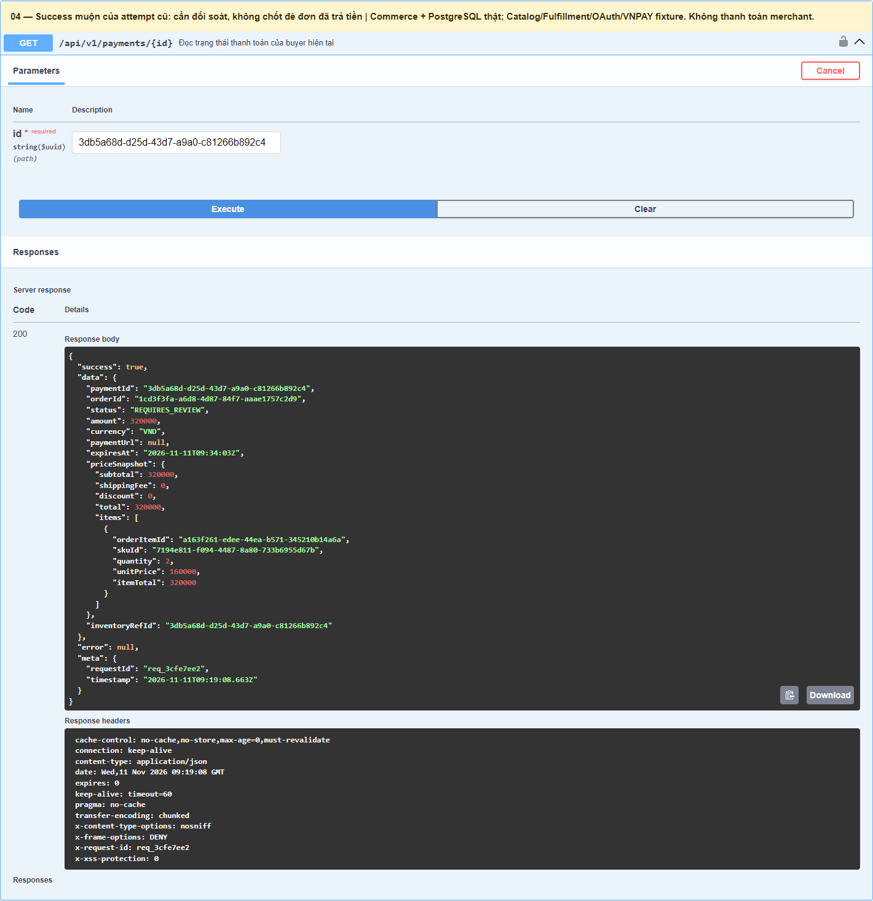
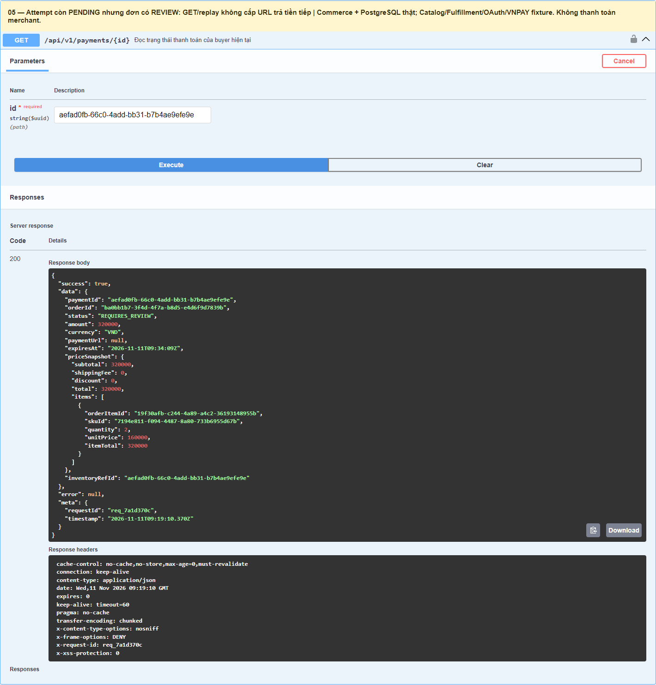
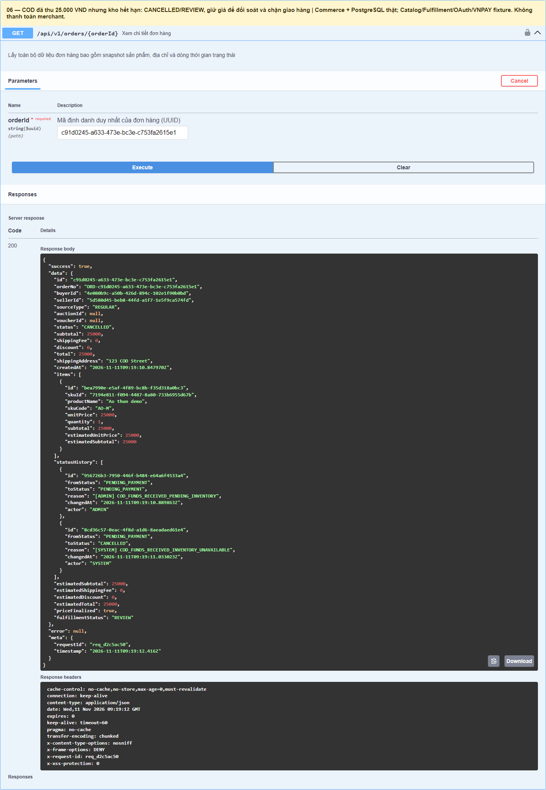

# Bằng chứng Order/Payment theo Payment Attempt

Ngày kiểm tra: 11/11/2026. Ảnh chụp từ **Swagger UI thực thi request tới Commerce JAR thật**, xác minh JWT RSA và dùng Flyway/PostgreSQL 18 riêng.

**Giới hạn:** Catalog, Fulfillment, OAuth và callback VNPAY là HTTP fixture do script tạo. Không đăng nhập/thu tiền tại merchant VNPAY, chưa chứng minh toàn stack hoặc UI Buyer đã tích hợp contract mới.

## Kết quả tự động

- Commerce: **369 test, 0 failure, 0 error, 0 skipped** khi bật PostgreSQL test.
- Line coverage JaCoCo: **91,76%**; Maven verify và Checkstyle pass.
- PaymentPostgresTest: 27 ca transaction/concurrency/retry/đối soát thật trên DB, gồm COD hết hạn/mất phiếu, timeout và rollback receipt.
- BaselineMigrationPostgresTest: 8 ca DB mới, nâng V3/V9/V10, giữ snapshot pending và chuyển tác vụ COD V10 an toàn sang V11.
- PaymentPricingServiceTest: 6 ca giá live, settlement đấu giá, dữ liệu lỗi và chốt snapshot.
- PaymentServiceTest: 21 ca chữ ký/amount, quyền sở hữu, idempotency, key retry, hết hạn và REVIEW trên GET/replay/helper URL.
- Script HTTP/Swagger assert giá và trạng thái trước khi chụp; commit kho đúng một lần, release chỉ attempt cũ.

Số liệu máy đọc: [test-summary.json](test-summary.json). Request/response HTTP đã lọc: [http-transcript.json](http-transcript.json). Không đính kèm log máy hoặc XML chứa environment.

## Ảnh review

| Ảnh | Kết quả cần kiểm tra |
| --- | --- |
| [01-draft-order.png](01-draft-order.png) | Đơn PENDING_PAYMENT, official null, estimatedTotal=300000 và priceFinalized=false. |
| [02-failed-attempt.png](02-failed-attempt.png) | Attempt lấy giá mới 160000/áo, amount=320000, FAILED; snapshot vẫn giữ nguyên. |
| [03-paid-frozen-price.png](03-paid-frozen-price.png) | Retry có giá 170000/áo; sau IPN và kho, đơn PAID, officialTotal=340000 dù Catalog đã tăng lên 990000/áo. |
| [04-late-funds-review.png](04-late-funds-review.png) | Attempt cũ nhận success muộn trả REQUIRES_REVIEW; không ghi đè giá/tổng của đơn đã trả tiền. |
| [05-reviewed-order-blocks-pending-url.png](05-reviewed-order-blocks-pending-url.png) | Attempt B còn PENDING nhưng A thu tiền muộn: GET/replay B trả REQUIRES_REVIEW và paymentUrl=null; key mới bị chặn. |
| [06-cod-expired-stock-review.png](06-cod-expired-stock-review.png) | COD đã thu 25000 nhưng kho hết hạn: CANCELLED/REVIEW, giữ giá/tiền và chặn giao hàng; không báo PAID. |

Ảnh giữ nguyên JSON response. Script chỉ thêm nhãn phạm vi fixture, bỏ bảng schema tham khảo/curl/request URL và mở rộng khung JSON để đọc đủ nội dung. Không sửa giá/trạng thái trong DOM. Header JWT được thêm ở transport, không xuất hiện trong ảnh.

## Tái lập

Tại root repo, cần Java 21, Maven, Node và dependencies frontend (Playwright có trong package.json). Dùng PostgreSQL test **riêng** trên loopback, mặc định cổng 15479, role postgres/password rỗng; không dùng DB của nhóm. Có thể dùng cluster tạm tạo bởi initdb/pg_ctl hoặc container PostgreSQL dành riêng.

1. Cài dependency common nếu máy chưa có: mvn -f backend/common/pom.xml install -DskipTests.
2. Tạo database nexus_payment_review trên PostgreSQL test.
3. Đặt NEXUS_TEST_DB_URL=jdbc:postgresql://127.0.0.1:15479/nexus_payment_review.
4. Chạy mvn -f backend/commerce-service/pom.xml verify checkstyle:check.
5. Chạy node scripts/capture-payment-attempt-evidence.mjs.

Script dùng PG_BIN để tìm createdb/dropdb, mặc định C:/Program Files/PostgreSQL/18/bin; EVIDENCE_PG_PORT để đổi cổng PostgreSQL. EVIDENCE_COMMERCE_PORT mặc định 18083; BROWSER_EXECUTABLE_PATH mặc định Chrome trên Windows.

Script tạo database nexus_attempt_evidence_<pid>, khởi chạy HTTP fixture và Commerce, gọi API và Swagger, chụp 6 ảnh rồi đóng process/xóa đúng database vừa tạo trong finally. Không đọc .env, không lưu JWT/merchant secret và không xóa database nguồn của nhóm. Transcript bỏ URL đã ký và query IPN; JSON sinh tự động không chèn comment trái định dạng.

Kết quả local không thay thế pipeline GitLab hoặc approval. Contract, migration và phần phụ thuộc: [PAYMENT_ATTEMPT_PRICING.md](../../PAYMENT_ATTEMPT_PRICING.md).
